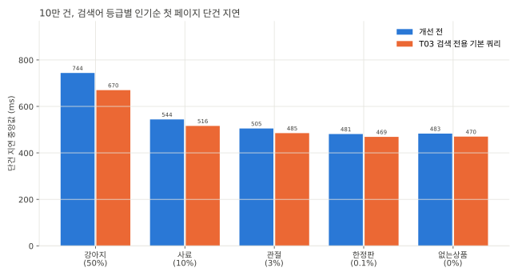

# SEARCH-T03 검색 전용 기본 쿼리와 lower() 제거

2026-11-05에 AWS perf 스택에서 키워드 상품 검색 `GET /api/v1/search/products`가 쓰는 기본 쿼리를 검색 전용으로 바꾸고 지연과 DB 사용량을 잰 기록이다. 지연은 ms, 요청률은 초당 HTTP 요청 수(req/s)다. run별 전체 표는 `SEARCH-T03.md`에 있다.

## 요약

- 검색이 카탈로그 목록과 함께 쓰던 기본 쿼리 대신 검색 전용 기본 쿼리를 쓴다. 일치한 상품마다 하던 카테고리 3단 조인을 빼고 활성 카테고리 id 목록으로 거른다. 상품명 조건은 `lower(name) LIKE`에서 `name LIKE`로 바꿨다.
- 응답은 그대로다. 10만 건과 100만 건에서 고정 요청 384개의 응답이 개선 전과 바이트 단위로 같고(`equiv/SEARCH-T03-*.jsonl`) 통합 테스트 11건이 상품명 일치, 노출 카테고리, 커서 순회 규칙을 고정한다.
- 10만 건 steady 첫 페이지 p50 중앙값은 543ms에서 519ms로 4.4%, p95는 753ms에서 685ms로 9.0% 줄었다. 요청당 RDS CPU초는 0.50에서 0.46으로 9% 줄었다. 같은 jar를 다시 잰 base2와 base의 차이(p50 1.5%, p95 2.0%)보다 크다.
- 100만 건 steady 첫 페이지 p50 중앙값은 6,393ms에서 6,106ms로 4.5% 줄었다. T02에서 잰 100만 건 A/A 차이는 1.4%다.
- 기대한 조인 순서 변화는 없었다. 옵티마이저는 여전히 셀러부터 읽고 처리 가능 요청률도 10만 건 2 req/s, 100만 건 0.25 req/s로 그대로다.

## 가설

개선 전 계획은 활성 셀러 990명마다 상품을 찾고 일치한 상품마다 카테고리를 자신, 부모, 조부모 순서로 PK 조회한다. 10만 건에서 강아지는 47,000행이 일치해 카테고리 PK 조회가 14만 번이다. 노출 카테고리는 수가 적고 거의 바뀌지 않는다. 요청마다 활성 카테고리 id를 먼저 구해 `category_id IN (...)`로 거르면 조회 세 번이 상품 행의 열 비교 하나로 바뀐다.

조인이 줄면 옵티마이저가 셀러 대신 상품부터 읽을 것으로 봤다. T01에서 `STRAIGHT_JOIN`으로 상품부터 읽게 하자 100만 건 없는상품 COUNT가 3,037ms에서 902ms로 줄었다.

`lower(name)`은 행마다 문자열을 소문자로 바꾼다. 열 collation `utf8mb4_0900_ai_ci`가 이미 대소문자를 구분하지 않아서 빼도 결과가 같다.

## 변경 내용

| 변형 | 바꾼 것 | jar |
|---|---|---|
| base | 개선 전(T01과 같은 코드) | `8b9454805771` |
| 셀 1 | 상품명 조건 `containsIgnoreCase`를 `contains`로 | `9c715056a644-dirty-99c229a2` |
| 셀 2 | 셀 1에 검색 전용 기본 쿼리를 더함 | `9c715056a644-dirty-2903db4d` |
| base2 | base와 같은 jar를 마지막에 다시 잼(A/A) | `8b9454805771` |

- `ProductKeywordSearchQuerySupport.keywordSearchBaseQuery`는 products에서 시작해 `ACTIVE` 셀러를 inner join하고 `product_stats`를 left join한다. 노출 조건(검수 승인, 판매 중이거나 품절)과 카테고리 id 목록으로 거른다.
- `ProductKeywordSearchService.searchableCategoryIds`는 활성 카테고리를 한 번 읽어 자신과 조상이 모두 활성인 id만 남긴다. 중분류 필터가 있으면 그 중분류와 활성 자식만 남긴다. 요청마다 카테고리 쿼리가 하나 늘어난다.
- 카탈로그 목록(`visibleProductQuery`)은 바꾸지 않았다. 그래서 활성 카테고리 규칙이 카탈로그의 SQL 조건과 검색의 애플리케이션 계산 두 곳에 있다.
- `ProductKeywordSearchSemanticsIntegrationTest`(11건)는 바꾸기 전 코드에서 먼저 통과시켰다. 1글자 검색어, 내부 공백, NFD 검색어, 100자 경계, 비활성 카테고리 체인, 중분류 필터, 낮은가격순 커서 순회, 최소 평점 경계를 고정한다.
- 셀 jar는 커밋 전 작업 트리로 만든 빌드다. 셀 2 작업 트리의 dirty 해시가 jar 이름의 해시와 같아서 커밋한 코드가 측정한 코드다.

## 환경

T01, T02와 같은 perf 측정층(api m7i.large, 러너 c7g.large, RDS db.m7g.large, MySQL 8.4)이다. 스키마는 T02를 마친 상태다. 100만 건은 2026-11-04 23:59부터 11-05 01:05까지, 10만 건은 01:29부터 02:44까지 쟀다. 10만 건 base2는 05:00 스택 자동 정지와 재기동 뒤 08:35에 쟀다.

## 측정 결과

### steady 첫 페이지

steady는 처리 가능 요청률의 0.7배로 돌았다. 실패는 없다.

| 변형 | 크기 | p50 중앙값 (반복별) | p95 중앙값 (반복별) | 요청당 RDS CPU초 (반복별) |
|---|---|---|---|---|
| base | 10만 건 | 543 (553, 543, 534) | 753 (759, 753, 746) | 0.51, 0.50, 0.48 |
| 셀 1 | 10만 건 | 530 (531, 523, 530) | 746 (746, 735, 750) | 0.48, 0.48, 0.49 |
| 셀 2 | 10만 건 | 519 (518, 522, 519) | 685 (686, 685, 680) | 0.46, 0.46, 0.46 |
| base2 | 10만 건 | 551 (547, 551, 551) | 768 (754, 780, 768) | 0.51, 0.48, 0.51 |
| base | 100만 건 | 6,393 (6,403, 6,393, 6,318) | 9,175 (9,175, 7,884, 9,436) | 5.57, 5.69, 5.42 |
| 셀 2 | 100만 건 | 6,106 (6,162, 6,106, 6,097) | 8,180 (8,180, 7,328, 8,517) | 5.09, 5.41, 5.29 |

- 10만 건은 셀 2만 base와 base2 범위 밖으로 줄었다. 셀 1(lower() 제거만)은 p50이 2.4% 줄어 A/A 차이와 비슷하다.
- 100만 건 p95는 반복마다 첫 페이지 표본이 20개라 반복 사이 폭이 15% 안팎이다. 그래서 100만 건은 p50으로 판정했다.

### 등급별 단건 지연

sequential은 부하 없이 요청을 하나씩 보낸다. 인기순 첫 페이지 중앙값이고 괄호 안은 seed에서 상품명이 일치하는 비율이다.



| 검색어 | 10만 건 base | 10만 건 셀 2 | 100만 건 base | 100만 건 셀 2 |
|---|---|---|---|---|
| 강아지 (50%) | 744 | 670 (-10%) | 8,769 | 8,122 (-7%) |
| 사료 (10%) | 544 | 516 (-5%) | 6,433 | 6,107 (-5%) |
| 관절 (3%) | 505 | 485 (-4%) | 5,882 | 5,620 (-4%) |
| 한정판 (0.1%) | 481 | 469 (-2%) | 5,633 | 5,536 (-2%) |
| 없는상품 (0%) | 483 | 470 (-3%) | 5,641 | 5,466 (-3%) |

일치 행이 많을수록 줄어든 몫이 크다. 없앤 비용이 일치한 상품마다 하던 카테고리 조회라서다.

### EXPLAIN ANALYZE

10만 건 강아지 인기순 첫 페이지 목록 쿼리(두 번째 실행)에서 셀러, 상품, 카테고리를 읽는 줄이다.

```
base
-> Limit: 21 row(s)  (actual time=478..478 rows=21 loops=1)
-> Table scan on s1_0  (cost=103 rows=1000) (actual time=0.0364..0.618 rows=1000 loops=1)
-> Index lookup on p1_0 using ix_products_seller_id (seller_id=s1_0.user_id)  (cost=24.6 rows=98.5) (actual time=0.0227..0.209 rows=100 loops=990)
-> Single-row index lookup on c1_0 using PRIMARY (id=p1_0.category_id)  (cost=0.25 rows=1) (actual time=143e-6..177e-6 rows=1 loops=47000)
-> Single-row index lookup on p2_0 using PRIMARY (id=c1_0.parent_id)  (cost=0.251 rows=1) (actual time=117e-6..151e-6 rows=1 loops=47000)
-> Single-row index lookup on p3_0 using PRIMARY (id=p2_0.parent_id)  (cost=0.251 rows=1) (actual time=130e-6..164e-6 rows=1 loops=47000)

셀 2
-> Limit: 21 row(s)  (actual time=384..384 rows=21 loops=1)
-> Table scan on s1_0  (cost=103 rows=1000) (actual time=0.0655..0.622 rows=1000 loops=1)
-> Index lookup on p1_0 using ix_products_seller_id (seller_id=s1_0.user_id)  (cost=24.6 rows=98.5) (actual time=0.0221..0.204 rows=100 loops=990)
```

- 카테고리 PK 조회 세 줄(각 47,000번)이 사라지고 상품 필터에 `p1_0.category_id in (...)`이 붙었다. 목록은 478ms에서 384ms, COUNT는 414ms에서 322ms다.
- 셀러 990명을 먼저 읽고 `ix_products_seller_id`로 상품을 찾는 순서는 그대로다. 100만 건 계획도 같다.
- 100만 건 강아지 최신순 첫 페이지는 목록이 5,520ms에서 4,704ms, COUNT가 4,867ms에서 4,060ms다.

### ramp와 spike

- 셀 2의 처리 가능 요청률은 10만 건 2 req/s, 100만 건 0.25 req/s로 T01 base와 같다. 두 크기 모두 SLO(첫 페이지 p95 500ms 미만)를 지킨 단계가 없다.
- 10만 건 셀 2 spike(6 req/s, 30초)는 burst 실패율 45%, 탐침 실패율 14%이고 회복에 27초 걸렸다. T04의 비교 기준으로 쓴다.

## 해석

- 카테고리 조회 14만 번을 없앤 몫은 강아지 목록 쿼리에서 94ms(478ms에서 384ms)다. 시간 대부분은 여전히 일치한 47,000행을 읽고 정렬하는 데 든다.
- 옵티마이저는 카테고리 조인이 빠져도 셀러부터 읽었다. 상품명 조건이 인덱스를 쓰지 못해서 상품부터 읽어도 전체를 훑어야 하므로 셀러 1,000행부터 읽는 비용을 더 낮게 본 것 같다. 상품부터 읽는 계획은 상품명 조건이 인덱스를 쓸 때 나온다(T04).
- 100만 건 sequential 최신순 2페이지는 셀 2에서 강아지 4,929ms가 8ms로 줄었다. 커서 조건 `id < ?`가 붙으면 상품을 PK 역순으로 읽는 계획으로 바뀐 것으로 보이는데 explain 셀이 최신순 2페이지를 돌지 않아 계획은 확인하지 않았다.

## 결정

- 셀 2를 코드로 남긴다. 결과가 같고 쿼리가 단순하며 일치 행이 많을수록 지연과 DB CPU를 줄인다.
- 조인 순서를 `STRAIGHT_JOIN` 네이티브 쿼리로 고정하지 않는다. 상품부터 읽는 계획은 T04에서 FULLTEXT 인덱스로 만든다.

## 측정의 한계

- base2는 스택 자동 정지와 재기동 뒤 6시간 지나서 쟀다. A/A 차이에 재기동 영향이 섞여 있다.
- 셀 1은 10만 건 steady와 explain만 쟀다.
- 100만 건 최신순 2페이지가 빨라진 이유는 계획으로 확인하지 않았다.

## 재현

```bash
make variant STEP=SEARCH-T03 DATASET=1m VARIANT=base REV=8b9454805771 BASE_RATE=0.25 CELLS="steady sequential explain"
make variant STEP=SEARCH-T03 DATASET=1m VARIANT=cell2 REV=9c715056a644-dirty-2903db4d BASE_RATE=0.25 CELLS="ramp steady sequential explain"
make variant STEP=SEARCH-T03 DATASET=100k VARIANT=base REV=8b9454805771 BASE_RATE=2 CELLS="steady sequential explain"
make variant STEP=SEARCH-T03 DATASET=100k VARIANT=cell1 REV=9c715056a644-dirty-99c229a2 BASE_RATE=2 CELLS="steady explain"
make variant STEP=SEARCH-T03 DATASET=100k VARIANT=cell2 REV=9c715056a644-dirty-2903db4d BASE_RATE=2
make variant STEP=SEARCH-T03 DATASET=100k VARIANT=base2 REV=8b9454805771 BASE_RATE=2 CELLS=steady
# 셀 jar는 셀 코드를 둔 작업 트리에서 make jar ALLOW_DIRTY=1로 만든다
```
