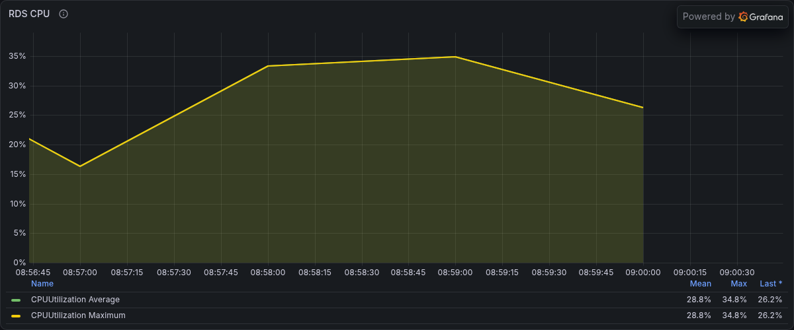
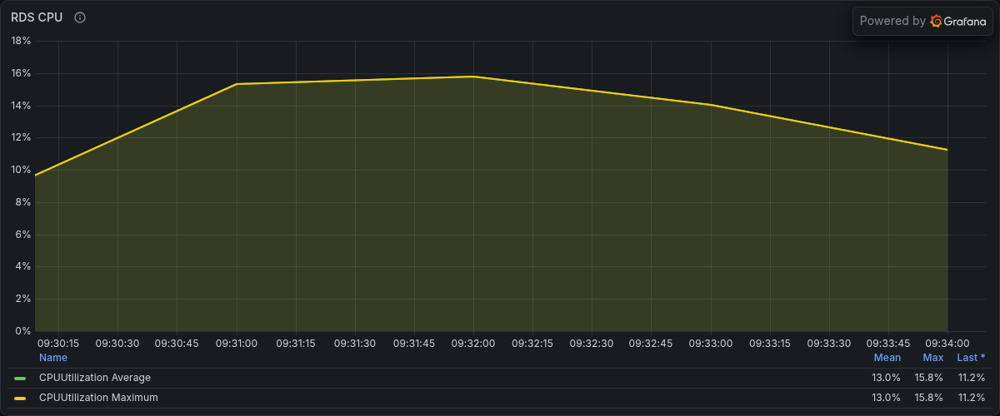
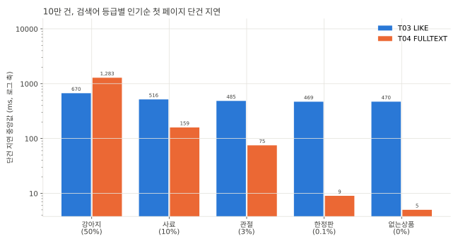
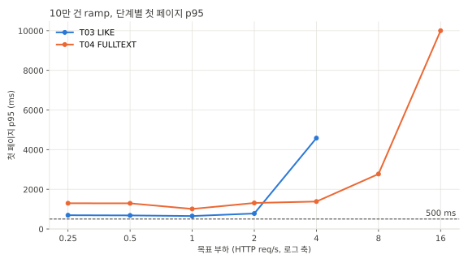
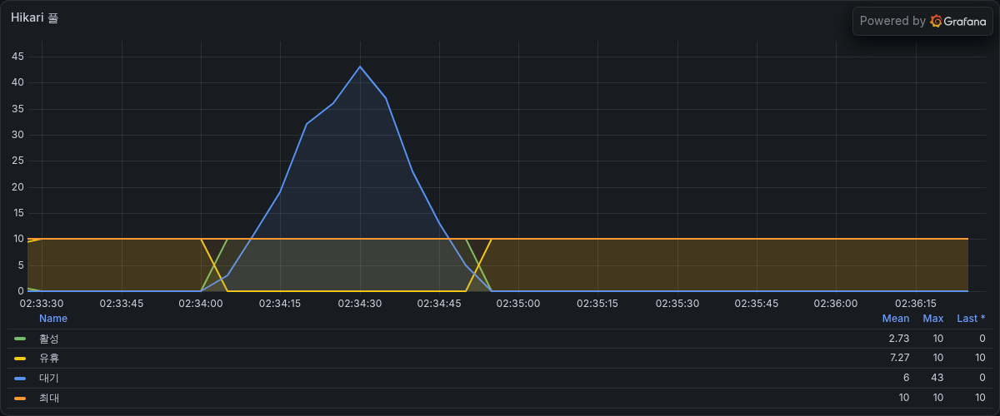
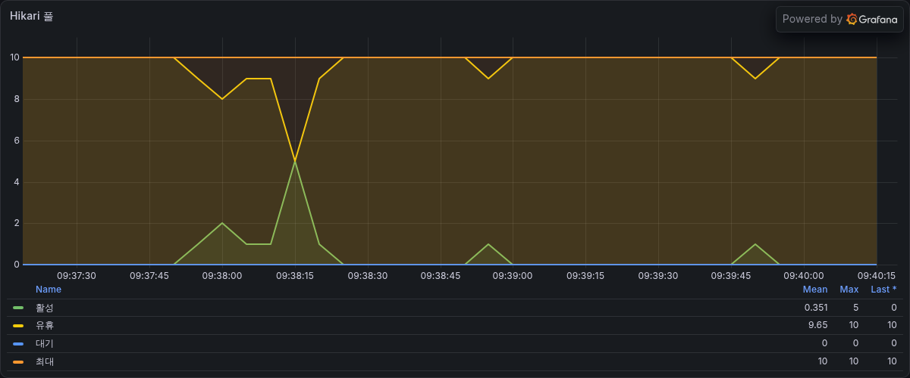

# SEARCH-T04 상품명 FULLTEXT ngram 검색

2026-11-05에 AWS perf 스택에서 상품명 조건을 선행 와일드카드 LIKE에서 FULLTEXT ngram 인덱스의 `MATCH ... AGAINST`로 바꾸고 지연과 DB 사용량을 잰 기록이다. 지연은 ms, 요청률은 초당 HTTP 요청 수(req/s)다. run별 전체 표는 `SEARCH-T04.md`에 있다.

## 요약

- 상품명 조건에 `MATCH(name) AGAINST(? IN BOOLEAN MODE)`를 더해 FULLTEXT 인덱스로 후보를 좁히고 같은 LIKE로 다시 거른다. 응답은 LIKE와 같다. 10만 건과 100만 건에서 고정 요청 384개의 응답이 T03과 바이트 단위로 같다.
- 같은 부하(10만 건, 1.4 req/s)에서 첫 페이지 p50 중앙값은 545ms에서 125ms로 77% 줄었다. 요청당 RDS CPU초는 0.47에서 0.23으로 53% 줄었다.
- 10만 건 처리 가능 요청률은 2 req/s에서 8 req/s로 4배가 됐다. 6 req/s spike에서 burst 실패율은 45%에서 0%, 회복 시간은 27초에서 2초가 됐다.
- 상품 절반에 일치하는 강아지는 느려졌다. 단건 지연이 670ms에서 1,283ms로 1.9배이고 이 때문에 steady p95가 721ms에서 1,320ms로 올랐다.
- 속성 `aechak.search.fulltext-enabled`의 기본값은 false다. 인덱스는 마이그레이션 V88이 만든다.

## 가설

선행 와일드카드 LIKE는 인덱스를 쓰지 못해 검색어와 관계없이 노출 상품을 모두 훑는다. 그래서 일치가 0건인 없는상품도 10만 건에서 470ms가 걸린다. ngram FULLTEXT 인덱스로 일치하는 상품만 찾으면 일치 행이 적은 검색어는 수 ms로 줄 것이다. 일치 행이 많은 검색어는 찾은 행을 하나씩 읽는 비용 때문에 이득이 작거나 손해일 수 있다.

## 변경 내용

| 변형 | 상품명 조건 | jar | 스키마 |
|---|---|---|---|
| like | LIKE만(T03과 같은 경로, 속성 off) | `9c715056a644-dirty-a4bb5e6e` | FULLTEXT 인덱스 있음 |
| match | MATCH로 좁히고 LIKE로 재검사(속성 on) | 같은 jar | 같음 |

- `MatchAgainstFunctionContributor`가 Hibernate에 `match_against` 함수를 등록한다. SQL로는 `MATCH(name) AGAINST(? IN BOOLEAN MODE)`가 된다.
- 검색어에서 영숫자와 `_` 밖의 문자를 공백으로 바꾸고 전체를 구문 검색 phrase(`"강아지 사료"`)로 감싼다. 불리언 연산자(`+ - * ( ) < > ~ @ "`)는 연산자로 해석되지 않는다.
- ngram 토큰(2글자)으로는 LIKE 결과를 놓치는 검색어는 phrase를 만들지 않고 LIKE만 쓴다. 2글자 미만 조각이 있는 검색어(`개`), ASCII 밖 구분 문자(가운데점, 전각 공백, 이모지)가 든 검색어, 라틴 글자가 든 검색어다. 라틴 글자는 기본 불용어(`a`, `at`, `it` 등)가 든 토큰이 색인에서 빠져서 MATCH가 일치를 놓칠 수 있다.
- MATCH는 후보를 좁히는 데만 쓰고 LIKE를 함께 건다. 그래서 응답이 LIKE와 같고 관련도 정렬은 쓰지 않는다.
- 마이그레이션 V88은 products가 있고 인덱스가 없을 때만 `ALTER TABLE products ADD FULLTEXT INDEX ft_products_name (name) WITH PARSER ngram`을 실행한다. 측정할 때 번호는 V82였고 열린 PR과 번호가 겹쳐 내용은 그대로 두고 번호만 바꿨다.
- 통합 테스트는 ddl-auto가 FULLTEXT 인덱스를 만들지 못해서 `IntegrationTestConfig`가 컨텍스트 시작 뒤 인덱스를 더하고 테스트 속성으로 FULLTEXT를 켠다.
- 측정한 jar는 커밋 전 작업 트리로 만든 빌드다. 작업 트리의 dirty 해시가 jar 이름의 해시와 같고 커밋한 코드와는 마이그레이션 번호만 다르다.

## 환경

T03과 같은 perf 측정층(api m7i.large, 러너 c7g.large, RDS db.m7g.large, MySQL 8.4)이다. FULLTEXT 인덱스는 kit DDL(`ddl/SEARCH-T02-fulltext.sql`)로 만들었다. 10만 건은 08:53부터 09:44까지, 100만 건은 11:17부터 쟀다. 두 변형은 같은 jar이고 match만 api를 `AECHAK_SEARCH_FULLTEXT_ENABLED=true`로 띄웠다.

## 측정 결과

### LIKE와 MATCH가 고르는 행

products 전체에서 검색어마다 LIKE와 MATCH(구문 검색)가 고르는 행을 셌다. 부하에 쓰는 검색어 9개는 두 크기 모두 같은 행을 고른다. 한쪽만 고른 행은 0이다.

| 검색어 | 10만 건 | 100만 건 |
|---|---|---|
| 강아지 | 50,000 | 500,000 |
| 사료 | 10,000 | 100,000 |
| 연어 | 10,000 | 100,000 |
| 간식 | 6,667 | 66,667 |
| 관절 | 3,334 | 33,334 |
| 하네스 | 3,333 | 33,333 |
| 바잇미 | 2,500 | 25,000 |
| 한정판 | 100 | 1,000 |
| 없는상품 | 0 | 0 |

### steady (10만 건, 1.4 req/s)

| 변형 | 첫 페이지 p50 중앙값 (반복별) | 첫 페이지 p95 중앙값 (반복별) | RDS CPU 평균 % (반복별) | 요청당 RDS CPU초 (반복별) |
|---|---|---|---|---|
| like | 545 (545, 551, 545) | 721 (700, 737, 721) | 33.0, 34.1, 30.7 | 0.47, 0.49, 0.45 |
| match | 125 (111, 125, 134) | 1,320 (1,313, 1,320, 1,322) | 16.2, 15.6, 14.1 | 0.23, 0.23, 0.21 |

같은 부하에서 RDS CPU가 절반이 됐다. 아래는 두 번째 반복의 Grafana RDS CPU 패널이고 최대가 34.8%에서 15.8%로 내려갔다.

| like | match |
|---|---|
|  |  |

### 등급별 단건 지연

sequential은 부하 없이 요청을 하나씩 보낸다. 인기순 첫 페이지 중앙값이고 괄호 안은 seed에서 상품명이 일치하는 비율이다. LIKE 값은 T03 셀 2 run이다.



| 검색어 | LIKE (T03) | MATCH | 변화 |
|---|---|---|---|
| 강아지 (50%) | 670 | 1,283 | 1.9배 |
| 사료 (10%) | 516 | 159 | -69% |
| 관절 (3%) | 485 | 75 | -85% |
| 한정판 (0.1%) | 469 | 9 | -98% |
| 없는상품 (0%) | 470 | 5 | -99% |

### EXPLAIN ANALYZE

10만 건 match 인기순 첫 페이지 목록 쿼리(두 번째 실행)에서 상품과 셀러를 읽는 줄이다.

```
강아지
-> Limit: 21 row(s)  (actual time=392..392 rows=21 loops=1)
-> Full-text index search on p1_0 using ft_products_name (name='"강아지"')  (cost=0.263 rows=1) (actual time=12.9..147 rows=50000 loops=1)
-> Single-row index lookup on s1_0 using PRIMARY (user_id=p1_0.seller_id)  (cost=0.33 rows=1) (actual time=0.0015..0.00153 rows=1 loops=47000)

한정판
-> Limit: 21 row(s)  (actual time=0.844..0.848 rows=21 loops=1)
-> Full-text index search on p1_0 using ft_products_name (name='"한정판"')  (cost=0.263 rows=1) (actual time=0.0251..0.341 rows=100 loops=1)
-> Single-row index lookup on s1_0 using PRIMARY (user_id=p1_0.seller_id)  (cost=0.33 rows=1) (actual time=224e-6..258e-6 rows=1 loops=100)
```

옵티마이저가 FULLTEXT 인덱스로 일치한 상품부터 읽고 셀러를 PK로 하나씩 찾는다. T03에서 기대했던 조인 순서다. 같은 run의 목록과 COUNT 시간이다.

| 검색어 | like 목록 | like COUNT | match 목록 | match COUNT |
|---|---|---|---|---|
| 강아지 | 398 | 344 | 392 | 319 |
| 사료 | 289 | 322 | 83 | 69 |
| 관절 | 265 | 251 | 26 | 22 |
| 한정판 | 256 | 249 | 0.8 | 0.8 |
| 없는상품 | 249 | 245 | 0.01 | 0.01 |

강아지는 EXPLAIN ANALYZE에서 like와 match가 비슷하지만 sequential의 슬로 로그에서는 DB 실행 시간 중앙값이 목록 367ms에서 495ms, COUNT 301ms에서 599ms로 늘었다(LIKE는 T03 셀 2 run). 전문 검색 자체의 시간이 EXPLAIN ANALYZE 반복자 시간에 잡히지 않는 것으로 보이는데 확인하지 않았다.

### ramp (10만 건)



| 목표 req/s | LIKE (T03) p95 | MATCH p95 |
|---|---|---|
| 0.25 | 692 | 1,296 |
| 1 | 651 | 1,009 |
| 2 | 778 | 1,310 |
| 4 | 4,582 (dropped 5) | 1,382 |
| 8 | 돌지 않음 | 2,772 |
| 16 | 돌지 않음 | 10,001 (실패 39%, dropped 81) |

처리 기준(실패율 1% 미만, dropped 0)을 통과한 가장 높은 단계가 2 req/s에서 8 req/s로 올랐다. 두 경우 모두 SLO(첫 페이지 p95 500ms 미만)를 지킨 단계는 없다. p95가 강아지 요청에서 나와서다.

### spike (10만 건, 6 req/s 30초)

| 변형 | burst 실패율 | 탐침 실패율 | 회복 시간 | Hikari 대기 최대 |
|---|---|---|---|---|
| LIKE (T03) | 45% | 14% | 27초 | 43 |
| MATCH | 0% | 0% | 2초 | 0 |

| LIKE (T03) Hikari 풀 | MATCH Hikari 풀 |
|---|---|
|  |  |

LIKE는 burst 동안 커넥션 10개가 모두 쓰이고 대기가 43까지 쌓였다. MATCH는 활성 커넥션이 최대 5개였고 대기가 생기지 않았다.

### 100만 건

| 변형 | 첫 페이지 p50 중앙값 (반복별) | 첫 페이지 p95 중앙값 |
|---|---|---|
| like | 6,366 (6,366, 6,359, 6,471) | 8,623 |
| match | 측정 중 | 측정 중 |

## 해석

- FULLTEXT는 일치 행 수만큼 일하고 LIKE는 일치와 관계없이 노출 상품을 모두 훑는다. 그래서 일치 행이 적을수록 차이가 크고(한정판 52배) 상품 절반이 일치하는 강아지는 오히려 느려진다.
- 부하에서 강아지는 검색어 가중치의 10%다. 나머지 90%가 빨라져 같은 부하의 DB CPU가 절반이 됐고 처리량이 4배가 됐다. p95만 강아지 때문에 올랐다.
- 강아지의 남은 비용은 일치한 47,000행을 정렬하고 따로 세는 일이다.

## 결정

- MATCH 경로를 코드로 남기고 속성 기본값은 false로 둔다. 운영에서 켜려면 V88로 인덱스를 만든 뒤 속성을 켠다.
- 100만 건에서 인덱스 생성은 49초 걸렸다. MySQL은 FULLTEXT 인덱스를 추가하는 동안 동시 DML을 허용하지 않아 그동안 상품 쓰기가 기다린다.
- 강아지처럼 상품 절반에 일치하는 검색어가 느려지는 것은 받아들인다. 처리량과 DB CPU 이득이 크다.

## 측정의 한계

- 등급별 단건 지연, ramp, spike의 LIKE 값은 T03 셀 2 run이다. 같은 10만 건 데이터이지만 다른 세션이고 스키마에 FULLTEXT 인덱스가 없다. like 변형은 steady와 explain만 돌았다.
- 강아지가 EXPLAIN ANALYZE와 슬로 로그에서 다르게 나오는 이유는 확인하지 않았다.
- 100만 건 match는 측정이 끝나면 이 문서에 더한다.

## 재현

```bash
make variant STEP=SEARCH-T04 DATASET=100k VARIANT=like REV=9c715056a644-dirty-a4bb5e6e DDL=SEARCH-T02-fulltext BASE_RATE=2 CELLS="steady explain"
make variant STEP=SEARCH-T04 DATASET=100k VARIANT=match REV=9c715056a644-dirty-a4bb5e6e DDL=SEARCH-T02-fulltext ENV=AECHAK_SEARCH_FULLTEXT_ENABLED=true BASE_RATE=2 CELLS="ramp steady spike sequential explain"
make variant STEP=SEARCH-T04 DATASET=1m VARIANT=like REV=9c715056a644-dirty-a4bb5e6e DDL=SEARCH-T02-fulltext BASE_RATE=0.25 CELLS="steady explain"
make variant STEP=SEARCH-T04 DATASET=1m VARIANT=match REV=9c715056a644-dirty-a4bb5e6e DDL=SEARCH-T02-fulltext ENV=AECHAK_SEARCH_FULLTEXT_ENABLED=true BASE_RATE=0.25 CELLS="ramp steady sequential explain"
# kit의 make equiv는 api 속성을 넘기지 않는다. match equiv는 러너에서 api를 속성 on으로 다시 띄우고 equiv.js를 돌렸다
```
