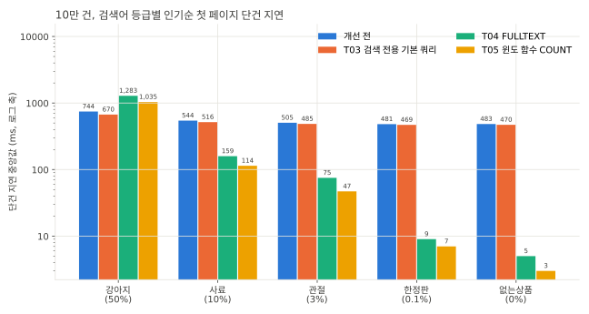
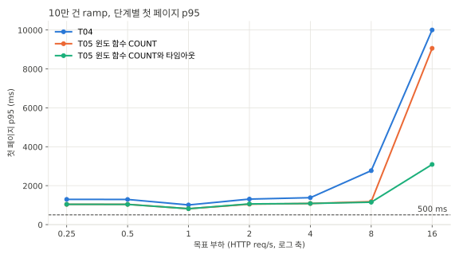
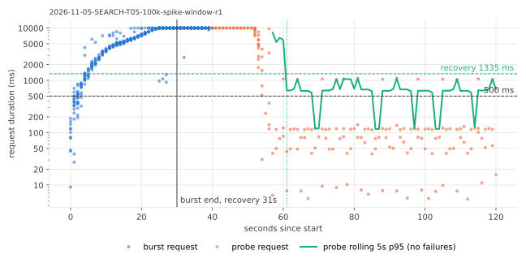
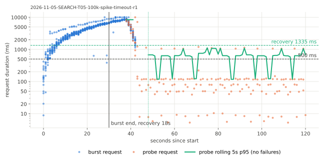
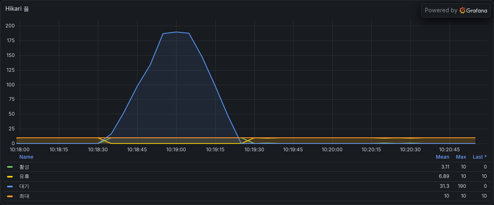
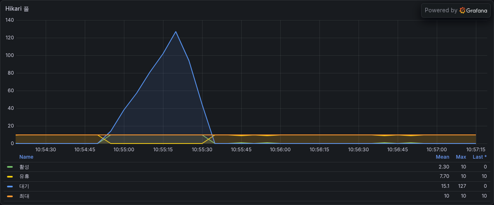
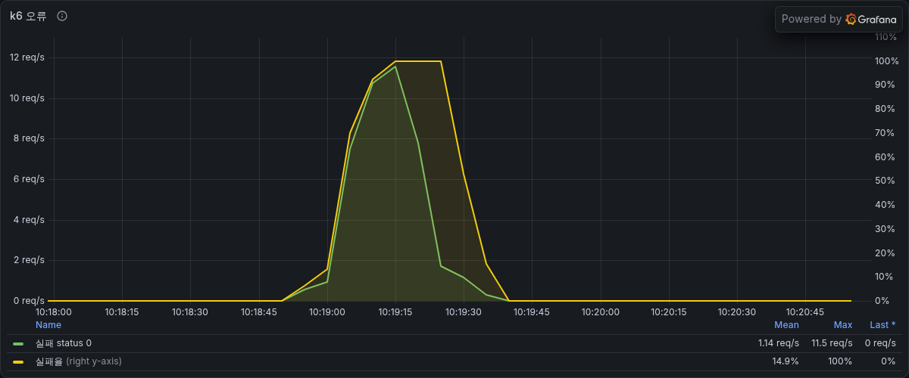
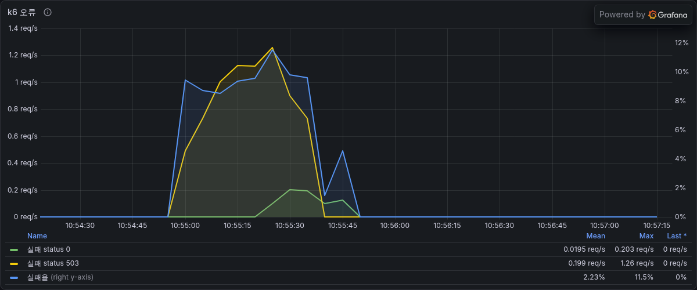

# SEARCH-T05 검색 첫 페이지 COUNT 통합과 쿼리 타임아웃

2026-11-05에 AWS perf 스택에서 검색 첫 페이지의 목록과 총개수를 윈도 함수 쿼리 하나로 합치고 검색 쿼리에 타임아웃을 건 뒤 지연과 과부하 동작을 잰 기록이다. 지연은 ms, 요청률은 초당 HTTP 요청 수(req/s)다. run별 전체 표는 `SEARCH-T05.md`에 있다.

## 요약

- 첫 페이지가 목록 쿼리와 COUNT 쿼리를 따로 돌리던 것을 `count(*) over()`를 붙인 목록 쿼리 하나로 합쳤다. 응답은 그대로다. 10만 건 고정 요청 384개의 응답이 T04와 바이트 단위로 같다.
- 10만 건 첫 페이지 단건 지연은 검색어에 따라 19%에서 40% 줄었다. 강아지는 1,283ms에서 1,035ms, 사료는 159ms에서 114ms다.
- ramp 8 req/s 단계의 첫 페이지 p95가 2,772ms에서 1,180ms로 줄었다. 처리 가능 요청률은 8 req/s로 같다.
- 검색 쿼리가 3초를 넘기면 서버가 쿼리를 멈추고 503(`PRODUCT_SEARCH_TIMEOUT`, 40008)으로 응답한다. 24 req/s spike에서 burst 실패율이 49%에서 7%로, 회복 시간이 31초에서 18초로 줄었다. steady에서는 타임아웃이 지연과 DB CPU를 바꾸지 않았다.
- 100만 건은 재지 않았다. 일치 행이 많은 검색어는 기본값 3초를 넘을 수 있어서 데이터 크기에 맞춰 값을 정해야 한다.

## 가설

첫 페이지는 같은 조건으로 목록과 COUNT를 따로 돌려 일치 행을 두 번 찾는다. 윈도 함수로 한 번에 읽으면 COUNT 한 번만큼 줄 것이다. 일치 행이 많은 검색어는 윈도 값을 구하려고 일치 행 전부를 임시 테이블에 담아야 해서 이득이 작을 것이다.

과부하 때 실패는 클라이언트 타임아웃(10초)까지 커넥션을 붙잡은 쿼리에서 나온다. 서버가 3초에서 쿼리를 멈추면 커넥션이 빨리 돌아와 burst 뒤 회복이 빨라질 것이다.

## 변경 내용

| 변형 | 코드 | 쿼리 타임아웃 | jar |
|---|---|---|---|
| window | 윈도 함수 COUNT | 끔(`AECHAK_SEARCH_QUERY_TIMEOUT_MS=0`) | `9c715056a644-dirty-4a623ade` |
| timeout | 같음 | 3초(기본값) | 같은 jar |

- `ProductKeywordSearchPort.searchFirstPage`가 `countMatching`을 대신한다. 어댑터는 목록 projection에 `count(*) over()`를 덧붙인 튜플을 읽어 목록과 총개수를 함께 돌려준다. 일치 행이 없으면 윈도 값을 실을 행도 없어서 총개수는 0이다. 이후 페이지는 지금처럼 세지 않는다.
- 목록 쿼리에 `jakarta.persistence.query.timeout` 힌트를 건다. 값은 `aechak.search.query-timeout-ms`(기본 3000)다. Hibernate가 밀리초를 초로 반올림해 JDBC에 넘겨서 500 미만은 타임아웃이 없는 것과 같다.
- 시간을 넘기면 MySQL 드라이버가 서버에 `KILL QUERY`를 보내 쿼리를 멈추고 서비스가 `QueryTimeoutException`을 `PRODUCT_SEARCH_TIMEOUT`(40008, 503)으로 바꾼다.
- 웹 구매자 검색 결과 화면은 오류면 상태 코드와 관계없이 `검색 결과를 불러오지 못했어요` 화면과 재시도를 보여 준다. 그래서 FE를 바꾸지 않아도 기존 오류 화면이 나온다.
- 두 변형 모두 api를 `AECHAK_SEARCH_FULLTEXT_ENABLED=true`로 띄웠다. 측정한 jar는 커밋 전 작업 트리로 만든 빌드이고 작업 트리의 dirty 해시가 jar 이름의 해시와 같다. 커밋은 윈도 함수와 타임아웃 둘로 나눴고 window 변형은 타임아웃을 끈 상태라 첫 커밋과 같게 동작한다.

## 환경

T04와 같은 perf 측정층과 스키마(FULLTEXT 인덱스 있음)다. 10만 건만 09:58부터 10:56까지 쟀다. 기준 요청률은 T04 match의 처리 가능 요청률 8 req/s라 steady는 5.6 req/s, spike는 24 req/s다.

## 측정 결과

### 등급별 단건 지연

sequential은 부하 없이 요청을 하나씩 보낸다. 인기순 첫 페이지 중앙값이고 괄호 안은 seed에서 상품명이 일치하는 비율이다. 개선 전부터 T05까지 모두 10만 건 run이다.



| 검색어 | 개선 전 | T03 | T04 | T05 |
|---|---|---|---|---|
| 강아지 (50%) | 744 | 670 | 1,283 | 1,035 |
| 사료 (10%) | 544 | 516 | 159 | 114 |
| 관절 (3%) | 505 | 485 | 75 | 47 |
| 한정판 (0.1%) | 481 | 469 | 9 | 7 |
| 없는상품 (0%) | 483 | 470 | 5 | 3 |

### EXPLAIN ANALYZE

10만 건 강아지 인기순 첫 페이지 쿼리(두 번째 실행)다.

```
-> Limit: 21 row(s)  (actual time=749..749 rows=21 loops=1)
    -> Sort: `case when (ps1_0.review_count is null) then 0 else ps1_0.review_count end` DESC, p1_0.id DESC  (actual time=749..749 rows=21 loops=1)
        -> Table scan on <temporary>  (cost=2.5..2.5 rows=0.0125) (actual time=692..716 rows=47000 loops=1)
            -> Temporary table  (cost=0.00125..0.00125 rows=0.0125) (actual time=692..692 rows=47000 loops=1)
                -> Window aggregate with buffering: count(0) OVER ()   (cost=0 rows=0.0125) (actual time=541..651 rows=47000 loops=1)
                    -> Nested loop left join  (cost=0.311 rows=0.0125) (actual time=9.88..336 rows=47000 loops=1)
                        -> Nested loop inner join  (cost=0.306 rows=0.0125) (actual time=9.87..266 rows=47000 loops=1)
                            -> Full-text index search on p1_0 using ft_products_name (name='"강아지"')  (cost=0.263 rows=1) (actual time=9.84..144 rows=50000 loops=1)
```

- 윈도 값을 구하려고 일치한 47,000행을 임시 테이블에 담은 뒤 정렬한다. T04 목록 쿼리는 상위 21행만 유지하며 정렬했는데(`limit input to 21 row(s) per chunk`) 윈도 함수 뒤에서는 47,000행을 모두 정렬한다.
- 반복자 시간으로는 쿼리 하나(749ms)가 T04의 목록과 COUNT를 합한 시간(392ms와 319ms)과 비슷하다.
- sequential 슬로 로그의 DB 실행 시간 중앙값은 강아지 첫 페이지 기준 T04가 목록 495ms와 COUNT 599ms, T05가 쿼리 하나 942ms다. 전문 검색과 쿼리 왕복을 한 번씩 덜 하는 만큼 줄어든 것으로 보인다.

| 검색어 | T04 목록 | T04 COUNT | T05 쿼리 하나 |
|---|---|---|---|
| 강아지 | 392 | 319 | 749 |
| 사료 | 83 | 69 | 109 |
| 관절 | 26 | 22 | 34 |
| 한정판 | 0.8 | 0.8 | 1.1 |
| 없는상품 | 0.01 | 0.01 | 0.02 |

### ramp (10만 건)



| 목표 req/s | T04 p95 | window p95 | timeout p95 |
|---|---|---|---|
| 2 | 1,310 | 1,049 | 1,062 |
| 4 | 1,382 | 1,085 | 1,085 |
| 8 | 2,772 | 1,180 | 1,150 |
| 16 | 10,001 (실패 39%, dropped 81) | 9,058 (실패 1.6%, dropped 48) | 3,091 (실패 5.5%, dropped 0) |

처리 가능 요청률은 셋 다 8 req/s다. 16 req/s에서 타임아웃이 있으면 p95가 3초 근처에 머물고 dropped가 없다.

### spike (10만 건, 24 req/s 30초)

| 변형 | burst 실패율 | 탐침 실패율 | 회복 시간 | Hikari 대기 최대 | 상태 코드 |
|---|---|---|---|---|---|
| window | 49% | 14% | 31초 | 190 | 200 457건, 클라이언트 타임아웃 319건 |
| timeout | 7.2% | 1.1% | 18초 | 127 | 200 824건, 503 40건, 클라이언트 타임아웃 12건 |

점 하나가 요청 하나의 지연이다. 검은 세로선이 burst 끝이고 초록 점선은 탐침 p95가 회복 기준(1,335ms) 아래로 내려온 시점이다.

| window | timeout |
|---|---|
|  |  |

같은 run의 Hikari 풀과 k6 실패 패널이다.

| window | timeout |
|---|---|
|  |  |
|  |  |

- 타임아웃이 없으면 burst 동안 요청이 클라이언트 타임아웃 10초까지 기다리다 실패한다. 실패율이 100%까지 올랐고 Hikari 대기가 190까지 쌓였다.
- 타임아웃이 있으면 오래 걸리는 쿼리가 3초에서 503으로 끝난다. 실패율은 최대 11.5%였고 대기는 127에서 꺾였다.

### steady (10만 건, 5.6 req/s)

| 변형 | 첫 페이지 p50 중앙값 (반복별) | 첫 페이지 p95 중앙값 (반복별) | 요청당 RDS CPU초 (반복별) |
|---|---|---|---|
| window | 85 (89, 83, 85) | 1,113 (1,113, 1,102, 1,116) | 0.15, 0.17, 0.14 |
| timeout | 85 (85, 85, 88) | 1,112 (1,112, 1,108, 1,114) | 0.16, 0.16, 0.16 |

평소 부하에서 타임아웃은 지연과 DB CPU를 바꾸지 않는다. 실패는 없다.

## 해석

- 윈도 함수는 COUNT를 따로 돌릴 때 하던 전문 검색과 쿼리 왕복을 한 번 덜어 모든 검색어를 빠르게 했다. 일치 행이 많은 검색어는 임시 테이블과 전체 정렬 비용이 생겨 줄어든 몫이 작다.
- 타임아웃은 과부하의 실패 모양을 바꿨다. 없으면 요청이 10초를 기다리다 실패하고 커넥션 대기가 쌓여 회복이 늦다. 있으면 오래 걸리는 쿼리만 3초에서 끊기고 나머지 요청이 커넥션을 받는다.

## 결정

- 두 변경을 모두 남긴다. 타임아웃 기본값은 3초이고 속성으로 바꿀 수 있다.
- FE는 바꾸지 않는다. 웹 구매자 앱은 실패한 쿼리를 한 번 다시 요청해서(`retry: 1`) 과부하 때 DB 부하가 최대 두 배가 될 수 있다. k6 spike는 이 재시도를 흉내 내지 않는다.

## 측정의 한계

- 100만 건은 재지 않았다. 10만 건 강아지 첫 페이지가 부하 없이 1,035ms라 일치 행이 10배인 100만 건에서는 기본값 3초를 넘을 수 있다.
- T04 steady는 1.4 req/s로 돌아서 T05와 같은 부하의 steady 비교가 없다.
- FE의 재시도는 부하에 넣지 않았다.

## 재현

```bash
make variant STEP=SEARCH-T05 DATASET=100k VARIANT=window REV=9c715056a644-dirty-4a623ade DDL=SEARCH-T02-fulltext ENV="AECHAK_SEARCH_FULLTEXT_ENABLED=true AECHAK_SEARCH_QUERY_TIMEOUT_MS=0" BASE_RATE=8 CELLS="ramp steady spike sequential explain"
make variant STEP=SEARCH-T05 DATASET=100k VARIANT=timeout REV=9c715056a644-dirty-4a623ade DDL=SEARCH-T02-fulltext ENV=AECHAK_SEARCH_FULLTEXT_ENABLED=true BASE_RATE=8 CELLS="ramp steady spike"
```
