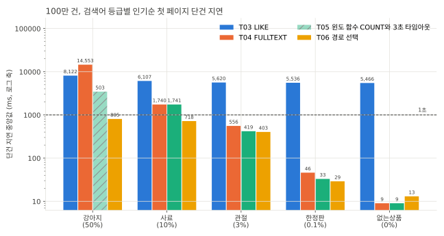
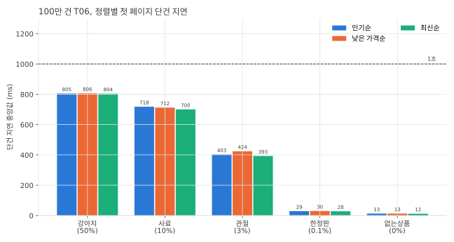
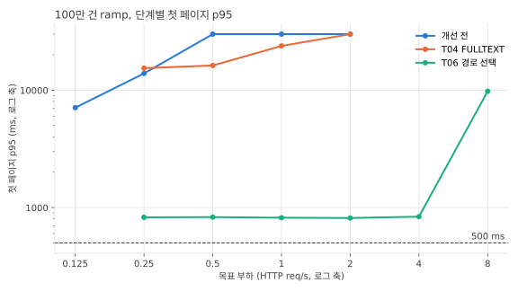
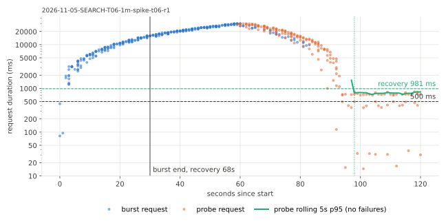
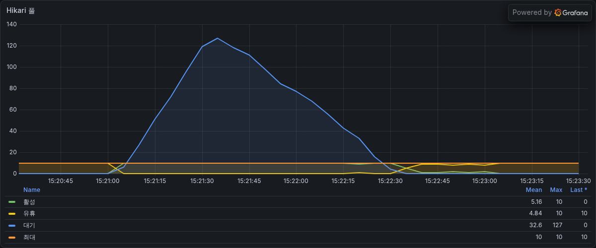
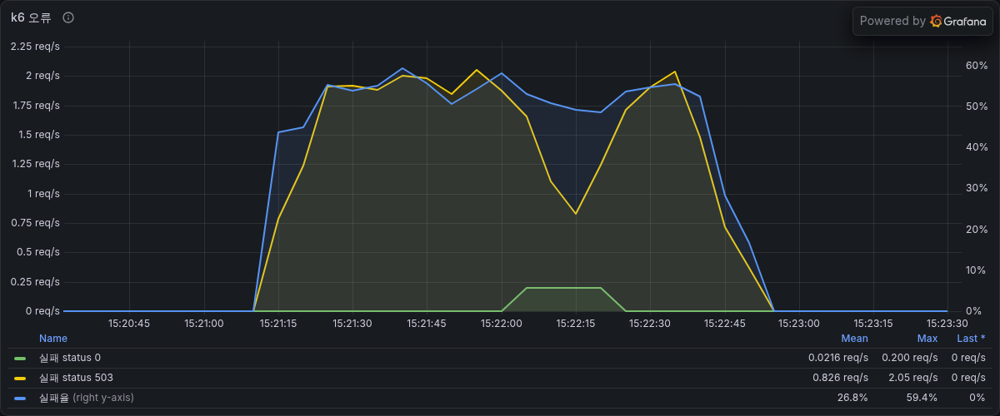
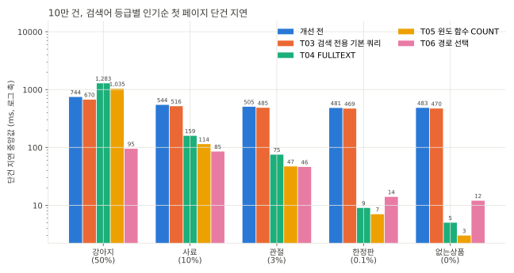
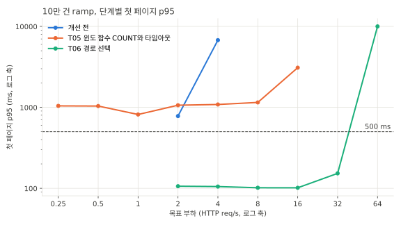
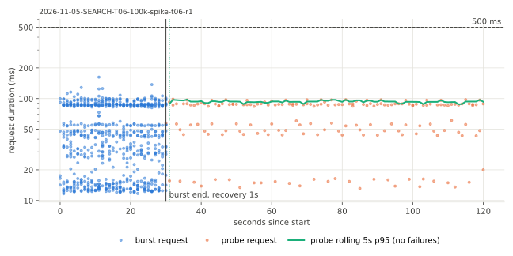
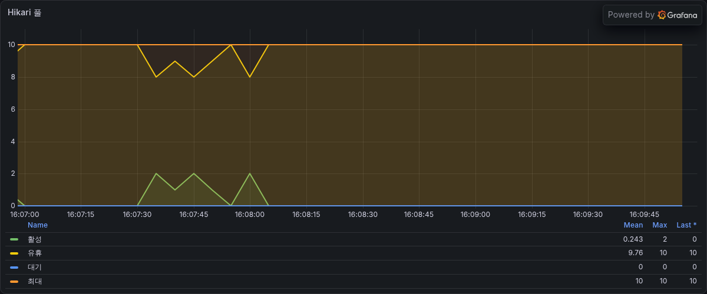

# SEARCH-T06 검색어 일치 비율에 따른 경로 선택과 정렬 인덱스

2026-11-05에 AWS perf 스택에서 검색 쿼리가 검색어마다 FULLTEXT와 LIKE 스캔 중 싼 경로를 고르고 목록을 정렬 인덱스 순서로 읽게 바꾼 뒤 100만 건과 10만 건에서 잰 기록이다. 지연은 ms, 요청률은 초당 HTTP 요청 수(req/s)다. run별 전체 표는 `SEARCH-T06.md`에 있다.

## 요약

- 검색마다 최근 상품 2,000개 표본으로 일치 비율을 세서 FULLTEXT, 정렬 인덱스 순서, 테이블 스캔 중 하나를 고르게 했다. 흔한 검색어는 목록을 정렬 인덱스 순서로 읽다 21행에서 멈추고 총개수만 테이블을 훑는다. 응답은 그대로다. 100만 건과 10만 건에서 고정 요청 384개씩의 응답이 이전 단계와 바이트 단위로 같다.
- 100만 건 첫 페이지 단건 지연은 강아지가 T05의 3초 타임아웃(503)에서 805ms, 사료가 1,741ms에서 718ms가 됐다. 2쪽은 두 검색어 모두 21ms 이하다.
- 100만 건 처리 가능 요청률은 T04의 0.5 req/s에서 4 req/s가 됐다. 2.8 req/s steady에서 첫 페이지 p95는 818ms, p99는 842ms에서 893ms이고 실패는 없다. SLO(첫 페이지 p95 500ms 미만)는 지키지 못했다.
- 10만 건은 시리즈에서 처음으로 SLO를 지켰다. 최대 안정 요청률이 32 req/s다(T05는 SLO 미충족, 처리 가능 8 req/s). 5.6 req/s steady의 첫 페이지 p95는 1,112ms에서 97ms로 91% 줄었고 24 req/s spike에서 실패가 없었다.
- 일치 상품이 거의 없는 검색어는 경로를 고르는 쿼리 몫만큼 느려졌다. 10만 건 없는상품이 3ms에서 12ms다.
- 남은 비용은 첫 페이지의 정확한 총개수다. 100만 건에서 COUNT가 DB 시간의 69%를 쓰고 한 번에 평균 703ms이며 상품 수에 비례한다. T01의 예측(10만 건은 SLO를 지키고 100만 건은 COUNT 때문에 못 지킨다)과 같다. MySQL 튜닝은 여기서 멈추고 T07에서 검색 엔진을 붙인다.

## 가설

T04와 T05 뒤 100만 건에서 남은 비용은 일치 상품이 많은 검색어였다. 강아지(상품 50%)는 MATCH가 일치 상품 47만 개를 FULLTEXT 인덱스에서 하나씩 찾아 읽고 그 전부를 셀러와 통계에 조인해 정렬하고 센다. 테이블을 처음부터 끝까지 훑는 것보다 일치 상품을 하나씩 찾는 쪽이 비싸므로 흔한 검색어는 MATCH를 빼고 훑는 편이 빠를 것이다. 목록은 정렬 순서대로 인덱스를 읽으면 21행에서 멈출 수 있고 총개수만 전체를 훑으면 된다.

## 설계 근거 측정

kit 셀이 아니라 러너에서 100만 건 RDS에 SQL을 직접 돌려 잰 값이다. 데이터가 버퍼 풀에 올라온 뒤 같은 쿼리를 두 번 이상 돌렸다.

### 강아지 총개수 쿼리

노출 조건(검수 승인, 판매중이나 품절, 검색 대상 카테고리, 활성 셀러)과 상품명 조건이 같고 읽는 방법만 다르다.

| 읽는 방법 | 시간 |
|---|---|
| MATCH 구문 검색(`"강아지"`), 셀러 내부 조인 (T05까지) | 6,137 |
| MATCH ngram AND 검색(`+강아 +아지`), 셀러 내부 조인 | 3,844 |
| LIKE, 셀러 내부 조인 (옵티마이저가 셀러부터 읽음) | 2,827 |
| LIKE, 셀러 내부 조인을 상품부터 읽게 고정(`STRAIGHT_JOIN`) | 1,530 |
| LIKE, 셀러 id 목록으로 거름, 상품명 조건을 맨 뒤에 둠 | 912 |
| LIKE, 셀러 id 목록으로 거름, 상품명 조건을 맨 앞에 둠 (T06) | 764 |

- MATCH는 일치 문서 50만 개를 FULLTEXT 인덱스에서 찾고 행을 하나씩 읽는다. 행을 읽지 않고 세기만 해도 구문 검색은 3,463ms, AND 검색은 1,118ms였다. 구문 검색은 일치 문서마다 토큰 위치를 확인하는 비용이 더 든다.
- 셀러를 내부 조인하면 옵티마이저가 셀러 1,000명을 먼저 읽고 `ix_products_seller_id`로 상품을 하나씩 찾았다. 활성 셀러가 10%라고 잘못 추정해서다(실제 99%). 셀러 id 목록으로 바꾸면 상품 테이블을 순서대로 훑는다.
- 상품명 조건을 맨 앞에 두면 일치하지 않는 절반은 나머지 조건을 계산하지 않아 150ms 줄었다.

### 검색어별 경로 비용

| 검색어 (일치 비율) | MATCH AND 총개수 (셀러 내부 조인) | LIKE 스캔 총개수 (셀러 id 목록, 상품명 조건 맨 뒤) |
|---|---|---|
| 강아지 (50%) | 3,844 | 929 |
| 사료 (10%) | 614 | 945 |
| 관절 (3%) | 201 | 950 |
| 한정판 (0.1%) | 8 | 940 |
| 없는상품 (0%) | 1 | 952 |

LIKE 스캔은 일치 수와 관계없이 테이블 전체를 훑어 일정하다. 상품명 조건을 맨 앞에 두면 강아지 764, 사료 672로 더 준다. MATCH는 일치 수에 비례한다. 두 비용이 사료(10%) 근처에서 만나서 일치 비율 5%를 기준으로 잡았다. 최근 상품 2,000개 표본의 일치 비율을 세는 쿼리는 1.3ms에서 3.2ms였다.

### 목록 쿼리

MATCH 없이 정렬 인덱스 순서로 읽은 목록 쿼리의 EXPLAIN ANALYZE다.

| 쿼리 | 시간 | 읽은 인덱스 항목 |
|---|---|---|
| 강아지 인기순 첫 페이지 | 0.19 | 21 |
| 사료 인기순 첫 페이지 | 9.9 | 3,061 |
| 강아지 인기순 2쪽 | 5.3 | 범위 검색 |
| 강아지 최신순 첫 페이지 | 0.16 | 46 |
| 강아지 낮은 가격순, 할인 중인 쪽 | 0.22 | 21 |
| 강아지 낮은 가격순, 할인 아닌 쪽 | 2.7 | 711 |

정렬 인덱스 앞에 `inspection_status`를 둔 첫 시도에서는 총개수 쿼리가 그 인덱스로 승인 상품 99만 개를 하나씩 찾아 읽어 2,861ms가 걸렸다(테이블 스캔 863ms, 둘 다 EXPLAIN ANALYZE). 그래서 정렬 인덱스에는 정렬 열만 둔다.

### 인덱스 순서가 불리한 검색어

첫 jar(`b42463cc15de`)는 MATCH를 쓰지 않는 검색어를 모두 정렬 인덱스 순서로 읽었다. 100만 건 equiv에서 고정 요청 22개가 3초 타임아웃(503)으로 T04와 달랐고 모두 낮은 가격순이었다.

| 쿼리 | 계획 | 시간 |
|---|---|---|
| `개` 인기순 (일치 0개) | `ix_products_popular`로 100만 행을 하나씩 읽음 | 2,575 |
| `개` 인기순, 정렬 열에 0을 더함 | 테이블 스캔 뒤 정렬 | 729 |
| `개` 낮은 가격순, 유효가격 식으로 정렬 | 테이블 스캔 뒤 정렬 | 796 |
| `개` 최신순 | 기본 키 역순으로 100만 행 | 847 |
| 연어 낮은 가격순, 할인 아닌 쪽 (일치 10만 개가 모두 할인 중) | `ix_products_regular_price`를 끝까지 읽음 | 3초 넘음 |
| 위 쿼리에 할인 중인 쪽 21번째 가격(4,000원)을 상한으로 둠 | 범위가 비어 바로 끝남 | 0.01 |

- 옵티마이저는 `LIKE '%검색어%'`의 일치 비율을 실제와 관계없이 추정한다. 그래서 ORDER BY LIMIT이 정렬 인덱스와 맞으면 일치 상품이 없어도 그 인덱스를 고른다. 인덱스 항목마다 상품 행을 하나씩 찾아 읽으므로 테이블을 순서대로 훑는 것보다 3배 넘게 느렸다.
- 그래서 표본에서 검색 조건 전체를 통과하는 비율이 1% 미만이면 정렬 열에 0을 더해(`review_count + 0`) 인덱스를 고르지 못하게 하고 테이블을 훑는다.
- 연어는 seed에서 상품 번호가 10의 배수라 모두 할인 대상이다. 낮은 가격순은 표본에서 일치 비율이 높은 쪽을 먼저 읽고 다른 쪽은 그 가격까지만 읽게 바꿨다.

## 변경 내용

| 변형 | 코드 | jar |
|---|---|---|
| t06 | 경로 선택, 정렬 인덱스, 셀러 id 목록 | `5985eaf0e8e5` (equiv에서 503이 나온 첫 jar `b42463cc15de`를 고친 것) |
| t05 | T05 (윈도 함수 COUNT, 3초 타임아웃) | `9c715056a644-dirty-4a623ade` |

- 어댑터가 검색마다 최근 상품 2,000개 표본에서 상품명 일치 수와 검색 조건 전체 통과 수를 세서 세 경로 중 하나를 고른다.

| 경로 | 고르는 조건 | 목록 | 첫 페이지 총개수 |
|---|---|---|---|
| FULLTEXT | 상품명 일치 비율 5% 미만이고 MATCH를 쓸 수 있는 검색어 | MATCH로 좁힌 후보를 정렬 | 윈도 함수로 목록과 함께 |
| 인덱스 순서 | 아니면서 검색 조건 전체 통과 비율 1% 이상 | 정렬 인덱스 순서로 읽다 21행에서 멈춤 | 조인 없이 상품 테이블만 훑는 COUNT |
| 스캔 | 나머지 | 테이블 전체를 읽어 정렬 | 윈도 함수로 목록과 함께 |

- MATCH 검색어를 구문 검색에서 ngram 토큰 AND 검색으로 바꿨다(`강아지` → `+강아 +아지`). 순서와 인접은 LIKE 재검사가 맞춘다.
- 인덱스 순서 경로의 인기순은 `ix_products_popular(review_count DESC, id DESC)`, 최신순은 기본 키 순서로 읽는다. 낮은 가격순은 유효가격이 시각에 따라 달라 인덱스에 담지 못해서 할인 중인 상품은 `ix_products_discount_price`, 나머지는 `ix_products_regular_price` 순서로 21행씩 읽어 합친다. 표본에서 일치 비율이 높은 쪽을 먼저 읽고 다른 쪽은 그 가격까지만 읽는다.
- 인기순 정렬 키를 product_stats에서 상품 행으로 옮겼다. 리뷰 통계 반영이 product_stats와 같은 트랜잭션에서 `products.review_count`에 같은 값을 쓴다. 커서 값은 그대로라 배포 전 커서도 이어진다.
- 셀러는 활성 셀러 id 목록으로 거르고 셀러 상호와 상품 통계는 왼쪽 조인으로 붙인다. 내부 조인이면 옵티마이저가 셀러부터 읽어 인덱스 순서 읽기와 테이블 스캔을 못 쓴다.
- 마이그레이션 V91이 컬럼을 더하고 product_stats에서 채운 뒤 인덱스 셋을 만든다. 측정 DB에는 같은 문장을 `ddl/SEARCH-T06.sql`로 적용했다. 100만 건에서 컬럼 추가 25.4초(FULLTEXT 인덱스가 있어 테이블을 다시 만듦), 채우기 6.0초, 인덱스마다 2초였다.

## 환경

T05와 같은 perf 측정층(api m7i.large, 러너 c7g.large, RDS db.m7g.large, MySQL 8.4)이다. 두 데이터 모두 FULLTEXT 인덱스(`ddl/SEARCH-T02-fulltext.sql`)와 이번 DDL(`ddl/SEARCH-T06.sql`)을 적용했고 api는 `AECHAK_SEARCH_FULLTEXT_ENABLED=true`로 띄웠다. 쿼리 타임아웃은 기본값 3초다.

- 100만 건은 14:52부터 15:38까지 쟀다. 기준 요청률은 t06 ramp의 처리 가능 요청률 4 req/s라 steady는 2.8 req/s, spike는 12 req/s다. 클라이언트 타임아웃은 kit 규약대로 30초다.
- 10만 건은 15:46부터 16:18까지 쟀다. T05와 같은 부하(기준 8 req/s, steady 5.6 req/s, spike 24 req/s)이고 클라이언트 타임아웃은 10초다.
- t05 변형은 100만 건 sequential만 같은 DB에서 다시 쟀다. T05 보고서에는 100만 건 측정이 없다.
- equiv는 api만 다시 띄우고 DDL을 적용하지 않아서 10만 건은 equiv 전에 `ddl/SEARCH-T06.sql`을 먼저 적용했다. kit이 적용할 때와 같은 문장을 돌리고 `perf_applied_ddl`에 같은 체크섬으로 기록했다.

## 측정 결과

### 응답

100만 건 고정 요청 384개의 응답이 T04와, 10만 건 384개가 T05와 바이트 단위로 같다.

### 등급별 단건 지연 (100만 건)

sequential은 부하 없이 요청을 하나씩 보낸다. 인기순 첫 페이지 중앙값이고 괄호 안은 seed에서 상품명이 일치하는 비율이다. T03과 T04는 각 보고서의 100만 건 run이고 T05와 T06은 같은 DB에서 이어서 쟀다.



| 검색어 | T03 | T04 | T05 | T06 | T06 경로 |
|---|---|---|---|---|---|
| 강아지 (50%) | 8,122 | 14,553 | 503 | 805 | 인덱스 순서 |
| 사료 (10%) | 6,107 | 1,740 | 1,741 | 718 | 인덱스 순서 |
| 관절 (3%) | 5,620 | 556 | 419 | 403 | FULLTEXT |
| 한정판 (0.1%) | 5,536 | 46 | 33 | 29 | FULLTEXT |
| 없는상품 (0%) | 5,466 | 9 | 9 | 13 | FULLTEXT |

- T05는 강아지 첫 페이지가 정렬과 관계없이 3초 타임아웃(503)으로 끝났다. 응답까지 3,453ms에서 3,575ms가 걸렸다.
- T06의 강아지와 사료 첫 페이지는 시간 대부분이 총개수 COUNT다. 목록은 인덱스 순서로 읽다 21행에서 멈춘다.
- 없는상품이 T05보다 4ms 느린 것은 경로를 고르는 표본 쿼리와 활성 셀러 id 쿼리 몫이다. steady 다이제스트에서 두 쿼리의 평균은 3.5ms와 0.5ms였다.

정렬과 페이지별로 보면 다음과 같다. 2쪽은 첫 페이지의 커서로 보낸 요청이고 총개수를 세지 않는다.



| 검색어 | 정렬 | T05 첫 페이지 | T06 첫 페이지 | T05 2쪽 | T06 2쪽 |
|---|---|---|---|---|---|
| 강아지 | 인기순 | 503 | 805 | 없음 | 16 |
| 강아지 | 낮은 가격순 | 503 | 806 | 없음 | 19 |
| 강아지 | 최신순 | 503 | 804 | 없음 | 21 |
| 사료 | 인기순 | 1,741 | 718 | 974 | 15 |
| 사료 | 낮은 가격순 | 1,635 | 712 | 567 | 19 |
| 사료 | 최신순 | 1,486 | 700 | 546 | 20 |
| 관절 | 인기순 | 419 | 403 | 325 | 194 |
| 관절 | 낮은 가격순 | 422 | 424 | 255 | 197 |
| 관절 | 최신순 | 402 | 393 | 201 | 195 |

- 인덱스 순서 경로의 2쪽은 15ms에서 21ms다. T04의 강아지 인기순 2쪽은 7,567ms였다.
- 한정판은 28ms에서 36ms, 없는상품은 8ms에서 13ms로 두 변형 모두 정렬과 관계없이 작다.

### DB 시간 분포 (100만 건)

steady r1(2.8 req/s, 3분)의 performance_schema 다이제스트 상위 10개를 경로별로 묶었다. 세 반복의 순서와 비율이 같았다.

| 쿼리 | 실행 수 | 평균 | DB 시간 비중 |
|---|---|---|---|
| 인덱스 순서 경로 총개수 COUNT | 184 | 703 | 69% |
| FULLTEXT 경로 목록 (첫 페이지는 윈도 함수 포함) | 218 | 231 | 27% |
| 스캔 경로 목록 (윈도 함수 포함) | 15 | 344 | 3% |
| 인덱스 순서 경로 목록 | 161 | 11 | 0.9% |
| 표본 쿼리 | 501 | 3.5 | 0.9% |
| 활성 셀러 id | 479 | 0.5 | 0.1% |

- 총개수 COUNT는 실행마다 상품 100만 행을 모두 읽는다(rows_examined 1,000,000).
- 인덱스 순서 경로의 첫 페이지 비용은 거의 COUNT이고 목록은 1%가 안 된다.

### 실행 계획 (100만 건)

kit explain 셀은 셀러 id 목록 때문에 대부분의 쿼리에서 실행 계획을 만들지 못했다(측정의 한계). 무료배송 필터가 붙어 셀러 목록이 짧은 요청 하나만 계획이 남았다. 강아지 낮은 가격순 첫 페이지(가격 1만에서 8만 원, 카테고리 11, 무료배송)의 EXPLAIN ANALYZE 두 번째 실행이고 필터 줄은 뺐다.

```
-- 할인 중인 쪽 목록
-> Limit: 21 row(s)  (actual time=18.2..18.4 rows=21 loops=1)
    -> Index range scan on p1_0 using ix_products_discount_price over (10000 <= discount_price <= 80000)  (actual time=0.126..16.1 rows=4950 loops=1)
-- 할인 아닌 쪽 목록
-> Limit: 21 row(s)  (actual time=52.4..52.4 rows=0 loops=1)
    -> Index range scan on p1_0 using ix_products_regular_price over (10000 <= regular_price <= 12000)  (actual time=0.114..46.6 rows=14482 loops=1)
-- 총개수
-> Aggregate: count(p1_0.id)  (actual time=260..260 rows=1 loops=1)
    -> Index range scan on p1_0 using FKog2rp4qthbtt2lfyhfo32lsw9 over (category_id = 11) OR (category_id = 111) OR (3 more)  (actual time=0.1..213 rows=80000 loops=1)
```

- 두 목록 쿼리 모두 가격 인덱스 순서로 읽고 21행에서 멈추거나 범위가 끝나면 멈춘다. 할인 아닌 쪽은 할인 중인 쪽 21행의 최고가 12,000원까지만 읽었다.
- 총개수는 카테고리 인덱스로 그 카테고리 상품 8만 행만 읽어 260ms였다. 카테고리 필터가 없으면 상품 100만 행을 모두 읽는다.

### ramp (100만 건)



| 목표 req/s | 개선 전 (T01) p95 | T04 p95 | T06 p95 |
|---|---|---|---|
| 0.125 | 7,094 | 재지 않음 | 재지 않음 |
| 0.25 | 13,882 | 15,401 | 826 |
| 0.5 | 30,001 (실패 50%) | 16,224 | 829 |
| 1 | 30,000 (실패 50%) | 23,826 (실패 4.4%) | 819 |
| 2 | 30,000 (실패 62.5%) | 30,000 (실패 6.4%, dropped 9) | 814 |
| 4 | 재지 않음 | 재지 않음 | 836 |
| 8 | 재지 않음 | 재지 않음 | 9,791 (실패 37.9%, dropped 33) |

- 첫 페이지 p95 500ms(kit SLO)는 어느 단계에서도 지키지 못했다. 부하가 없어도 강아지와 사료 첫 페이지가 700ms에서 800ms라서다.
- 실패율 1% 미만과 dropped 0을 지킨 가장 높은 단계는 4 req/s로 T04(0.5 req/s)의 8배, 개선 전(0.25 req/s)의 16배다.
- steady의 요청당 RDS CPU초가 0.29에서 0.38이라 vCPU 2개로는 초당 5건에서 7건이 DB 쪽 상한이다. 8 req/s는 이를 넘는다.

### steady (100만 건, 2.8 req/s)

| 요청 | 비율 | p50 (반복별) | p95 (반복별) | p99 (반복별) | 최대 (반복별) |
|---|---|---|---|---|---|
| 첫 페이지 | 60% | 702, 702, 699 | 820, 817, 813 | 870, 893, 842 | 934, 1,020, 937 |
| 필터 첫 페이지 | 20% | 249, 289, 270 | 832, 972, 872 | 840, 1,010, 926 | 850, 1,075, 969 |
| 다음 페이지 | 20% | 19, 17, 18 | 243, 236, 234 | 294, 243, 244 | 325, 247, 252 |

- kit 집계의 첫 페이지 p95 중앙값은 818ms이고 반복 사이 폭은 0.8%다. 실패는 없다.
- 1초를 넘은 요청은 r2에만 있었다. 첫 페이지 최대가 1,020ms(mid 등급 검색어)이고 필터 요청 최대가 1,075ms(강아지)다. r1과 r3의 전체 최대는 935ms와 969ms다.
- 다음 페이지 p95 240ms 안팎은 FULLTEXT 경로의 2쪽이다. 인덱스 순서 경로의 2쪽은 20ms 안팎이다.
- 요청당 RDS CPU초는 0.38, 0.29, 0.35다. T04 100만 건 steady는 16분의 1 부하(0.175 req/s)에서 1.42에서 2.38이었다.

### spike (100만 건, 12 req/s 30초)

| burst 실패율 | 탐침 실패율 | 회복 시간 | 상태 코드 | RDS CPU 최대 |
|---|---|---|---|---|
| 40.85% | 33.7% | 68초 | 200 301건, 503 172건, 클라이언트 타임아웃 14건 | 99.7% |



| Hikari 풀 | k6 실패 |
|---|---|
|  |  |

- 처리 가능 요청률의 3배가 30초 동안 들어오면 COUNT가 DB CPU를 다 쓰고 커넥션 10개가 모두 바쁜 채로 Hikari 대기가 127까지 쌓인다. 실패율은 최대 59%였다.
- 쿼리는 3초에서 503으로 끝나지만 커넥션을 기다리는 시간은 쿼리 타임아웃에 들지 않는다. 그래서 클라이언트 타임아웃 30초까지 기다린 요청이 14건 있었다.
- T04와 T05에는 100만 건 spike가 없어 비교하지 않았다.

### 등급별 단건 지연 (10만 건)

인기순 첫 페이지 중앙값이다. 개선 전부터 T05까지는 각 보고서의 10만 건 run이다.



| 검색어 | 개선 전 | T03 | T04 | T05 | T06 | T06 경로 |
|---|---|---|---|---|---|---|
| 강아지 (50%) | 744 | 670 | 1,283 | 1,035 | 95 | 인덱스 순서 |
| 사료 (10%) | 544 | 516 | 159 | 114 | 85 | 인덱스 순서 |
| 관절 (3%) | 505 | 485 | 75 | 47 | 46 | FULLTEXT |
| 한정판 (0.1%) | 481 | 469 | 9 | 7 | 14 | FULLTEXT |
| 없는상품 (0%) | 483 | 470 | 5 | 3 | 12 | FULLTEXT |

| 검색어 | 정렬 | T05 첫 페이지 | T06 첫 페이지 | T05 2쪽 | T06 2쪽 |
|---|---|---|---|---|---|
| 강아지 | 인기순 | 1,035 | 95 | 675 | 14 |
| 강아지 | 낮은 가격순 | 946 | 98 | 501 | 17 |
| 강아지 | 최신순 | 897 | 95 | 487 | 16 |
| 사료 | 인기순 | 114 | 85 | 88 | 14 |
| 사료 | 낮은 가격순 | 123 | 88 | 52 | 17 |
| 사료 | 최신순 | 116 | 85 | 48 | 16 |
| 관절 | 인기순 | 47 | 46 | 42 | 29 |
| 관절 | 낮은 가격순 | 50 | 49 | 32 | 30 |
| 관절 | 최신순 | 48 | 47 | 31 | 32 |

- 강아지 첫 페이지는 1,035ms에서 95ms로 91%, 2쪽은 675ms에서 14ms로 98% 줄었다.
- 한정판과 없는상품은 5ms 안팎에서 13ms 안팎으로 늘었다. 표본 쿼리(3.5ms)와 활성 셀러 id 쿼리(0.5ms)를 더해도 4ms라 나머지 4ms 안팎은 셀러 id 1,000개를 쿼리마다 바인딩하는 api 쪽 비용으로 보는데 확인하지 않았다. 100만 건에서는 4ms만 늘었는데 FULLTEXT 쿼리가 빨라진 몫과 상쇄된 것으로 보인다.

### ramp (10만 건)



| 목표 req/s | 개선 전 (T01) p95 | T05 p95 | T06 p95 |
|---|---|---|---|
| 2 | 780 | 1,062 | 106 |
| 4 | 6,762 (dropped 11) | 1,085 | 105 |
| 8 | 재지 않음 | 1,150 | 102 |
| 16 | 재지 않음 | 3,091 (실패 5.5%) | 101 |
| 32 | 재지 않음 | 재지 않음 | 153 |
| 64 | 재지 않음 | 재지 않음 | 10,000 (실패 9.2%, dropped 252) |

- 32 req/s까지 모든 단계가 SLO(첫 페이지 p95 500ms 미만, 실패율 1% 미만, dropped 0)를 지켰다. 최대 안정 요청률은 32 req/s이고 시리즈에서 SLO를 지킨 첫 단계다. 개선 전과 T05는 SLO를 지킨 단계가 없었고 처리 가능 요청률이 2 req/s와 8 req/s였다.
- 64 req/s에서는 실제 처리량이 42.8 req/s에 머물고 대기가 쌓였다.

### steady (10만 건, 5.6 req/s)

| 변형 | 첫 페이지 p50 (반복별) | 첫 페이지 p95 (반복별) | 첫 페이지 p99 (반복별) | 첫 페이지 최대 (반복별) |
|---|---|---|---|---|
| T05 (timeout) | 85, 85, 88 | 1,112, 1,108, 1,114 | 1,289, 1,331, 1,424 | 1,816, 1,600, 1,583 |
| T06 | 85, 84, 85 | 97, 96, 97 | 110, 102, 109 | 191, 208, 196 |

- 첫 페이지 p95 중앙값이 1,112ms에서 97ms로 91% 줄었다. 반복 사이 폭은 T05 0.5%(1,108에서 1,114), T06 1.4%(96에서 97)이고 두 범위가 겹치지 않는다.
- 등급별로 보면 줄어든 것은 일치 상품이 많은 검색어다. steady r1의 모든 요청을 등급별로 나눈 중앙값이다.

| 등급 (검색어) | T05 | T06 |
|---|---|---|
| high (강아지) | 1,075 | 96 |
| mid (사료, 연어, 간식) | 116 | 86 |
| low (관절, 하네스, 바잇미) | 49 | 44 |
| rare (한정판) | 9 | 16 |
| none (없는상품) | 6 | 14 |

- rare와 none은 7ms에서 8ms 늘었다. 등급별 단건 지연에서 본 경로 선택의 고정 비용과 같은 크기다.
- 첫 페이지 p50은 두 변형 모두 mid 등급 요청에서 정해져 85ms 근처로 같다.
- 필터 첫 페이지 p95는 105ms에서 116ms, 다음 페이지 p95는 31ms에서 32ms다. 실패는 없다.
- 요청당 RDS CPU초는 0.043, 0.053, 0.041로 T05(0.163, 0.163, 0.159)보다 73% 적다.

### DB 시간 분포 (10만 건)

steady r1의 다이제스트 상위 10개다.

| 쿼리 | 실행 수 | 평균 | DB 시간 비중 |
|---|---|---|---|
| 인덱스 순서 경로 총개수 COUNT | 366 | 71 | 64% |
| FULLTEXT 경로 목록 (첫 페이지는 윈도 함수 포함) | 437 | 21 | 23% |
| 표본 쿼리 | 999 | 3.5 | 9% |
| 스캔 경로 목록 (윈도 함수 포함) | 30 | 31 | 2% |
| 인덱스 순서 경로 목록 | 319 | 2.4 | 2% |
| 활성 셀러 id | 955 | 0.5 | 1% |

- 총개수 COUNT는 실행마다 10만 행을 읽고 평균 71ms다. 100만 건(703ms)의 10분의 1로 상품 수에 비례한다.
- 표본 쿼리는 데이터 크기와 관계없이 3.5ms라 10만 건에서는 DB 시간의 9%다.

### spike (10만 건, 24 req/s 30초)

| 변형 | burst 실패율 | 탐침 실패율 | 회복 시간 | Hikari 대기 최대 | 상태 코드 |
|---|---|---|---|---|---|
| T05 (timeout) | 7.2% | 1.1% | 18초 | 127 | 200 824건, 503 40건, 클라이언트 타임아웃 12건 |
| T06 | 0% | 0% | 1초 (탐침 첫 창부터 기준 아래) | 0 | 200 894건 |

| 요청별 응답 시간 | Hikari 풀 |
|---|---|
|  |  |

- 24 req/s는 최대 안정 요청률(32 req/s) 안이라 burst 동안에도 모든 요청이 성공했고 첫 페이지 p95는 97ms였다. 활성 커넥션은 최대 2개였고 RDS CPU는 30%였다.

## 해석

- 검색 비용은 읽는 방법에 따라 일치 상품 수나 테이블 크기 중 하나를 따라간다. MATCH는 일치 상품 수에 비례하고 LIKE 스캔은 일치와 관계없이 상품 수에 비례한다. 두 비용이 일치 비율 10% 근처에서 만나서 한 경로로 고정하면 한쪽 검색어가 늘 손해를 본다. T04는 강아지, T03은 나머지 검색어가 손해를 봤다.
- 정렬 인덱스 순서 읽기는 일치 상품이 많을수록 21행을 빨리 채운다. MATCH가 가장 불리한 검색어에서 가장 유리해서 FULLTEXT와 서로 빈 곳을 채운다.
- 남은 비용은 첫 페이지의 정확한 총개수다. 노출 조건과 상품명 조건을 모든 상품 행에 확인해야 해서 상품 수에 비례한다. steady 다이제스트 평균이 10만 건 71ms, 100만 건 703ms였다.
- 계획이 나빠진 곳은 모두 옵티마이저의 추정이 틀린 곳이었다. MATCH는 1행, `LIKE '%검색어%'`는 일치 비율과 관계없는 고정값, 활성 셀러는 10%로 추정했다. 힌트로 계획을 고정하는 대신 표본으로 경로를 고르고 정렬 키에 0을 더하거나 셀러를 id 목록으로 넘겨 옵티마이저가 고를 수 있는 계획을 줄였다.

## 결정

- T06 변경을 남긴다. 100만 건에서 처리 가능 요청률 4 req/s 안에서는 503이 없고 2.8 req/s에서 첫 페이지 p95가 818ms다.
- 쿼리 타임아웃은 3초로 둔다. 100만 건에서 503은 처리 가능 요청률을 넘긴 spike와 ramp 8 req/s 단계에서만 나왔다.
- MySQL에서 더 줄일 곳은 총개수 COUNT인데 남은 방법은 모두 다른 비용을 만든다.
  - 커버링 인덱스(검수 상태, 판매 상태, 카테고리, 셀러, 상품명)를 강제하면 강아지 총개수가 764ms에서 567ms로 줄었다. 인덱스 힌트가 필요하고 상품을 쓸 때마다 고칠 인덱스가 하나 늘며 SLO 500ms에는 여전히 못 미친다.
  - 총개수를 어림값으로 바꾸거나 캐시하면 API가 돌려주는 총개수의 뜻이 바뀐다.
- 그래서 MySQL 튜닝은 여기서 멈추고 T07에서 검색 엔진으로 같은 API를 구현해 잰다.

### T01 예측과 측정

T01은 DB만으로 가면(T02에서 T06) 10만 건은 SLO를 지키지만 100만 건은 최대 안정 요청률이 0에 머문다고 예측했다. 흔한 검색어의 정확한 COUNT 한 번이 500ms를 넘는다고 봤다.

| 데이터 | 지표 | T01 | T06 |
|---|---|---|---|
| 10만 건 | 최대 안정 요청률 | 0 | 32 req/s |
| 10만 건 | 처리 가능 요청률 | 2 req/s | 32 req/s |
| 100만 건 | 최대 안정 요청률 | 0 | 0 |
| 100만 건 | 처리 가능 요청률 | 0.25 req/s | 4 req/s |
| 100만 건 | steady 첫 페이지 p95 중앙값 | 9,842 (0.175 req/s) | 818 (2.8 req/s) |
| 100만 건 | 요청당 RDS CPU초 | 6.0에서 6.9 | 0.29에서 0.38 |

두 예측 모두 맞았다. 100만 건을 막은 것도 예측대로 흔한 검색어의 정확한 COUNT이고 한 번에 평균 703ms다.

## 측정의 한계

- 경로를 고르는 기준(상품명 일치 5%, 조건 전체 통과 1%)은 이 seed의 100만 건에서 잰 비용으로 정했다. 운영 데이터의 검색어 분포에서 다시 확인해야 한다.
- 표본은 최근 상품 2,000개다. 일치 상품이 오래된 상품에 몰린 검색어는 일치 비율을 낮게 보고 FULLTEXT로 가서 T05와 같은 비용이 든다. 반대로 최근 상품에 몰린 검색어는 인덱스 순서로 가서 COUNT 스캔 비용이 든다. 두 경우 모두 응답은 같고 속도만 다르다.
- kit explain 셀이 T06 쿼리 대부분의 실행 계획을 만들지 못했다(100만 건과 10만 건 모두 39개 중 31개). performance_schema가 SQL 원문을 1,024바이트에서 자르는데 셀러 id 목록 때문에 쿼리가 그보다 길다. 무료배송 필터로 셀러 목록이 짧은 요청만 계획이 남았고 나머지 실행 계획은 설계 근거 측정에서 러너로 직접 돌린 값이다.
- 활성 셀러 id 목록은 seed의 셀러 1,000명 기준이다. 셀러가 수만 명이면 IN 목록이 길어지므로 다시 재야 한다.
- 100만 건 spike는 T04와 T05에 없어서 이전 단계와 비교하지 못했다.
- 100만 건은 kit SLO(첫 페이지 p95 500ms 미만)를 지키지 못했다. 부하가 없어도 흔한 검색어 첫 페이지가 700ms를 넘는다.
- 쓰기 셀(리뷰 통계 반영을 steady와 함께 돌리는 셀)은 돌리지 않았다. 리뷰 통계 반영마다 상품 행 UPDATE가 하나 늘었고 그 비용은 재지 않았다.

## 재현

```bash
make jar REV=5985eaf0
make variant STEP=SEARCH-T06 DATASET=1m VARIANT=t06 REV=5985eaf0e8e5 DDL="SEARCH-T02-fulltext SEARCH-T06" ENV=AECHAK_SEARCH_FULLTEXT_ENABLED=true CELLS="ramp steady spike sequential explain"
make variant STEP=SEARCH-T06 DATASET=1m VARIANT=t05 REV=9c715056a644-dirty-4a623ade DDL="SEARCH-T02-fulltext SEARCH-T06" ENV=AECHAK_SEARCH_FULLTEXT_ENABLED=true CELLS=sequential
make variant STEP=SEARCH-T06 DATASET=100k VARIANT=t06 REV=5985eaf0e8e5 DDL="SEARCH-T02-fulltext SEARCH-T06" ENV=AECHAK_SEARCH_FULLTEXT_ENABLED=true BASE_RATE=8 CELLS="ramp steady spike sequential explain"
```

`make reseed`는 products를 다시 넣으면서 `review_count`를 0으로 되돌린다. `perf_applied_ddl`에는 SEARCH-T06이 남아 있어 run.sh가 채우기를 다시 하지 않으므로 reseed 뒤에는 `ddl/SEARCH-T06.sql`의 UPDATE 문을 손으로 다시 돌린다.
