# SEARCH-T07 Elasticsearch 검색 어댑터

2026-11-05에 AWS perf 스택에서 같은 키워드 검색 API를 Elasticsearch로 처리하게 바꾼 뒤 100만 건과 10만 건에서 잰 기록이다. 지연은 ms, 요청률은 초당 HTTP 요청 수(req/s)다. run별 전체 표는 `SEARCH-T07.md`에 있다.

## 요약

- 검색 포트에 Elasticsearch 어댑터를 더하고 `aechak.search.engine=es`일 때 이 어댑터로 검색하게 했다. 상품명은 2글자 ngram 구문 일치로 찾아 `LIKE '%검색어%'`와 같은 상품을 찾는다. 100만 건과 10만 건에서 고정 요청 384개씩의 응답이 T06과 바이트 단위로 같다.
- 100만 건 첫 페이지 단건 지연은 강아지가 T06의 805ms에서 22ms, 사료가 718ms에서 7ms가 됐다. 검색어와 정렬을 통틀어 가장 느린 첫 페이지는 강아지 낮은 가격순 100ms다.
- 100만 건에서 시리즈 처음으로 SLO(첫 페이지 p95 500ms 미만)를 지켰다. 최대 안정 요청률이 256 req/s다. T06은 SLO를 지킨 단계가 없었고 처리 가능 요청률이 4 req/s였다. 2.8 req/s steady의 첫 페이지 p95는 818ms에서 25ms로 97% 줄었고 12 req/s spike의 실패율은 40.85%에서 0%가 됐다.
- 100만 건은 384 req/s에서 ES 호스트 CPU가 포화돼 무너졌다(실제 331 req/s, 첫 페이지 p95 4,056ms). 요청 하나에 쓰는 검색 저장소 CPU는 T06이 RDS 0.29초에서 0.38초, T07이 ES 0.005초 안팎이다.
- 10만 건은 kit ramp의 마지막 단계인 256 req/s까지 첫 페이지 p95 20ms 이하로 SLO를 지켰다(T06 32 req/s). 5.6 req/s steady의 첫 페이지 p95는 97ms에서 7ms가 됐다.
- api를 다시 띄운 직후 바로 256 req/s를 받으면 JIT 컴파일이 api의 1코어를 다 써서 무너졌다. 단계적으로 올리면 같은 요청률을 api CPU 36%로 처리한다.
- 실시간 동기화는 넣지 않았다. 색인은 재작성 시점의 데이터이고 100만 건 재작성에 61.9초가 걸렸다.

## 가설

T06 뒤 100만 건에서 남은 비용은 첫 페이지의 정확한 총개수였다. MySQL은 노출 조건과 상품명 조건을 상품 행마다 확인해야 해서 총개수 COUNT가 상품 수에 비례했다(10만 건 71ms, 100만 건 703ms). 검색 엔진은 상품명 조각마다 그 조각을 가진 상품 목록을 미리 만들어 둔다. 그래서 일치 상품을 찾고 세는 비용이 전체 상품 수가 아니라 일치 상품 수를 따를 것이다. 같은 API를 Elasticsearch로 처리하면 100만 건에서도 흔한 검색어의 첫 페이지가 SLO 안에 들 것이다.

## 변경 내용

- 새 모듈 `infra/persistence/elasticsearch`(`:elasticsearch-persistence`)에 검색 포트 `ProductKeywordSearchPort`의 Elasticsearch 어댑터를 넣었다. JPA 어댑터와 같은 노출 조건, 필터, 정렬, keyset, 첫 페이지 총개수를 색인 위에서 계산한다.
- 상품명은 공백과 문장부호까지 포함한 2글자 조각(ngram)으로 색인하고 2글자 이상 검색어는 조각이 연속한 위치에 있는지(`match_phrase`)로 찾는다. 길이가 같은 조각이 연속하면 원문에 검색어가 그대로 있다는 뜻이라 `LIKE '%검색어%'`와 같은 상품을 찾는다. 1글자 검색어는 1글자 조각 하위 필드로 찾는다.
- 정렬은 인기순(리뷰 수, id), 낮은 가격순(요청 시각 기준 유효가격을 painless 스크립트로 계산, id), 최신순(id)이다. 다음 페이지는 `search_after`로 읽고 첫 페이지 총개수는 같은 요청의 `track_total_hits`로 센다.
- 색인 재작성은 상품 전체를 id 순서로 1,000개씩 읽어(셀러와 상품 통계는 왼쪽 조인) bulk로 넣는다. 넣는 동안 refresh를 끄고 끝에 한 번 refresh한다. `aechak.search.es.reindex-on-startup=true`면 api가 시작 직후 한 번 돌린다.
- `aechak.search.engine=es`일 때만 이 어댑터로 검색한다. 기본값은 jpa라 배포 환경 동작은 바뀌지 않는다.
- 검색 요청은 비동기 클라이언트로 보내고 `aechak.search.query-timeout-ms`(기본 3초)만큼 기다린다. 넘기면 JPA 경로와 같은 503이다.
- 실시간 동기화는 넣지 않았다. 색인은 마지막 재작성 시점의 데이터다.
- 카테고리 id 목록 계산과 읽기 트랜잭션은 그대로라 검색 요청마다 MySQL에서 활성 카테고리를 한 번 읽는다.

## 환경

T06과 같은 perf 측정층(api m7i.large, 러너 c7g.large, RDS db.m7g.large, MySQL 8.4)에 ES 호스트 하나를 더했다. api 컨테이너는 지금까지처럼 1코어, 2GB로 제한했다.

- ES 호스트는 m7g.large(vCPU 2, 메모리 8GB)이고 Elasticsearch 9.2.6 단일 노드를 힙 4GB로 띄웠다. 색인은 샤드 1개, 복제 0개다. 클라이언트는 elasticsearch-java 9.2.6이다.
- DB에는 T06과 같은 DDL(`ddl/SEARCH-T02-fulltext.sql`, `ddl/SEARCH-T06.sql`)이 적용돼 있다. es 변형의 상품 검색은 DB를 읽지 않는다.
- 부하는 T06과 같다. 100만 건은 기준 4 req/s(steady 2.8 req/s, spike 12 req/s), 10만 건은 기준 8 req/s(steady 5.6 req/s, spike 24 req/s)다. 클라이언트 타임아웃은 100만 건 30초, 10만 건 10초다.
- 10만 건은 19:34부터 20:06까지, 100만 건은 20:22부터 21:17까지 쟀다. 각 데이터의 측정 직전에 색인을 재작성했다.
- 100만 건 ramp는 세 번 돌렸다. es는 kit 기본 단계(2 req/s에서 256 req/s), eshigh는 같은 단계에 384, 512, 768 req/s를 더한 것, esramp는 256 req/s부터 바로 시작한 것이다. 뒤의 둘은 kit에 ramp 단계 목록(`RAMP_RATES`)을 받는 부분을 더한 뒤 돌려서 kit 해시가 다르다(es는 0319732f5945, 둘은 fad00af68e54).
- T06 수치는 같은 날 같은 스택에서 잰 T06 보고서 값이다. 다시 재지 않았다.
- 측정 jar는 `235e95a53568`이고 빌드할 때 검색 테스트(동등성 테스트 포함)가 통과했다.

## 측정 결과

### 재색인

| 데이터 | 문서 수 | 재색인 시간 (앱 로그) | api 재시작 포함 | 색인 크기 |
|---|---|---|---|---|
| 10만 건 | 100,000 | 12.4초 | 99초 | 16MB |
| 100만 건 | 1,000,000 | 61.9초 | 126초 | 145MB (측정 뒤 162MB) |

- 재색인 시간은 앱이 남긴 `SEARCH_REINDEX_DONE`의 값이다. 100만 건은 초당 약 1만 6천 건을 넣었다.
- 100만 건 색인 크기는 재색인 직후 145MB, 측정을 모두 마친 뒤 162MB였다. 차이가 생긴 이유는 확인하지 않았다.

### 응답

고정 요청 384개의 응답이 100만 건과 10만 건 모두 T06 응답과 바이트 단위로 같다. 같은 날 같은 DB에서 T06 jar로 받은 응답과 비교했다. 요청에는 1글자 검색어(개), 띄어쓰기가 든 검색어(강아지 사료), NFD 자모로 쓴 검색어, 100자 검색어, `%`, `_`, 따옴표와 `+`, `-` 기호가 든 검색어가 들어 있다.

### 등급별 단건 지연 (100만 건)

sequential은 부하 없이 요청을 하나씩 보낸다. 인기순 첫 페이지 중앙값이고 괄호 안은 seed에서 상품명이 일치하는 비율이다. 개선 전은 T03 보고서의 base run이다.

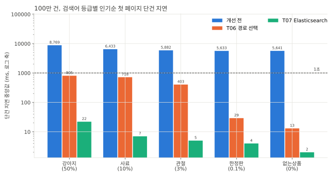

| 검색어 | 개선 전 | T06 | T07 |
|---|---|---|---|
| 강아지 (50%) | 8,769 | 805 | 22 |
| 사료 (10%) | 6,433 | 718 | 7 |
| 관절 (3%) | 5,882 | 403 | 5 |
| 한정판 (0.1%) | 5,633 | 29 | 4 |
| 없는상품 (0%) | 5,641 | 13 | 2 |

정렬과 페이지별로 보면 다음과 같다. 2쪽은 첫 페이지의 커서로 보낸 요청이고 총개수를 세지 않는다.

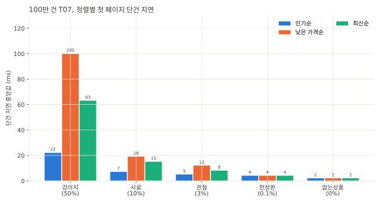

| 검색어 | 정렬 | T06 첫 페이지 | T07 첫 페이지 | T06 2쪽 | T07 2쪽 |
|---|---|---|---|---|---|
| 강아지 | 인기순 | 805 | 22 | 16 | 7 |
| 강아지 | 낮은 가격순 | 806 | 100 | 19 | 104 |
| 강아지 | 최신순 | 804 | 63 | 21 | 76 |
| 사료 | 인기순 | 718 | 7 | 15 | 7 |
| 사료 | 낮은 가격순 | 712 | 19 | 19 | 21 |
| 사료 | 최신순 | 700 | 15 | 20 | 18 |
| 관절 | 인기순 | 403 | 5 | 194 | 5 |
| 관절 | 낮은 가격순 | 424 | 12 | 197 | 13 |
| 관절 | 최신순 | 393 | 8 | 195 | 9 |

- 첫 페이지는 모든 검색어와 정렬에서 100ms 이하다.
- 강아지 낮은 가격순과 최신순은 2쪽(104ms, 76ms)이 T06(19ms, 21ms)보다 느리다. T06은 정렬 인덱스를 커서 위치부터 21행만 읽는다. ES의 `search_after`는 커서 위치에서 읽기 시작하지 않고 일치 상품 47만 개 가운데 커서 뒤의 상위 21개를 다시 고른다. 낮은 가격순은 그때마다 일치 상품마다 유효가격 스크립트를 계산한다.
- 강아지 인기순 2쪽은 7ms다. 같은 숫자 필드 정렬인데 최신순만 느린 것은 Lucene이 상위 후보가 될 수 없는 문서를 건너뛰는 최적화가 id 내림차순에는 거의 듣지 않아서로 보인다. 문서가 id 오름차순으로 색인돼 뒤에 읽는 문서일수록 id가 커서 매번 상위 후보가 된다. 확인하지는 않았다.

### ramp (100만 건)

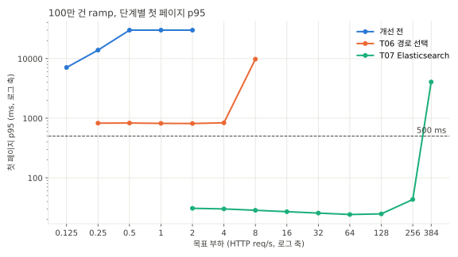

T07 열은 2 req/s부터 384 req/s까지 올린 eshigh ramp다. kit 기본 단계로 돈 es ramp도 256 req/s까지 모든 단계가 SLO를 지켰고 256 req/s의 첫 페이지 p95는 61ms였다.

| 목표 req/s | 개선 전 (T01) p95 | T06 p95 | T07 p95 |
|---|---|---|---|
| 0.125 | 7,094 | 재지 않음 | 재지 않음 |
| 0.25 | 13,882 | 826 | 재지 않음 |
| 0.5 | 30,001 (실패 50%) | 829 | 재지 않음 |
| 1 | 30,000 (실패 50%) | 819 | 재지 않음 |
| 2 | 30,000 (실패 62.5%) | 814 | 31 |
| 4 | 재지 않음 | 836 | 30 |
| 8 | 재지 않음 | 9,791 (실패 37.9%, dropped 33) | 28 |
| 16 | 재지 않음 | 재지 않음 | 27 |
| 32 | 재지 않음 | 재지 않음 | 26 |
| 64 | 재지 않음 | 재지 않음 | 24 |
| 128 | 재지 않음 | 재지 않음 | 25 |
| 256 | 재지 않음 | 재지 않음 | 43 |
| 384 | 재지 않음 | 재지 않음 | 4,056 (실제 331 req/s, dropped 486) |

- 256 req/s까지 모든 단계가 SLO를 지켰다. 최대 안정 요청률과 처리 가능 요청률이 모두 256 req/s다. T06은 SLO를 지킨 단계가 없었고 처리 가능 요청률이 4 req/s였다.
- 384 req/s에서는 실제 처리량이 331 req/s에 머물고 대기가 쌓였다. 실패 응답은 없었지만 dropped가 486이라 처리 기준을 지키지 못했다.

단계별 자원 사용은 다음과 같다. ES 호스트와 api CPU는 Prometheus에서 단계 구간의 평균을 다시 읽은 값이다. ES 호스트는 vCPU 2개 전체 대비, api는 컨테이너 한도 1코어 대비다. RDS CPU는 CloudWatch 1분 지표의 시간 가중 평균이다.

| 목표 req/s | 첫 페이지 p95 | ES 호스트 CPU | api CPU | RDS CPU | Hikari 대기 최대 |
|---|---|---|---|---|---|
| 32 | 26 | 8% | 18% | 3.0% | 0 |
| 64 | 24 | 16% | 20% | 3.5% | 0 |
| 128 | 25 | 32% | 32% | 3.9% | 0 |
| 256 | 43 | 64% | 36% | 5.5% | 0 |
| 384 | 4,056 | 91% (최대 98%) | 49% | 7.8% | 190 |

| ES CPU와 힙 | ES 검색 지연 |
|---|---|
| 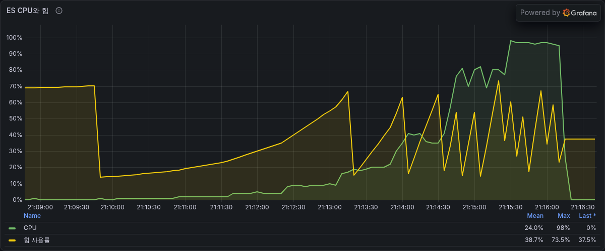 | 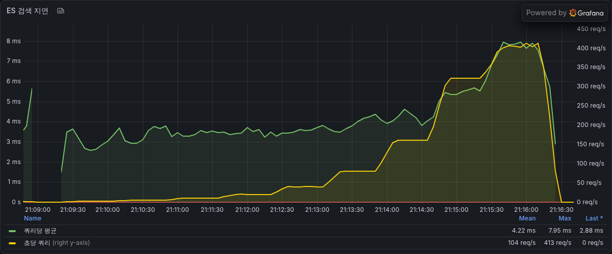 |

- ES 호스트 CPU가 요청률에 비례해 오르다 384 req/s에서 포화됐다. 256 req/s 단계에서 요청 하나에 ES CPU 0.005초 안팎(평균 64% x vCPU 2개 / 252 req/s)을 썼다. 이 비율이면 vCPU 2개의 상한이 400 req/s 안팎이고 실제로는 331 req/s에서 멈췄다.
- ES 안의 쿼리 실행 시간은 384 req/s에서도 쿼리당 평균 8ms 안팎이었다. 4초 넘는 p95는 실행 시간이 아니라 대기에서 생겼다.
- 검색 요청은 읽기 트랜잭션 안에서 ES 응답을 기다리는 동안 DB 커넥션을 쥐고 있다. 384 req/s에서 커넥션 10개가 모두 바빠지고 Hikari 대기가 190까지 쌓였다. 커넥션 10개로 331 req/s를 냈으니 요청 하나가 커넥션을 30ms 안팎 쥔 셈이다. ES가 느려지면 DB 커넥션 풀에서 대기가 쌓인다.

#### api를 다시 띄운 직후의 256 req/s (esramp)

kit은 변형마다 api 컨테이너를 다시 띄운다. 워밍업(2 req/s 60초) 뒤 바로 256 req/s를 보낸 esramp는 첫 단계에서 무너졌다.

| ramp | 실제 req/s | 첫 페이지 p95 | dropped | api CPU 평균 | api 스로틀링 | JIT 컴파일 시간 | ES 호스트 CPU | Hikari 대기 최대 |
|---|---|---|---|---|---|---|---|---|
| 2 req/s부터 단계적으로 (eshigh) | 252.27 | 43 | 0 | 36% | 0.8초 | 2.4초 | 64% | 0 |
| 256 req/s부터 (esramp) | 191.61 | 7,386 | 881 | 76% (최대 100%) | 36.4초 | 56.1초 | 37% | 192 |

| api CPU | Hikari 풀 |
|---|---|
| 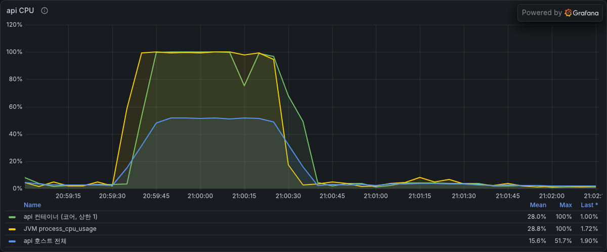 | 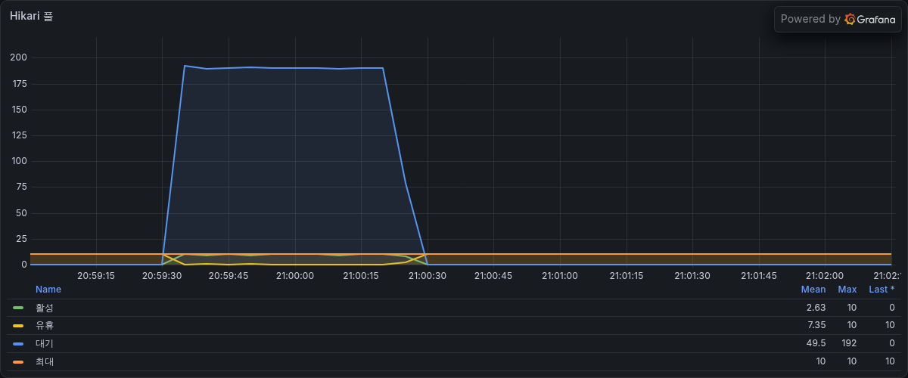 |

- 54초 단계 동안 JIT 컴파일 시간이 56초 쌓였다. 컴파일러가 1코어 한도를 거의 다 써서 요청 처리가 밀렸고 스로틀링이 36초 생겼다. ES 호스트 CPU는 평균 37%로 여유가 있었다.
- 단계적으로 올린 ramp는 같은 256 req/s를 api CPU 36%로 처리했다. JVM이 데워지기 전에 높은 부하가 들어오면 같은 jar와 같은 데이터에서도 처리 가능 요청률이 크게 낮다. 배포나 오토스케일링으로 새 태스크가 뜬 직후가 이 조건이다.

### steady (100만 건, 2.8 req/s)

| 요청 | 비율 | T06 p95 (반복별) | T07 p50 (반복별) | T07 p95 (반복별) | T07 p99 (반복별) | T07 최대 (반복별) |
|---|---|---|---|---|---|---|
| 첫 페이지 | 60% | 820, 817, 813 | 8, 8, 8 | 25, 25, 25 | 26, 26, 26 | 26, 26, 31 |
| 필터 첫 페이지 | 20% | 832, 972, 872 | 11, 15, 12 | 32, 115, 51 | 36, 115, 77 | 40, 115, 116 |
| 다음 페이지 | 20% | 243, 236, 234 | 6, 6, 6 | 7, 8, 8 | 9, 10, 8 | 12, 12, 9 |

- 첫 페이지 p95 중앙값이 818ms에서 25ms로 97% 줄었다. 반복 사이 폭은 0.3%이고 실패는 없다.
- 첫 페이지 p95가 25ms에 고정된 것은 강아지 첫 페이지 몫이다. steady r1의 등급별 중앙값은 high 24.8ms, mid 8.0ms, low 7.7ms, rare 6.3ms, none 5.1ms다. T06은 806ms, 718ms, 372ms, 32ms, 16ms였다.
- 필터 첫 페이지 p95는 반복마다 32ms에서 115ms로 다르다. steady 반복은 서로 다른 요청 순서를 쓰고 필터 요청이 반복마다 100건 남짓이라 느린 조합 몇 건이 p95를 정하는 것으로 보인다.
- 요청당 RDS CPU초는 0.021, 0.020, 0.019로 T06(0.38, 0.29, 0.35)의 6% 안팎이다. 남은 DB 일은 활성 카테고리 조회와 트랜잭션 문장이고 다이제스트의 57%에서 59%가 카테고리 조회다. 유휴 상태의 RDS CPU도 이 값에 들어 있다.

### spike (100만 건, 12 req/s 30초)

| 변형 | burst 실패율 | 탐침 실패율 | 회복 시간 | 상태 코드 | Hikari 대기 최대 | CPU 최대 |
|---|---|---|---|---|---|---|
| T06 | 40.85% | 33.7% | 68초 | 200 301건, 503 172건, 클라이언트 타임아웃 14건 | 127 | RDS 99.7% |
| T07 | 0% | 0% | 1초 | 200 543건 | 0 | RDS 2.5%, ES 4.4% |

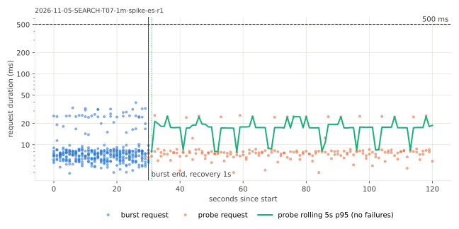

- T06에서 처리 가능 요청률의 3배였던 12 req/s가 T07에서는 최대 안정 요청률의 20분의 1 아래다. burst 동안에도 모든 요청이 성공했다.

### 등급별 단건 지연 (10만 건)

인기순 첫 페이지 중앙값이다. 개선 전은 T03 보고서의 base run이다.

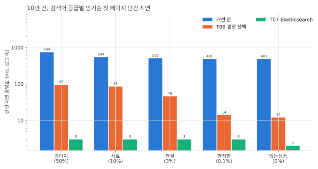

| 검색어 | 개선 전 | T06 | T07 |
|---|---|---|---|
| 강아지 (50%) | 744 | 95 | 3 |
| 사료 (10%) | 544 | 85 | 3 |
| 관절 (3%) | 505 | 46 | 3 |
| 한정판 (0.1%) | 481 | 14 | 3 |
| 없는상품 (0%) | 483 | 12 | 2 |

| 검색어 | 정렬 | T06 첫 페이지 | T07 첫 페이지 | T06 2쪽 | T07 2쪽 |
|---|---|---|---|---|---|
| 강아지 | 인기순 | 95 | 3 | 14 | 4 |
| 강아지 | 낮은 가격순 | 98 | 11 | 17 | 12 |
| 강아지 | 최신순 | 95 | 8 | 16 | 10 |
| 사료 | 인기순 | 85 | 3 | 14 | 4 |
| 사료 | 낮은 가격순 | 88 | 4 | 17 | 5 |
| 사료 | 최신순 | 85 | 4 | 16 | 5 |

- 검색어와 관계없이 첫 페이지가 2ms에서 3ms다. T06에서 경로를 고르는 고정 비용 때문에 늘었던 한정판과 없는상품도 3ms 이하가 됐다.
- 강아지 낮은 가격순(11ms)과 최신순(8ms)이 인기순(3ms)보다 느린 것은 100만 건과 같은 이유다.

### ramp (10만 건)

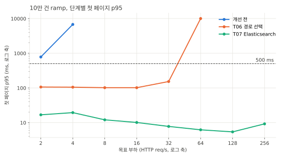

| 목표 req/s | 개선 전 (T01) p95 | T06 p95 | T07 p95 |
|---|---|---|---|
| 2 | 780 | 106 | 17 |
| 4 | 6,762 (dropped 11) | 105 | 19 |
| 8 | 재지 않음 | 102 | 12 |
| 16 | 재지 않음 | 101 | 10 |
| 32 | 재지 않음 | 153 | 8 |
| 64 | 재지 않음 | 10,000 (실패 9.2%, dropped 252) | 6 |
| 128 | 재지 않음 | 재지 않음 | 5 |
| 256 | 재지 않음 | 재지 않음 | 9 |

- kit ramp의 마지막 단계인 256 req/s까지 모든 단계가 SLO를 지켰다. 실제 처리량은 252.26 req/s, 실패는 0이다. 최대 안정 요청률은 256 req/s 이상이고 한계는 이번 ramp 범위 밖이다.
- 256 req/s 단계에서 ES 호스트 CPU는 평균 18%, api CPU는 36%였다. 요청 하나에 ES CPU 0.0015초 안팎으로 100만 건(0.005초)의 3분의 1 아래다.
- 요청률이 낮을수록 오히려 느리다. 첫 페이지 중앙값이 2 req/s 14ms, 8 req/s 10ms, 32 req/s 6.5ms, 256 req/s 3ms로 분포 전체가 내려간다. 요청을 쉬지 않고 이어 보낸 sequential도 3ms였다. 요청 사이가 비는 낮은 부하에서만 생기는 지연인데 원인은 확인하지 않았다.

### steady (10만 건, 5.6 req/s)

| 요청 | 비율 | T06 p95 (반복별) | T07 p50 (반복별) | T07 p95 (반복별) | T07 p99 (반복별) | T07 최대 (반복별) |
|---|---|---|---|---|---|---|
| 첫 페이지 | 60% | 97, 96, 97 | 5, 5, 5 | 6, 7, 7 | 10, 9, 9 | 105, 10, 42 |
| 필터 첫 페이지 | 20% | 105, 116, 107 | 7, 7, 7 | 9, 16, 14 | 12, 17, 16 | 19, 19, 33 |
| 다음 페이지 | 20% | 32, 31, 32 | 4, 4, 4 | 5, 5, 5 | 7, 6, 10 | 9, 7, 18 |

- 첫 페이지 p95 중앙값이 97ms에서 7ms로 93% 줄었다. 반복 사이 폭은 3.3%(6에서 7)다. 실패는 없다.
- steady r1의 등급별 중앙값은 high 5.8ms, mid 5.2ms, low 5.0ms, rare 5.0ms, none 4.6ms로 등급 사이 차이가 1ms 남짓이다. T06은 96ms에서 14ms였다.
- 요청당 RDS CPU초는 0.012, 0.010, 0.010으로 T06(0.043, 0.053, 0.041)의 4분의 1 안팎이다.

### spike (10만 건, 24 req/s 30초)

| 변형 | burst 실패율 | 탐침 실패율 | 회복 시간 | Hikari 대기 최대 | 상태 코드 |
|---|---|---|---|---|---|
| T06 | 0% | 0% | 1초 | 0 | 200 894건 |
| T07 | 0% | 0% | 1초 | 0 | 200 894건 |

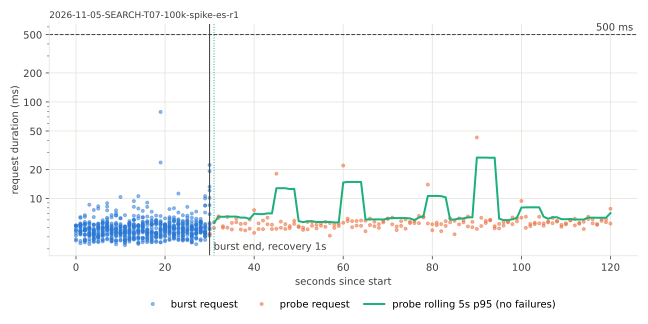

- 24 req/s는 두 변형 모두 처리 가능 요청률 안이라 burst 동안에도 모든 요청이 성공했다. T07 burst 요청은 대부분 10ms 아래다.

## 해석

- 검색 비용이 따라가는 대상이 바뀌었다. MySQL에서는 첫 페이지 비용이 상품 수를 따랐다(T06 강아지 첫 페이지 10만 건 95ms, 100만 건 805ms). ES에서는 강아지 첫 페이지가 10만 건 3ms, 100만 건 22ms다. 강아지 일치 상품도 약 10배가 됐으니 이 증가는 일치 상품 수를 따른 것이다. 일치 상품이 적은 검색어는 100만 건에서도 2ms에서 7ms다.
- 요청 하나의 비용이 크게 줄었다. T06은 100만 건 steady에서 요청 하나에 RDS CPU 0.29초에서 0.38초를 썼고 T07은 256 req/s 단계에서 ES CPU 0.005초 안팎을 썼다. 같은 vCPU 2개 인스턴스에서 처리 가능 요청률이 4 req/s에서 256 req/s가 된 것도 이 차이와 맞는다.
- 정렬마다 비용이 다르다. 인기순은 다음 페이지가 일치 상품 수와 관계없이 7ms 이하다. 낮은 가격순은 일치 상품마다 스크립트로 유효가격을 계산하고 최신순은 건너뛰기가 거의 듣지 않아 일치 상품이 많으면 다음 페이지도 70ms에서 100ms가 든다. 다음 페이지만 보면 T06의 정렬 인덱스 순서 읽기(20ms 안팎)가 더 싸다.
- 병목이 DB에서 ES 호스트로 옮겨 갔다. 100만 건 384 req/s에서 ES 호스트 CPU가 포화될 때 RDS CPU는 7.8%, api는 1코어 한도의 49%였다. 10만 건은 256 req/s에서도 ES 18%, api 36%라 한계가 더 위에 있다.
- 검색 요청은 여전히 읽기 트랜잭션 안에서 처리된다. 요청마다 MySQL 커넥션을 잡고 카테고리를 읽은 뒤 커넥션을 쥔 채 ES 응답을 기다린다. ES가 포화되거나 api가 느려지면 대기가 DB 커넥션 풀(10개)에 쌓인다. ES로 옮긴 검색도 DB 커넥션 풀 크기만큼만 동시에 처리된다.
- JVM이 데워지기 전의 높은 부하는 1코어 api에 치명적이다. 같은 256 req/s를 단계적으로 올리면 api CPU 36%로 처리하고 바로 보내면 JIT 컴파일이 1코어를 다 써서 무너진다.

## 결정

- T07 변경을 남긴다. 기본 엔진은 jpa라 배포 환경 동작은 그대로이고 `aechak.search.engine=es`와 재색인으로 Elasticsearch 검색을 켤 수 있다.
- 100만 건에서 목표(타임아웃 없이 첫 페이지 1초 안)와 kit SLO(첫 페이지 p95 500ms 미만)를 모두 지켰다. 최대 안정 요청률은 256 req/s다. T06에서 MySQL로는 닿지 못한다고 본 지점이다.
- 운영 전환에는 실시간 동기화(상품, 셀러, 리뷰 수 변경을 색인에 반영), 색인이 없을 때의 처리, 콜레이션 차이 정리, 상품명이 다양한 데이터로 다시 재기가 더 필요하다. 이번 단계에는 넣지 않았다.
- 다음 페이지가 느린 낮은 가격순과 최신순, ES 응답을 기다리는 동안 쥐는 DB 커넥션, 새 태스크의 콜드 스타트는 이후 최적화 단계의 후보다.

## 측정의 한계

- 실시간 동기화가 없다. 색인은 각 데이터의 측정 직전에 재작성했고 측정 중에는 상품이 바뀌지 않았다. 쓰기와 색인 갱신을 함께 돌리는 셀은 없다.
- 상품명은 시드 번호에서 짧은 주기로 만든 합성 데이터다(3,000행 주기 안의 이름 조합 123개). 색인에 들어가는 조각 종류가 적고 조각마다 상품 목록이 길다. 실제 상품명처럼 어휘가 다양하면 색인 크기와 검색 비용이 달라진다. T01에서 ES 도입을 정하기 전에 보겠다고 적은 민감도 측정은 이번에 하지 않았다.
- ES는 단일 노드에 복제 0이다. 노드가 멈추면 검색이 실패하는 구성이라 운영 구성의 처리량이나 장애 동작을 나타내지 않는다.
- T06 수치는 같은 날 같은 스택에서 앞서 잰 T06 보고서 값이다. 두 변형을 번갈아 다시 재지 않았다.
- 10만 건 ramp는 kit 상한인 256 req/s까지만 쟀다. 한계는 그 위에 있고 얼마인지는 재지 않았다.
- 100만 건 최대 안정 요청률은 256 req/s와 384 req/s 사이에 있다. 그 사이 요청률은 재지 않았다.
- 요청당 ES CPU초는 ES 호스트 전체 CPU로 계산해 수집기와 ES 자체의 유휴 부하가 들어 있다. 요청률이 높은 ramp 단계 값으로 비교했다.
- MySQL 콜레이션(`utf8mb4_0900_ai_ci`)의 LIKE는 악센트와 전각, 반각을 무시하고 ES의 소문자화는 무시하지 않는다(cafe와 café). equiv 요청의 검색어에는 이런 문자가 없어 차이가 드러나지 않았다.
- 색인이 없는 상태에서 엔진을 es로 두면 검색이 오류로 끝난다. JPA로 돌아가지 않는다.

## 재현

```bash
make jar REV=235e95a5
make up DATASET=100k
make reindex DATASET=100k REV=235e95a53568
make equiv STEP=SEARCH-T07 DATASET=100k ENGINE=es REV=235e95a53568
make variant STEP=SEARCH-T07 DATASET=100k VARIANT=es REV=235e95a53568 DDL="SEARCH-T02-fulltext SEARCH-T06" ENV=AECHAK_SEARCH_ENGINE=es BASE_RATE=8 CELLS="ramp steady spike sequential"
make up DATASET=1m
make reindex DATASET=1m REV=235e95a53568
make equiv STEP=SEARCH-T07 DATASET=1m ENGINE=es REV=235e95a53568
make variant STEP=SEARCH-T07 DATASET=1m VARIANT=es REV=235e95a53568 DDL="SEARCH-T02-fulltext SEARCH-T06" ENV=AECHAK_SEARCH_ENGINE=es BASE_RATE=4 CELLS="ramp steady spike sequential"
make variant STEP=SEARCH-T07 DATASET=1m VARIANT=esramp REV=235e95a53568 DDL="SEARCH-T02-fulltext SEARCH-T06" ENV=AECHAK_SEARCH_ENGINE=es BASE_RATE=4 RAMP_RATES="256 384 512 768" CELLS=ramp
make variant STEP=SEARCH-T07 DATASET=1m VARIANT=eshigh REV=235e95a53568 DDL="SEARCH-T02-fulltext SEARCH-T06" ENV=AECHAK_SEARCH_ENGINE=es BASE_RATE=4 RAMP_RATES="2 4 8 16 32 64 128 256 384 512 768" CELLS=ramp
```

ES 호스트는 perf terraform을 `-var es_enabled=true`로 apply해야 생긴다. `make reindex`는 색인을 지우고 다시 만든다. 100만 건 DB에 T06 측정 때의 `perf_applied_ddl` 체크섬이 남아 있으면 `ddl/SEARCH-T06.sql`의 현재 체크섬으로 고친 뒤 돌린다(T06 DDL 파일의 첫 줄 주석만 바뀌었다).
