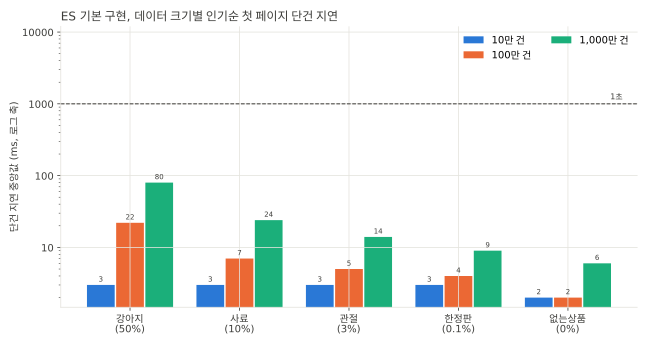
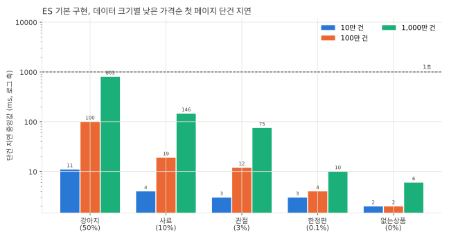
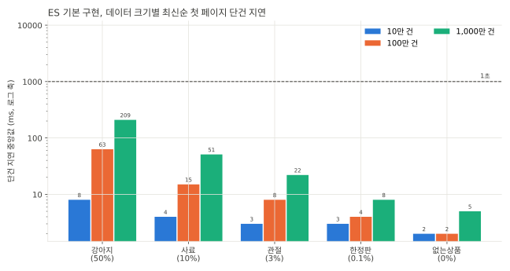
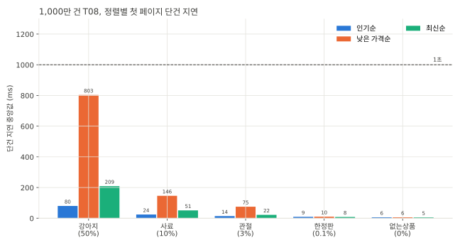
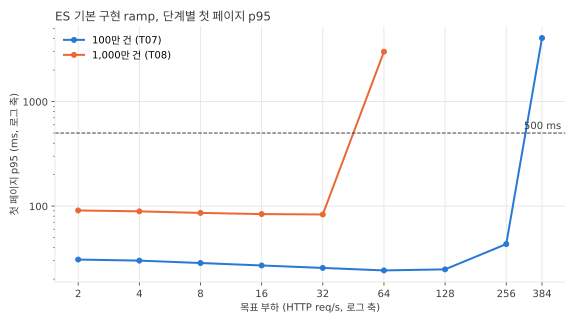
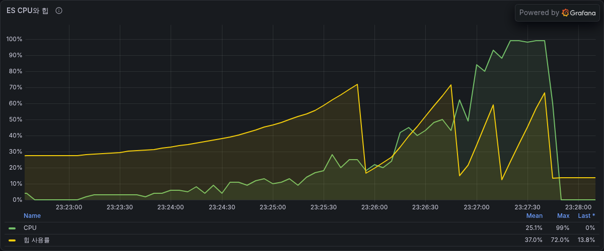
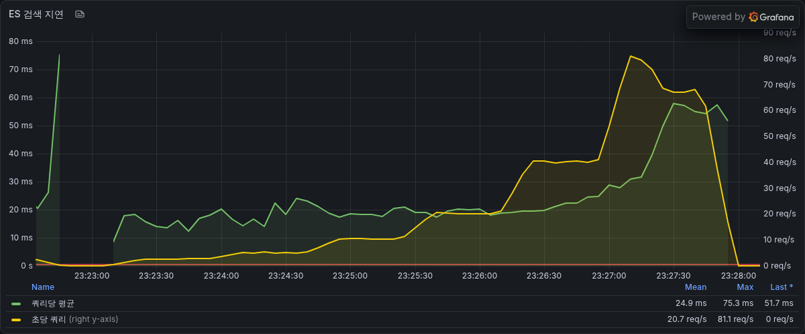
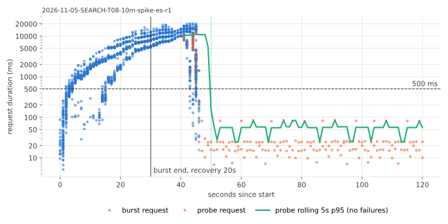
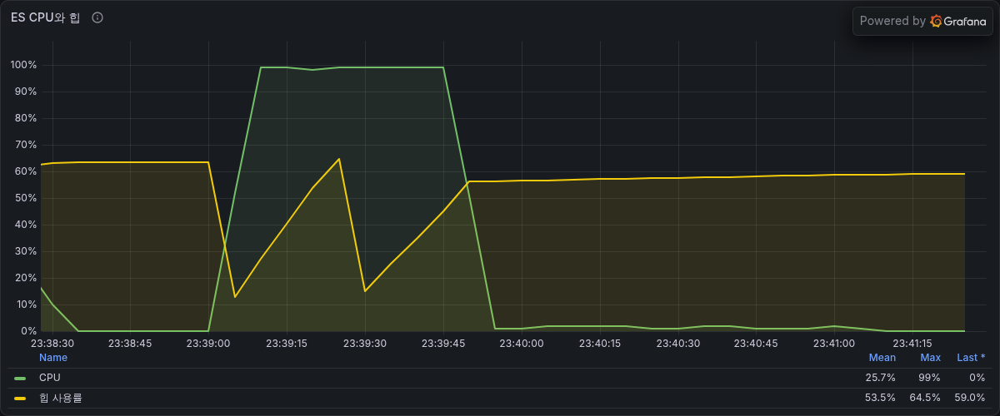
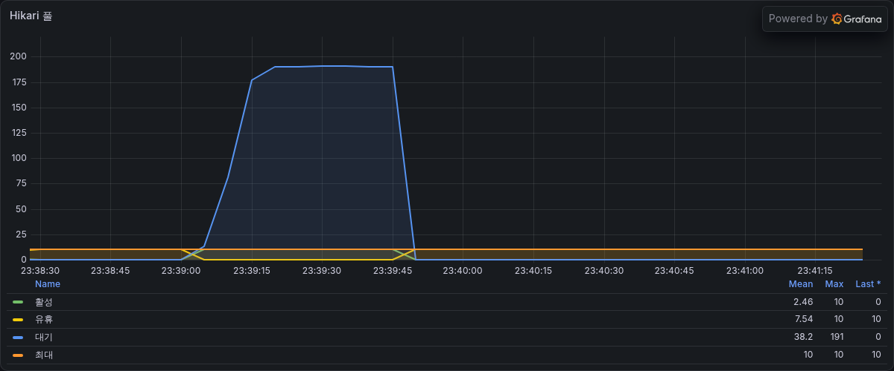

# SEARCH-T08 Elasticsearch 1,000만 건

2026-11-05에 AWS perf 스택에서 T07의 Elasticsearch 검색을 바꾸지 않고 상품 1,000만 건에서 잰 기록이다. MySQL 경로는 재지 않았다. 지연은 ms, 요청률은 초당 HTTP 요청 수(req/s)다. run별 전체 표는 `SEARCH-T08.md`에 있고 10만 건과 100만 건 수치는 T07 보고서 값이다.

## 요약

- 상품 1,000만 건에서 ES 기본 구현의 한계를 쟀다. 앱 코드는 T07 그대로이고 측정 도구와 perf terraform에 1,000만 건 데이터셋을 더했다. 이 결과가 ES 최적화 단계(T10)의 기준선이다.
- 부하 없이 보낸 첫 페이지는 모든 검색어와 정렬에서 1초 안이었다. 가장 느린 것은 강아지 낮은 가격순 803ms이고 같은 검색어의 인기순은 80ms, 최신순은 209ms다.
- 상품이 10배가 될 때 느려진 정도가 정렬마다 다르다. 강아지 첫 페이지 기준으로 낮은 가격순은 8.0배, 인기순은 3.6배, 최신순은 3.3배다.
- 최대 안정 요청률과 처리 가능 요청률이 32 req/s다(100만 건 256 req/s). 64 req/s 단계에서 ES 호스트 CPU가 100%에 닿아 실제 처리량이 57 req/s에 머물렀다. 요청 하나에 쓰는 ES CPU는 0.024초로 100만 건(0.005초)의 약 5배다.
- 22.4 req/s steady에서 첫 페이지 p95는 80ms이고 반복 사이 폭은 0.2%다. 가격 범위를 걸고 낮은 가격순으로 보는 필터 첫 페이지는 p95가 407ms에서 497ms, p99가 1.1초였다.
- 96 req/s spike는 실패 없이 끝났지만 burst 동안 첫 페이지 p95가 15초였다. ES가 포화된 동안 요청이 DB 커넥션 대기열에 쌓였고(Hikari 대기 최대 191) 이 대기에는 ES 3초 타임아웃이 걸리지 않는다.
- 재색인은 9분 50초(초당 약 1만 7천 건)가 걸렸고 색인은 1,631MB로 100만 건의 10배다.

## 가설

10만 건에서 100만 건으로 늘어난 비율을 이으면 1,000만 건에서는 강아지 낮은 가격순 첫 페이지와 2쪽이 1초 안팎, 최신순 2쪽이 0.6초 안팎, 인기순 첫 페이지가 150ms에서 200ms가 되고 처리 가능 요청률이 수십 req/s로 떨어질 것이다.

## 변경 내용

앱 코드는 바꾸지 않았다. T07 jar(`235e95a53568`)를 그대로 쓰고 측정 도구와 perf terraform만 고쳤다.

- perf terraform의 `datasets`에 10m을 더해 RDS `aechak-perf-10m`(db.m7g.large, 저장 공간 40GB)을 만들었다. 저장 공간은 데이터 크기별 값(`db_storage_gb`)으로 정하고 목록에 없는 크기는 지금처럼 20GB다.
- seed.sql의 번호 생성기는 100만 개까지만 만들었다. 100만 개를 넘으면 백만 단위 블록을 더해 채우게 했다. 10만 건과 100만 건은 만드는 번호가 그대로다.
- run.sh, remote.sh, apihost/restart.sh, monitoring/targets.sh가 10m 데이터셋을 받는다. 10m은 100만 건처럼 클라이언트 타임아웃 30초, sequential 3회 반복이다.
- `make reindex`의 api 준비 대기를 2시간까지 늘렸다. 시작 직후 재색인은 끝나야 api가 준비 상태가 되는데 대기가 240초라 1,000만 건 재색인(9분 50초)에서 kit이 실패로 처리했다. 이번 재색인은 고치기 전에 돌았고 api 안에서는 끝까지 진행돼 문서 수 1,000만 건을 확인했다.

## 환경

- T07과 같은 perf 측정층(api m7i.large, 러너 c7g.large, RDS db.m7g.large, MySQL 8.4)과 ES 호스트(m7g.large, vCPU 2, 메모리 8GB)다. Elasticsearch 9.2.6 단일 노드를 힙 4GB로 띄웠고 색인은 샤드 1개, 복제 0개다. api 컨테이너는 1코어, 2GB로 제한했다.
- DB에는 `ddl/SEARCH-T06.sql`만 적용했다. 재색인이 이 DDL이 더하는 리뷰 수 컬럼을 읽는다. T07의 10만 건과 100만 건에는 FULLTEXT 인덱스도 있었지만 es 변형의 상품 검색은 DB에서 상품을 읽지 않는다.
- 기준 요청률은 이 데이터의 ramp가 정한 최대 안정 요청률 32 req/s다. steady는 0.7배인 22.4 req/s, spike는 3배인 96 req/s를 30초 보낸다. T07은 T06 기준(100만 건 4 req/s)을 그대로 써서 steady와 spike 요청률이 다르다.
- ramp 단계는 2 req/s부터 512 req/s까지 열어 두었고 64 req/s에서 실패해 멈췄다. 클라이언트 타임아웃은 30초다.
- 23:12부터 23:50까지 쟀다. 재색인은 측정 직전 23:00에 했다.
- 측정 jar는 `235e95a53568`이고 kit 해시는 1,000만 건 분기를 더해 T07과 다른 c50cf4f96345다.

## 데이터 준비

| 단계 | 걸린 시간 | 비고 |
|---|---|---|
| RDS 생성 (terraform) | 8분 19초 | |
| 시드 | 5분 14초 | 상품 1,000만 건, 상품 통계 600만 건 |
| manifest | 5분 17초 | |
| 기준 스냅샷 | 9분 4초 | `aechak-perf-10m-baseline` |
| T06 DDL | 3분 33초 | 리뷰 수 컬럼 추가와 채우기, 정렬 인덱스 셋 |
| ES 재색인 | 9분 50초 | 앱 로그 기준 |

- products 테이블은 2,715MB, product_stats는 405MB다. 측정이 끝날 때 RDS 저장 공간은 40GB 가운데 약 6.6GB를 썼다.
- 검색어별 일치 상품 수는 100만 건의 정확히 10배다(강아지 470만, 사료 100만, 관절 26만 6,667, 한정판 1만).

## 측정 결과

### 재색인과 색인 크기

| 데이터 | 문서 수 | 재색인 시간 (앱 로그) | 초당 문서 수 | 색인 크기 |
|---|---|---|---|---|
| 10만 건 | 100,000 | 12.4초 | 약 8천 | 16MB |
| 100만 건 | 1,000,000 | 61.9초 | 약 1만 6천 | 162MB |
| 1,000만 건 | 10,000,000 | 589.6초 | 약 1만 7천 | 1,631MB |

- 색인 크기는 측정을 모두 마친 뒤 값이다. 1,000만 건 색인은 세그먼트 16개였다.
- 측정 뒤 ES 호스트 메모리는 사용 4,923MB(힙 4GB 포함), 페이지 캐시 2,245MB, 사용 가능 2,674MB였다. 색인이 페이지 캐시보다 작다.
- 재색인은 kit 준비 대기(240초)를 넘겨 kit이 실패로 처리했지만 api 안에서는 끝까지 진행됐다. 앱 로그의 `SEARCH_REINDEX_DONE`과 색인 문서 수 10,000,000으로 확인했다.

### 크기별 단건 지연

sequential은 부하 없이 요청을 하나씩 보낸다. 값은 중앙값이고 괄호 안은 seed에서 상품명이 일치하는 비율이다.







| 검색어 | 정렬 | 10만 건 | 100만 건 | 1,000만 건 | 100만 건 대비 |
|---|---|---|---|---|---|
| 강아지 (50%) | 인기순 | 3 | 22 | 80 | 3.6배 |
| 강아지 (50%) | 낮은 가격순 | 11 | 100 | 803 | 8.0배 |
| 강아지 (50%) | 최신순 | 8 | 63 | 209 | 3.3배 |
| 사료 (10%) | 인기순 | 3 | 7 | 24 | 3.4배 |
| 사료 (10%) | 낮은 가격순 | 4 | 19 | 146 | 7.7배 |
| 사료 (10%) | 최신순 | 4 | 15 | 51 | 3.4배 |
| 관절 (3%) | 인기순 | 3 | 5 | 14 | 2.8배 |
| 관절 (3%) | 낮은 가격순 | 3 | 12 | 75 | 6.3배 |
| 관절 (3%) | 최신순 | 3 | 8 | 22 | 2.8배 |
| 한정판 (0.1%) | 인기순 | 3 | 4 | 9 | |
| 한정판 (0.1%) | 낮은 가격순 | 3 | 4 | 10 | |
| 한정판 (0.1%) | 최신순 | 3 | 4 | 8 | |
| 없는상품 (0%) | 인기순 | 2 | 2 | 6 | |
| 없는상품 (0%) | 낮은 가격순 | 2 | 2 | 6 | |
| 없는상품 (0%) | 최신순 | 2 | 2 | 5 | |

2쪽은 첫 페이지의 커서로 보낸 요청이고 전체 개수를 세지 않는다.



| 검색어 | 정렬 | 첫 페이지 | 2쪽 | 100만 건 2쪽 |
|---|---|---|---|---|
| 강아지 | 인기순 | 80 | 14 | 7 |
| 강아지 | 낮은 가격순 | 803 | 814 | 104 |
| 강아지 | 최신순 | 209 | 195 | 76 |
| 사료 | 인기순 | 24 | 14 | 7 |
| 사료 | 낮은 가격순 | 146 | 150 | 21 |
| 사료 | 최신순 | 51 | 50 | 18 |

- 모든 검색어와 정렬의 첫 페이지와 2쪽이 1초 안이다. 가장 느린 것은 강아지 낮은 가격순 2쪽 814ms다.
- 낮은 가격순은 일치 상품 수에 거의 비례해 늘었다. 요청 시각의 유효가격을 스크립트로 계산해 정렬하므로 일치 상품마다 스크립트를 한 번씩 실행한다. 첫 페이지와 2쪽이 같은 비용이다.
- 인기순은 2쪽이 14ms인데 첫 페이지가 80ms다. 첫 페이지만 정확한 전체 개수를 세려고 일치 상품 470만 개를 모두 확인하므로 그 차이가 개수 세기 비용인 것으로 보인다. profile API로 나눠 보지는 않았다.
- 최신순은 첫 페이지와 2쪽이 비슷하다(209ms와 195ms). T07에서 본 것처럼 id 내림차순 정렬에는 상위 후보가 될 수 없는 문서를 건너뛰는 최적화가 거의 듣지 않는 것으로 보인다. 확인하지는 않았다.
- 일치 상품이 없는 검색어도 2ms에서 6ms가 됐다. 원인은 확인하지 않았다.

### ramp



100만 건 열은 T07의 eshigh ramp다.

| 목표 req/s | 100만 건 p95 | 1,000만 건 p95 | 1,000만 건 실제 req/s |
|---|---|---|---|
| 2 | 31 | 91 | 2.02 |
| 4 | 30 | 89 | 3.97 |
| 8 | 28 | 86 | 8.04 |
| 16 | 27 | 84 | 15.84 |
| 32 | 26 | 83 | 31.57 |
| 64 | 24 | 2,999 (dropped 25) | 57.26 |
| 128 | 25 | 재지 않음 | |
| 256 | 43 | 재지 않음 | |
| 384 | 4,056 (실제 331 req/s, dropped 486) | 재지 않음 | |

- 32 req/s까지 모든 단계가 SLO(인기순 첫 페이지 p95 500ms 미만)를 지켰다. 최대 안정 요청률과 처리 가능 요청률이 모두 32 req/s다.
- 64 req/s에서는 실제 처리량이 57 req/s에 머물고 대기가 쌓였다. 실패 응답은 없었지만 dropped가 25라 처리 기준을 지키지 못했다.

단계별 자원 사용은 다음과 같다. ES 호스트와 api CPU는 Prometheus에서 단계 구간의 평균을 다시 읽은 값이다. ES 호스트는 vCPU 2개 전체 대비, api는 컨테이너 한도 1코어 대비다. RDS CPU는 CloudWatch 1분 지표의 시간 가중 평균이다.

| 목표 req/s | 첫 페이지 p95 | ES 호스트 CPU | api CPU | RDS CPU | Hikari 대기 최대 |
|---|---|---|---|---|---|
| 2 | 91 | 3% | 4% | 2.6% | 0 |
| 4 | 89 | 6% | 7% | 3.1% | 0 |
| 8 | 86 | 12% | 9% | 3.3% | 0 |
| 16 | 84 | 21% | 14% | 3.2% | 0 |
| 32 | 83 | 38% (최대 50%) | 21% | 3.3% | 0 |
| 64 | 2,999 | 80% (최대 100%) | 23% | 3.7% | 139 |

| ES CPU와 힙 | ES 검색 지연 |
|---|---|
|  |  |

- ES 호스트 CPU가 요청률에 비례해 오르다 64 req/s에서 포화됐다. 32 req/s 단계에서 요청 하나에 ES CPU 0.024초(평균 38% x vCPU 2개 / 31.57 req/s)를 썼다. 100만 건 256 req/s 단계의 0.005초보다 약 5배 크다. 이 비율이면 vCPU 2개의 상한이 83 req/s 안팎이고 실제로는 57 req/s에서 멈췄다.
- 같은 32 req/s에서 ES 호스트 CPU는 100만 건이 8%, 1,000만 건이 38%였다.
- ES 안의 쿼리 실행 시간은 32 req/s 단계까지 쿼리당 평균 20ms 안팎이었고 64 req/s 단계에서 55ms 안팎까지 올랐다. 100만 건은 384 req/s에서도 8ms 안팎이었다.
- api CPU는 64 req/s에서도 23%이고 RDS CPU는 4% 아래라 병목은 ES 호스트다. 64 req/s에서 커넥션 10개가 모두 바빠지고 Hikari 대기가 139까지 쌓였다.

### steady (22.4 req/s)

| 요청 | 비율 | p50 (반복별) | p95 (반복별) | p99 (반복별) | 최대 (반복별) |
|---|---|---|---|---|---|
| 첫 페이지 (인기순) | 60% | 20, 20, 20 | 81, 80, 80 | 91, 112, 93 | 178, 340, 241 |
| 필터 첫 페이지 (가격 범위, 낮은 가격순) | 20% | 57, 57, 58 | 407, 497, 489 | 1,091, 1,100, 1,110 | 1,166, 1,350, 1,382 |
| 다음 페이지 (인기순) | 20% | 13, 12, 12 | 15, 15, 15 | 23, 23, 23 | 49, 42, 36 |

- 첫 페이지 p95 중앙값은 80ms이고 반복 사이 폭은 0.2%다. 실패는 없다. 부하 없이 잰 강아지 인기순 첫 페이지와 같은 값이다.
- steady r1의 등급별 중앙값은 high 80.3ms, mid 24.2ms, low 15.6ms, rare 10.8ms, none 7.4ms다.
- 필터 첫 페이지는 10,000원에서 80,000원 가격 범위를 걸고 낮은 가격순으로 본다. p99가 세 반복 모두 1.1초이고 최대는 1.4초다. 검색어 비중에서 강아지가 10%라 필터 요청의 p95 위쪽은 강아지 요청으로 보인다.
- 요청당 RDS CPU초는 0.0036, 0.0029, 0.0028이다. 다이제스트의 56%에서 57%가 카테고리 조회다.

### spike (96 req/s 30초)

| burst 실패율 | 탐침 실패율 | 회복 시간 | 첫 페이지 p50/p95/p99/최대 | Hikari 대기 최대 | ES 호스트 CPU 최대 | 상태 코드 |
|---|---|---|---|---|---|---|
| 0% | 0% | 20초 | 3,121/15,008/17,533/19,996 | 191 | 99.9% | 200 3,022건 |



| ES CPU와 힙 | Hikari 풀 |
|---|---|
|  |  |

- 96 req/s는 64 req/s 단계의 실제 처리량(57 req/s)보다 높다. burst가 시작된 뒤 약 40초 동안 ES 호스트 CPU가 99%에 머물렀고 같은 동안 Hikari 대기가 190 안팎이었다. burst 요청의 지연은 시간에 따라 늘어 최대 20초가 됐다.
- burst가 끝나고 20초 뒤 탐침 p95가 500ms 아래로 돌아왔다.
- 실패가 없었던 것은 대기가 ES 호출 앞에서 생겼기 때문이다. 검색 요청은 읽기 트랜잭션을 열 때 DB 커넥션을 받고 ES 응답을 받을 때까지 반납하지 않는다. 커넥션 10개가 모두 ES 응답 대기에 쓰이는 동안 나머지 요청은 커넥션을 받지 못하고 대기했다. ES 호출의 3초 타임아웃에는 이 대기 시간이 들어가지 않고 Hikari 커넥션 대기 상한은 기본값 30초다. 클라이언트 타임아웃도 30초라 20초 대기한 요청도 성공으로 끝났다.

### 가설과 비교

| 항목 | 가설 | 실측 |
|---|---|---|
| 강아지 낮은 가격순 첫 페이지와 2쪽 | 1초 안팎 | 803ms, 814ms |
| 강아지 최신순 2쪽 | 0.6초 안팎 | 195ms |
| 강아지 인기순 첫 페이지 | 150ms에서 200ms | 80ms |
| 처리 가능 요청률 | 수십 req/s | 32 req/s |

- 낮은 가격순과 처리 가능 요청률은 가설에 가까웠다. 인기순 첫 페이지와 최신순 2쪽은 가설의 절반 아래였다.
- 가설은 10만 건에서 100만 건으로 늘어난 비율(인기순 첫 페이지 7.3배, 최신순 2쪽 7.6배)을 그대로 이었다. 100만 건에서 1,000만 건으로는 인기순 첫 페이지가 3.6배, 최신순 2쪽이 2.6배 늘었다. 증가율이 줄어든 원인은 확인하지 않았다.

## 해석

- 일치 상품 수를 따르는 비용이 1,000만 건에서 드러났다. T07에서 ES 비용은 전체 상품 수가 아니라 일치 상품 수를 따른다고 봤고 1,000만 건에서는 강아지 일치 상품이 470만 개다. 일치 상품마다 스크립트를 실행하는 낮은 가격순이 가장 크게 늘었다(8.0배).
- 남은 비용은 정렬과 첫 페이지 개수 세기에 있다. 같은 강아지 검색이 정렬만 바꿔 80ms, 209ms, 803ms이고 인기순은 개수를 세지 않는 2쪽이 14ms다.
- 처리 한계는 ES 호스트 CPU다. 64 req/s 단계에서 ES CPU가 100%에 닿을 때 api CPU는 23%, RDS CPU는 3.7%였다. 요청 하나의 ES CPU가 100만 건의 약 5배이고 처리 가능 요청률은 256 req/s에서 32 req/s로 내려왔다(64 req/s 단계의 실제 처리량은 57 req/s).
- 부하 안에서는 필터를 건 낮은 가격순이 먼저 1초를 넘는다. 22.4 req/s에서 인기순 첫 페이지 p99는 112ms 이하였지만 필터 첫 페이지 p99는 1.1초였다.
- ES가 포화되면 대기가 DB 커넥션 풀에 쌓이고 ES 타임아웃이 걸리지 않는다. T07에서 본 구조가 1,000만 건 spike에서 20초 대기로 나타났다. 클라이언트가 30초보다 먼저 끊으면 서버는 이미 끊긴 요청을 계속 처리할 수 있다.

## 결정

- T08은 측정만 남긴다. 앱 코드는 바꾸지 않았다.
- 1,000만 건에서도 부하 없는 첫 페이지는 모두 1초 안이고 SLO는 32 req/s까지 지켰다. 낮은 가격순(803ms)과 필터 첫 페이지(p99 1.1초)는 여유가 없다.
- ES 최적화 단계(T10)는 이 결과를 기준선으로 삼는다. 이번 결과에서 본 후보는 낮은 가격순 스크립트 정렬, 첫 페이지 개수 세기, id 내림차순 정렬, ES 응답을 기다리는 동안 반납하지 않는 DB 커넥션이다.
- 1,000만 건 색인(1.6GB)은 ES 호스트의 페이지 캐시 안에 들어가는 크기다. 1억 건이면 색인이 16GB 안팎이라 지금 ES 호스트(메모리 8GB, 힙 4GB)의 메모리를 넘는다.

## 측정의 한계

- MySQL 경로는 재지 않았다. 1,000만 건에서 T06과 비교한 값이 없다.
- 응답 동등성(equiv)은 확인하지 않았다. 1,000만 건에서 MySQL 기준 응답을 받지 않았고 재색인 문서 수가 상품 수와 같은지만 봤다.
- 상품명은 시드 번호에서 짧은 주기로 만든 합성 데이터다. 색인에 들어가는 조각 종류가 적고 조각마다 상품 목록이 길다. 실제 상품명처럼 어휘가 다양하면 색인 크기와 검색 비용이 달라진다.
- ES는 단일 노드, 샤드 1개, 복제 0이다. 샤드를 나누거나 노드를 늘린 구성은 재지 않았다.
- steady와 spike 요청률이 데이터 크기마다 다르다(1,000만 건은 자기 ramp 기준 32 req/s, 100만 건은 T06 기준 4 req/s). 크기 사이 비교는 sequential과 ramp 값으로만 했다.
- 최대 안정 요청률은 32 req/s와 64 req/s 사이에 있다. 그 사이 요청률은 재지 않았다.
- 요청당 ES CPU초는 ES 호스트 전체 CPU로 계산해 수집기와 ES 자체의 유휴 부하가 들어 있다.
- 재색인은 kit의 준비 대기를 고치기 전에 돌았다. 재색인 시간은 앱 로그 값이고 kit의 `REINDEX_DONE` 줄은 없다.
- ES 호스트의 디스크 읽기는 보지 않았다. 색인이 페이지 캐시보다 작다는 것만 확인했다.
- ramp, spike, sequential은 한 번씩 돌렸다.

## 재현

```bash
cd loadtest/terraform && terraform apply -var es_enabled=true   # datasets 기본값에 10m이 있다
cd ../search && make outputs
make up DATASET=10m
make init DATASET=10m REV=6dce8608b83c-dirty-5c874761
# 러너에서 T06 DDL만 넣고 체크섬을 남긴다(아래 참고)
make reindex DATASET=10m REV=235e95a53568
make variant STEP=SEARCH-T08 DATASET=10m VARIANT=es REV=235e95a53568 DDL="SEARCH-T06" ENV=AECHAK_SEARCH_ENGINE=es RAMP_RATES="2 4 8 16 32 64 128 256 384 512" CELLS="ramp steady spike sequential"
```

`make init`은 100만 건과 10만 건을 처음 만든 T00 jar로 스키마를 만든다. 재색인 전에 러너(`make shell-runner`)에서 T06 DDL을 넣고 kit이 쓰는 체크섬을 기록한다.

```bash
cd /opt/perf/kit/search && . lib/common.sh && resolve_env 10m >/dev/null
echo 'CREATE TABLE IF NOT EXISTS perf_applied_ddl (id VARCHAR(64) NOT NULL PRIMARY KEY, sha256 CHAR(64) NOT NULL, applied_at DATETIME(6) NOT NULL)' | sql
sql < ddl/SEARCH-T06.sql
printf "INSERT INTO perf_applied_ddl VALUES ('SEARCH-T06', '%s', NOW(6))\n" "$(sha256_file ddl/SEARCH-T06.sql)" | sql
```
