# SEARCH-T10 Elasticsearch 검색 튜닝

2026-11-06에 AWS perf 스택에서 T07의 Elasticsearch 검색을 레버 하나씩 바꿔 가며 상품 1,000만 건에서 잰 기록이다. 기준선은 같은 데이터에서 T07 jar로 잰 T08이다. 지연은 ms, 요청률은 초당 HTTP 요청 수(req/s)다. run별 전체 표는 `SEARCH-T10.md`에 있다.

## 요약

- T07의 Elasticsearch 검색을 레버 다섯 개로 고쳐 상품 1,000만 건에서 다시 쟀다. 검색 결과는 T07과 같다(고정 요청 384개의 응답 비교, JPA 어댑터와 비교하는 통합 테스트).
- 부하 없이 보낸 강아지 첫 페이지가 인기순 80ms에서 15ms, 낮은 가격순 803ms에서 29ms, 최신순 209ms에서 12ms가 됐다. 2쪽은 낮은 가격순 814ms에서 30ms, 최신순 195ms에서 12ms다. 관절 낮은 가격순은 75ms에서 27ms다.
- 22.4 req/s steady에서 첫 페이지 p95가 80ms에서 25ms, 가격 범위 필터 첫 페이지 p95가 407ms에서 497ms였던 것이 93ms에서 98ms, p99가 1.1초에서 124ms에서 132ms가 됐다. ES 호스트 CPU는 33%에서 23%로 줄었다.
- 최대 안정 요청률이 32 req/s에서 64 req/s가 됐다. 128 req/s 단계에서 ES 호스트 CPU가 100%에 닿았고 실제 처리량은 96 req/s였다(T08 포화 때 57 req/s). 요청 하나의 ES CPU는 0.024초에서 0.018초다.
- 96 req/s spike에서 첫 페이지 p95가 15초에서 229ms, 회복 시간이 20초에서 1초, DB 커넥션 대기 최대가 191에서 5가 됐다.
- 중간에 예상과 다른 결과가 셋 나왔다. 요청 시각을 고정한 실험이 캐시 때문에 실제보다 빨라 L1이 회귀했다. 색인 정렬(L2)만 넣으면 steady가 나빠졌다. 일치 상품이 적은 관절에서는 할인 조건 하나가 175ms를 썼다. L4와 L5는 이 원인을 찾은 뒤 더한 레버다.

## 가설

T08에서 1,000만 건의 남은 비용은 정렬과 첫 페이지 개수 세기에 있었다. 레버를 넣기 전에 ES 호스트에서 쿼리를 직접 보내 비용을 나눠 봤다(9회 중앙값, ES 응답의 took).

| 요청 (강아지, 상위 21개) | took |
|---|---|
| 인기순 첫 페이지 (개수 포함) | 82에서 100 |
| 인기순, 개수 없음 (2쪽과 같은 모양) | 18 |
| 같은 조건의 개수만 (크기 0) | 1 (요청 캐시) |
| 최신순 첫 페이지 | 183 |
| 최신순, 개수 없음 | 163 |
| 낮은 가격순 첫 페이지 (스크립트 정렬) | 815 |
| 낮은 가격순을 할인 중인 상품과 나머지로 나눈 두 요청 (개수 포함) | 85, 63 |
| 같은 두 요청, 개수 없음 | 11, 9 |
| 상품명 구문 일치만 (필터 없음, 개수 포함) | 80 |
| 2글자 조각 하나와 필터 (개수 포함) | 72 |

- 낮은 가격순 비용은 스크립트 정렬에서 나온다. 할인 여부로 나눠 색인 필드로 정렬하면 첫 페이지 803ms가 100ms 안팎, 2쪽 814ms가 20ms 안팎이 될 것이다.
- 최신순은 개수를 세지 않아도 163ms다. 문서가 id 오름차순으로 색인돼 id 내림차순 정렬이 상위 후보가 아닌 문서를 건너뛰지 못한다. 색인을 id 내림차순으로 정렬해 저장하면 2쪽이 20ms 아래가 될 것이다.
- 인기순 첫 페이지 비용의 대부분은 일치 문서 470만 개를 세는 데 든다. 개수를 크기 0 요청으로 나누면 ES 요청 캐시가 같은 개수를 재사용해 첫 페이지가 2쪽 수준(20ms 안팎)이 될 것이다.
- 상품명을 3글자 조각으로 찾는 레버는 뺐다. 2글자 조각 하나로 찾아도 필터가 있으면 72ms라 구문 일치(82에서 100ms)보다 크게 싸지 않다.
- 처리 가능 요청률은 요청 하나의 ES CPU가 줄어 32 req/s에서 128 req/s 이상이 될 것이다.

이 표는 같은 요청을 요청 시각(now)까지 똑같이 9번 보내 잰 값이다. 뒤에서 보듯 낮은 가격순 두 요청의 85ms와 63ms는 이 방식 때문에 실제보다 작게 나왔다.

## 변경 내용

레버마다 커밋 하나로 넣고 그 커밋으로 만든 jar로 쟀다. 앞 레버를 그대로 두고 다음 레버를 더하는 순서다.

| 레버 | 커밋 | 바꾼 것 |
|---|---|---|
| L1 가격 정렬 분할 | 15fc78db | 낮은 가격순을 요청 시각에 할인 중인 상품(할인가 정렬)과 나머지(정가 정렬) 두 요청으로 받아 합친다. 스크립트 정렬을 뺐다 |
| L2 색인 정렬 | 31d5b318 | 색인을 id 내림차순으로 정렬해 저장한다(`index.sort`). 재색인이 필요하다 |
| L3 개수 분리 | f633570a | 가격 필터가 없는 첫 페이지의 총개수를 크기 0 요청으로 따로 센다. ES 요청 캐시가 같은 요청의 개수를 재사용한다 |
| L4 개수 뺄셈 | 96ab7966 | 결과 요청은 늘 개수를 세지 않는다. 가격 필터가 있으면 개수를 (할인 중이고 할인가가 범위 안) + (정가가 범위 안) - (할인 중이고 정가가 범위 안)으로 센다 |
| L5 정가 쪽 조건 | 533fc297 | 할인 중이 아닌 상품을 할인 중 조건의 `must_not` 대신 (할인가 없음) 또는 (시작이 요청 시각 뒤) 또는 (끝이 요청 시각 앞)으로 거른다. 가격 필터 개수는 할인 중인 쪽과 아닌 쪽 두 요청의 합으로 센다 |

- L1부터 L3까지는 측정 전에 정한 레버다. L4는 L1이 오히려 느려진 원인을 찾은 뒤에, L5는 L3를 잰 뒤 관절 낮은 가격순이 T08보다 느린 것을 보고 더했다. 찾은 과정은 측정 결과의 과정 절에 적었다.
- 앱의 검색 결과는 바뀌지 않는다. L1, L2, L4, L5 jar로 고정 요청 384개(검색어, 정렬, 필터, 쪽 조합)를 보내 응답의 상품 id 목록, 총개수, 다음 페이지 여부를 T07 jar 응답과 비교했고 모두 같았다. L3는 L4가 개수 세는 방식을 다시 바꿔 따로 비교하지 않았다.
- JPA 어댑터와 결과를 비교하는 통합 테스트가 L5에서 통과한다. 할인 시작 경계를 1마이크로초 틀리게 바꾸거나 가격 필터 개수에서 할인 조건을 빼면 이 테스트가 실패하는 것도 확인했다.

## 환경

- T08과 같은 perf 측정층(api m7i.large, 러너 c7g.large, RDS db.m7g.large, MySQL 8.4)과 ES 호스트(m7g.large, vCPU 2, 메모리 8GB)다. Elasticsearch 9.2.6 단일 노드를 힙 4GB로 띄웠고 색인은 샤드 1개, 복제 0개다. 데이터는 T08의 RDS `aechak-perf-10m`(상품 1,000만 건)을 그대로 썼다.
- L1은 T08 색인(T07 매핑, 세그먼트 16개)에서 쟀다. L2부터는 L2 jar로 다시 만든 색인(id 내림차순 정렬, 1,656MB, 세그먼트 18개)을 썼다. 재색인은 api 재시작을 포함해 621초였다.
- 레버마다 api를 그 레버의 jar로 다시 띄운 뒤 2 req/s로 60초 데우고 steady(22.4 req/s, 180초)를 3번, sequential을 1번 돌렸다. L5는 T08과 같은 전체 셀(ramp, steady, spike, sequential)을 돌렸다. 기준 요청률은 T08과 같은 32 req/s다(steady 0.7배, spike 3배).
- ES에 직접 보낸 실험은 측정 트래픽이 없는 동안 ES 호스트에서 `curl`로 보냈다. 요청 캐시를 끄고(`request_cache=false`) 요청 시각을 요청마다 바꿔 9번 보낸 took 중앙값이다. 가설 표만 요청 시각을 고정했다.
- 00:30부터 04:05까지 쟀다. 동등성 비교와 L1을 T08 색인에서 먼저 재고 01:04에 L2 jar로 재색인한 뒤 L2부터 L5를 쟀다.
- 측정 jar는 레버 커밋으로 만든 15fc78db721f, 31d5b3188453, f633570a0165, 96ab796662af, 533fc2978da2다.

## 측정 결과

### 레버별 단건 지연

sequential은 부하 없이 요청을 하나씩 보낸다. 값은 중앙값이고 T08 열은 T08 보고서 값이다.

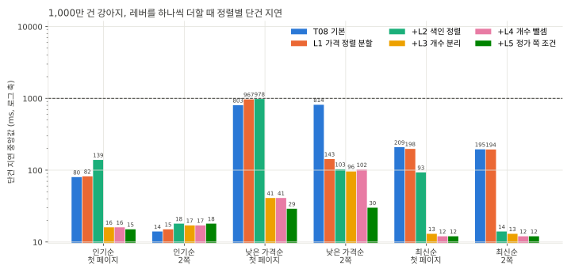

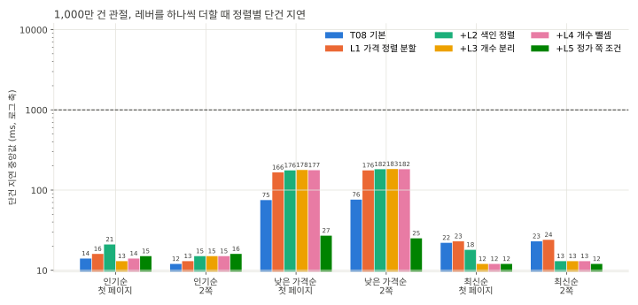

| 검색어 | 정렬 | 쪽 | T08 | L1 | L2 | L3 | L4 | L5 |
|---|---|---|---|---|---|---|---|---|
| 강아지 | 인기순 | 첫 페이지 | 80 | 82 | 139 | 16 | 16 | 15 |
| 강아지 | 인기순 | 2쪽 | 14 | 15 | 18 | 17 | 17 | 18 |
| 강아지 | 낮은 가격순 | 첫 페이지 | 803 | 967 | 978 | 41 | 41 | 29 |
| 강아지 | 낮은 가격순 | 2쪽 | 814 | 143 | 103 | 96 | 102 | 30 |
| 강아지 | 최신순 | 첫 페이지 | 209 | 198 | 93 | 13 | 12 | 12 |
| 강아지 | 최신순 | 2쪽 | 195 | 194 | 14 | 13 | 12 | 12 |
| 사료 | 인기순 | 첫 페이지 | 24 | 25 | 29 | 16 | 15 | 16 |
| 사료 | 인기순 | 2쪽 | 14 | 14 | 17 | 16 | 16 | 17 |
| 사료 | 낮은 가격순 | 첫 페이지 | 146 | 673 | 574 | 35 | 39 | 29 |
| 사료 | 낮은 가격순 | 2쪽 | 150 | 143 | 100 | 99 | 99 | 30 |
| 사료 | 최신순 | 첫 페이지 | 51 | 49 | 20 | 12 | 12 | 12 |
| 사료 | 최신순 | 2쪽 | 50 | 50 | 13 | 13 | 13 | 14 |
| 관절 | 인기순 | 첫 페이지 | 14 | 16 | 21 | 13 | 14 | 15 |
| 관절 | 인기순 | 2쪽 | 12 | 13 | 15 | 15 | 15 | 16 |
| 관절 | 낮은 가격순 | 첫 페이지 | 75 | 166 | 176 | 178 | 177 | 27 |
| 관절 | 낮은 가격순 | 2쪽 | 76 | 176 | 182 | 183 | 182 | 25 |
| 관절 | 최신순 | 첫 페이지 | 22 | 23 | 18 | 12 | 12 | 12 |
| 관절 | 최신순 | 2쪽 | 23 | 24 | 13 | 13 | 13 | 12 |
| 한정판 | 인기순 | 첫 페이지 | 9 | 10 | 13 | 13 | 13 | 13 |
| 한정판 | 인기순 | 2쪽 | 12 | 12 | 15 | 14 | 14 | 15 |
| 한정판 | 낮은 가격순 | 첫 페이지 | 10 | 16 | 19 | 20 | 21 | 18 |
| 한정판 | 낮은 가격순 | 2쪽 | 10 | 17 | 20 | 21 | 20 | 19 |
| 한정판 | 최신순 | 첫 페이지 | 8 | 8 | 13 | 12 | 12 | 11 |
| 한정판 | 최신순 | 2쪽 | 10 | 10 | 13 | 12 | 12 | 13 |
| 없는상품 | 인기순 | 첫 페이지 | 6 | 6 | 6 | 6 | 6 | 6 |
| 없는상품 | 낮은 가격순 | 첫 페이지 | 6 | 7 | 7 | 7 | 7 | 7 |
| 없는상품 | 최신순 | 첫 페이지 | 5 | 6 | 6 | 7 | 6 | 6 |

- sequential은 같은 검색어와 정렬을 3번씩 보낸다. L3부터 첫 페이지 개수는 같은 조건의 앞 요청이 남긴 요청 캐시에서 나온다. 캐시가 없을 때의 개수 비용은 과정 3에 적었다.
- L1은 낮은 가격순 2쪽만 줄였다(강아지 814ms에서 143ms). 첫 페이지는 개수를 세는 비용 때문에 967ms로 오히려 느려졌다(과정 1).
- L2는 최신순을 줄였다. 강아지 2쪽이 194ms에서 14ms, 첫 페이지가 198ms에서 93ms다. 인기순 첫 페이지는 82ms에서 139ms로 느려졌다(과정 3).
- L3는 첫 페이지 개수를 결과 요청과 나눠 세서 강아지 인기순 첫 페이지 139ms를 16ms, 최신순 93ms를 13ms, 낮은 가격순 978ms를 41ms로 줄였다.
- L4는 가격 필터가 있는 첫 페이지만 바꿨다. sequential에는 가격 필터가 없어 L3와 같다.
- L5는 낮은 가격순의 할인 중이 아닌 쪽 요청을 싸게 만들었다. 관절 첫 페이지가 177ms에서 27ms, 강아지 2쪽이 102ms에서 30ms가 됐다(과정 4).
- 일치 상품이 적은 검색어는 L1 뒤로 몇 ms씩 느려졌다. 한정판 인기순 첫 페이지는 9ms에서 13ms다. 관절과 한정판의 낮은 가격순은 과정 4에서 다룬다.

### 과정 1. L1이 오히려 느려졌다

가설대로라면 L1은 강아지 낮은 가격순 첫 페이지를 100ms 안팎으로 줄여야 했다. 실제로는 967ms로 T08(803ms)보다 느렸고 사료는 146ms에서 673ms, 관절은 75ms에서 166ms가 됐다. steady에서는 가격 범위를 건 필터 첫 페이지 p50이 57ms에서 255ms 안팎으로 올랐고 ES 호스트 CPU도 33%에서 55%가 됐다. 2쪽만 814ms에서 143ms로 줄었다.

요청 시각을 요청마다 바꿔 같은 요청을 다시 쟀다.

| 요청 (강아지, 개수 포함) | took |
|---|---|
| 스크립트 정렬 한 요청 (T07) | 922 |
| 할인 중인 쪽 | 187 |
| 할인 중이 아닌 쪽 (할인 중 조건을 `must_not`으로) | 954 |
| 할인 중인 쪽, 개수 없음 | 34 |

- 가설 표의 85ms와 63ms는 같은 요청을 요청 시각까지 똑같이 보낸 값이다. 할인 기간 조건(시작이 요청 시각 이전, 끝이 요청 시각 이후)이 요청마다 같아서 ES 쿼리 캐시가 이 조건의 결과를 다시 쓴 것으로 보인다. 앱은 요청마다 그 시각을 보내므로 실제 요청에서는 이 캐시를 쓸 수 없다.
- 요청 시각을 바꾸자 할인 중이 아닌 쪽 요청이 954ms였다. 이 요청은 할인 중인 상품을 `must_not`으로 빼면서 나머지 일치 상품을 모두 센다.
- 할인 조건을 1시간 단위 경계로 나눠 같은 시간대의 요청이 같은 조건을 쓰게 하는 방법도 시도했다. 할인 중이 아닌 쪽이 831ms로 거의 줄지 않아 쓰지 않았다.
- 그래서 결과 요청에서 개수를 빼고 개수는 따로 세게 했다(L3, L4). 가격 필터 개수는 `must_not` 없이 세 요청의 뺄셈으로 셌다(L4). 강아지와 가격 10,000원에서 80,000원 필터로 잰 세 요청은 82ms, 47ms, 80ms였고 같은 개수를 `must_not`으로 세면 400ms였다. 47ms 요청은 요청 시각과 무관해 요청 캐시를 쓸 수 있다.

### 과정 2. 예열 조건을 맞춰 L2와 L3를 다시 쟀다

L2와 L3는 처음에 60초 예열 뒤 sequential만 돌렸다. L1은 steady 3번 뒤에 sequential을 돌려 예열 조건이 달랐다. 일치 상품이 없는 없는상품 첫 페이지가 L1에서 정렬별로 6ms, 7ms, 6ms였는데 L2에서 14ms, 12ms, 11ms였고 한정판도 8ms에서 16ms 늘었다. 레버와 상관없는 요청까지 같은 폭으로 느려져 예열 차이로 보고 L2와 L3를 L1과 같은 순서(steady 3번 뒤 sequential)로 다시 쟀다. 다시 재니 없는상품이 L2와 L3 모두 6ms에서 7ms로 돌아왔다. 이 보고서의 L2와 L3 값은 다시 잰 값(변형 l2s, l3s)이고 처음 값(l2, l3)도 `SEARCH-T10.md`에 남겼다.

### 과정 3. 색인 정렬이 인기순 첫 페이지를 느리게 했다

L2 뒤 강아지 인기순 첫 페이지가 82ms에서 139ms가 됐다. steady에서도 첫 페이지 p95가 92ms에서 205ms 안팎으로 늘었고(steady 첫 페이지는 모두 인기순이다) ES 호스트 CPU는 55%에서 62%였다. 색인 정렬 전 값은 가설 표의 값이다.

| 요청 (강아지) | 색인 정렬 전 | 색인 정렬 뒤 |
|---|---|---|
| 인기순 첫 페이지 (개수 포함) | 82에서 100 | 133 |
| 인기순, 개수 없음 | 18 | 9 |
| 개수만 (크기 0, 요청 캐시 끔) | 재지 않음 | 65 |
| 최신순 첫 페이지 (개수 포함) | 183 | 85 |
| 최신순, 개수 없음 | 163 | 5 |

- 개수를 세지 않는 요청은 모두 빨라졌다. 최신순은 색인 순서대로 읽다가 21개에서 멈춰 163ms가 5ms가 됐다.
- 색인 순서와 다른 정렬(인기순)로 상위 21개를 고르면서 일치 문서 470만 개를 모두 세는 요청만 느려졌다. 원인은 확인하지 않았다.
- L3가 개수를 크기 0 요청으로 나눈 뒤에는 결과 요청(9ms)과 개수 요청(65ms, 요청 캐시에 있으면 1ms 안팎)이 함께 나가 캐시가 없어도 T08의 80ms보다 짧다. 색인 정렬의 이득은 L3와 같이 넣어야 남는다.

### 과정 4. 관절 낮은 가격순을 L5로 줄였다

L3까지 넣었을 때 강아지 낮은 가격순 첫 페이지는 50ms가 됐지만 관절은 180ms로 T08(75ms)보다 느렸다. 한정판도 10ms에서 27ms였다. L1 뒤로 계속 그랬다. 낮은 가격순의 두 요청을 개수 없이 ES에 직접 보내 나눠 봤다.

| 요청 (개수 없음) | 관절 | 강아지 |
|---|---|---|
| 할인 중인 쪽 | 18 | 21 |
| 할인 중이 아닌 쪽, 할인 중 조건을 `must_not`으로 | 175 | 34 |
| 할인 중이 아닌 쪽, (할인가 없음) 또는 (시작이 요청 시각 뒤) 또는 (끝이 요청 시각 앞) | 16 | 18 |
| 스크립트 정렬 한 요청 (T07) | 54 | 649 |

- 느린 쪽은 할인 중이 아닌 쪽이었다. 할인 중 조건은 할인가가 있고 시작이 요청 시각 이전이고 끝이 요청 시각 이후인 상품이다. 시드는 상품의 30%가 할인 중이고 할인 기간이 측정 기간을 모두 포함해서 시작과 끝 조건이 할인 상품 약 300만 개에 맞는다. 요청 시각이 요청마다 달라 이 조건을 캐시하지 못하고 요청마다 다시 확인하는 것으로 보인다.
- 같은 상품을 (할인가 없음) 또는 (시작이 요청 시각 뒤) 또는 (끝이 요청 시각 앞)으로 거르면 시각 조건은 할인 기간 밖의 상품에만 맞는다. 시드에서는 시작 전과 끝난 할인이 각각 상품의 0.1%다. 할인가 없음은 요청 시각과 무관해 캐시에 남는다. 관절 175ms가 16ms, 강아지 34ms가 18ms가 됐다.
- 관절이 강아지보다 크게 느렸던 이유는 확인하지 않았다.

### 과정 5. 가격 필터 개수를 두 요청 합으로 셌다

L5 조건이면 L4가 피했던 할인 중이 아닌 쪽 개수도 바로 셀 수 있다. 가격 10,000원에서 80,000원 필터로 개수 요청을 쟀다.

| 개수 요청 (가격 필터) | 강아지 | 관절 |
|---|---|---|
| 할인 중이고 할인가가 범위 안 | 73 | 39 |
| 정가가 범위 안 (요청 시각과 무관) | 45 | 9 |
| 할인 중이고 정가가 범위 안 | 64 | 38 |
| 할인 중이 아니고 정가가 범위 안, `must_not` | 388 | 90 |
| 할인 중이 아니고 정가가 범위 안, L5 조건 | 72 | 17 |

- 개수 요청들은 함께 나가므로 가장 느린 요청이 지연이 된다. L4 뺄셈은 강아지 73ms, 관절 39ms이고 L5 조건으로 두 요청을 더해도 73ms, 39ms다. 지연이 같고 요청이 하나 적어 L5에서 두 요청 합으로 바꿨다. 강아지에서 두 방식의 할인 중이 아닌 쪽 개수는 965,509개로 같았다.

### 레버별 steady (22.4 req/s)

steady는 22.4 req/s로 180초씩 3번 보낸다. 요청의 60%는 인기순 첫 페이지, 20%는 가격 범위(10,000원에서 80,000원)를 건 낮은 가격순 첫 페이지, 20%는 인기순 다음 페이지다. 값은 세 반복의 범위다. 요청당 ES CPU초는 ES 호스트 CPU 평균 x vCPU 2개 / 초당 요청 수다.

| 단계 | 첫 페이지 p50 / p95 / p99 | 필터 첫 페이지 p50 / p95 / p99 | 다음 페이지 p50 / p95 | ES 호스트 CPU 평균 | 요청당 ES CPU초 |
|---|---|---|---|---|---|
| T08 | 20 / 80에서 81 / 91에서 112 | 57에서 58 / 407에서 497 / 1,091에서 1,110 | 12에서 13 / 15 | 32에서 33% | 0.029에서 0.030 |
| L1 | 25에서 26 / 92에서 97 / 174에서 199 | 251에서 263 / 799에서 818 / 962에서 991 | 13에서 16 / 23에서 32 | 53에서 56% | 0.048에서 0.051 |
| L2 | 30에서 31 / 205에서 226 / 368에서 414 | 287에서 297 / 950에서 1,028 / 1,269에서 1,356 | 17에서 19 / 49에서 52 | 61에서 63% | 0.056에서 0.057 |
| L3 | 18에서 19 / 39에서 42 / 111에서 162 | 258에서 265 / 784에서 921 / 1,060에서 1,194 | 17에서 18 / 28에서 30 | 51에서 52% | 0.046에서 0.047 |
| L4 | 17에서 18 / 74에서 88 / 140에서 154 | 264에서 269 / 473에서 479 / 562에서 597 | 16에서 18 / 21에서 28 | 50에서 52% | 0.045에서 0.047 |
| L5 | 17 / 25 / 31에서 33 | 44에서 45 / 93에서 98 / 124에서 132 | 16에서 17 / 18 | 22에서 23% | 0.020에서 0.020 |

- L1에서 필터 첫 페이지 p50이 57ms에서 251ms에서 263ms로 올랐고 ES 호스트 CPU가 33%에서 55% 안팎이 됐다(과정 1).
- L2에서 첫 페이지 p95가 92ms에서 97ms(L1)에서 205ms에서 226ms로 늘었다. 색인 정렬 뒤 인기순 정렬과 개수를 한 요청에서 하는 비용이 커졌다(과정 3).
- L3에서 첫 페이지 p95가 39ms에서 42ms로 T08(80ms)의 절반이 됐다. 필터 첫 페이지는 결과 요청이 여전히 `must_not`으로 개수를 세서 p95가 784ms에서 921ms였다.
- L4에서 필터 첫 페이지 p95가 473ms에서 479ms, p99가 562ms에서 597ms로 줄었다. 대신 첫 페이지 p95가 74ms에서 88ms로 올랐다. 필터 요청 하나가 ES에 결과 요청 둘과 개수 요청 셋을 함께 보내면서 ES 검색 스레드(4개)의 대기가 늘었다. 한 run에서 검색 스레드가 처리한 작업이 L3 약 17,000개에서 L4 약 21,700개로 늘었고 대기열 평균(5초 간격 표본)은 0.1에서 0.3이던 것이 0.8에서 0.9가 됐다. DB 커넥션 대기는 L3와 L4 모두 0이었다.
- L5에서 필터 첫 페이지 p50이 44ms에서 45ms, p95가 93ms에서 98ms, p99가 124ms에서 132ms가 됐다. 개수 요청이 둘로 줄고 정가 쪽 요청이 싸져 첫 페이지 p95도 25ms로 내려갔다. ES 호스트 CPU는 22%에서 23%, 요청당 ES CPU초는 0.020으로 T08(0.029에서 0.030)의 3분의 2다.

### 최종 상태(L5)와 T08

#### ramp

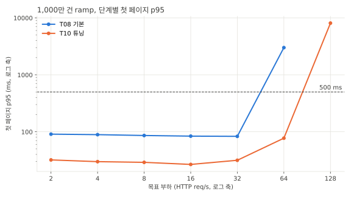

ES 호스트와 api CPU는 Prometheus에서 단계 구간의 평균을 다시 읽은 값이다. ES 호스트는 vCPU 2개 전체 대비, api는 컨테이너 한도 1코어 대비다.

| 목표 req/s | T08 첫 페이지 p95 | L5 첫 페이지 p95 | L5 실제 req/s | T08 ES 호스트 CPU | L5 ES 호스트 CPU | L5 api CPU |
|---|---|---|---|---|---|---|
| 2 | 91 | 32 | 2.02 | 3% | 2% | 6% |
| 4 | 89 | 30 | 3.97 | 6% | 4% | 7% |
| 8 | 86 | 29 | 8.04 | 12% | 8% | 10% |
| 16 | 84 | 27 | 15.84 | 21% | 14% | 13% |
| 32 | 83 | 32 | 31.57 | 38% (최대 50%) | 27% (최대 34%) | 19% |
| 64 | 2,999 (dropped 25) | 77 | 63.12 | 80% (최대 100%) | 57% (최대 67%) | 25% |
| 128 | 재지 않음 | 8,077 (dropped 398) | 96.47 | | 91% (최대 100%) | 33% |

| ES CPU와 힙 | ES 검색 지연 |
|---|---|
| 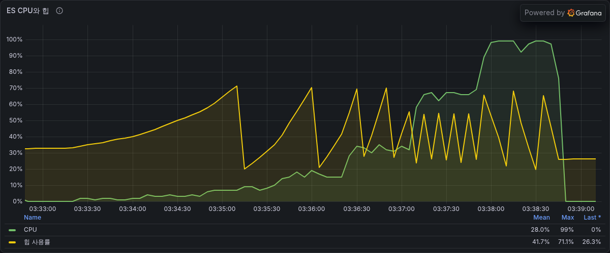 | 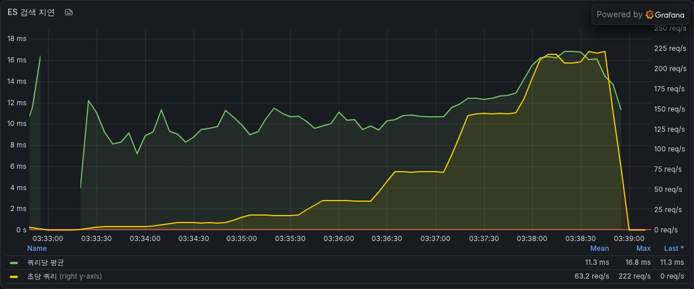 |

- 64 req/s까지 모든 단계가 SLO(인기순 첫 페이지 p95 500ms 미만)를 지켰다. 최대 안정 요청률과 처리 가능 요청률이 모두 64 req/s다(T08 32 req/s).
- 128 req/s 단계에서 실제 처리량은 96 req/s에 머물렀고 ES 호스트 CPU가 100%에 닿았다. 이때 api CPU는 33%, RDS CPU는 4.4%라 병목은 여전히 ES 호스트다.
- 64 req/s 단계에서 요청 하나가 쓴 ES CPU는 0.018초(57% x vCPU 2개 / 63.12 req/s)로 T08 32 req/s 단계의 0.024초보다 25% 적다. 이 비율이면 vCPU 2개의 상한은 110 req/s 안팎이다.
- ES 안의 쿼리당 실행 시간은 32 req/s 단계까지 10ms 안팎이었고 128 req/s 단계에서 17ms 안팎이었다. 초당 ES 쿼리는 HTTP 요청의 2배를 넘는다(128 req/s 단계에서 220 안팎). 결과 요청과 개수 요청을 나눠 보내기 때문이다.

#### steady (22.4 req/s)

| 요청 | 비율 | T08 p50 / p95 / p99 | L5 p50 / p95 / p99 |
|---|---|---|---|
| 첫 페이지 (인기순) | 60% | 20 / 80에서 81 / 91에서 112 | 17 / 25 / 31에서 33 |
| 필터 첫 페이지 (가격 범위, 낮은 가격순) | 20% | 57에서 58 / 407에서 497 / 1,091에서 1,110 | 44에서 45 / 93에서 98 / 124에서 132 |
| 다음 페이지 (인기순) | 20% | 12에서 13 / 15 / 23 | 16에서 17 / 18 / 20에서 21 |

- 실패는 없다. 첫 페이지 p95 반복 사이 폭은 0.4%(T08 0.2%), 필터 첫 페이지 p95는 4.9%(T08 22%)다.
- 다음 페이지(인기순 2쪽)만 T08보다 4ms 안팎 느리다. sequential에서도 인기순 2쪽은 L2 뒤로 3ms에서 4ms 늘었다. 색인 정렬 뒤 ES에 직접 보낸 인기순 개수 없는 요청은 18ms에서 9ms로 오히려 빨라졌다. 다만 이 요청에는 2쪽의 커서 조건(`search_after`)이 없다. 원인은 확인하지 않았다.

#### spike (96 req/s 30초)

| 단계 | burst 실패율 | 탐침 실패율 | 회복 시간 | 첫 페이지 p50/p95/p99/최대 | Hikari 대기 최대 | ES 호스트 CPU 최대 |
|---|---|---|---|---|---|---|
| T08 | 0% | 0% | 20초 | 3,121/15,008/17,533/19,996 | 191 | 99.9% |
| L5 | 0% | 0% | 1초 | 95/229/279/331 | 5 | 97.9% |

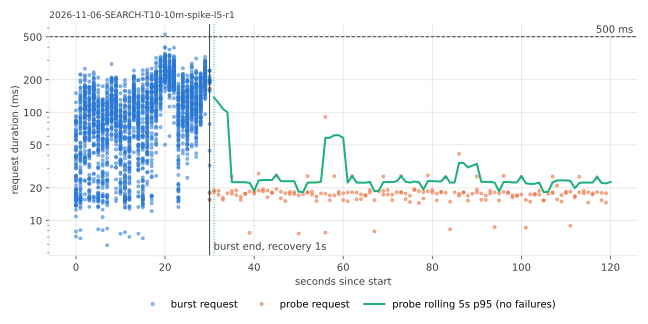

| ES CPU와 힙 | Hikari 풀 |
|---|---|
| 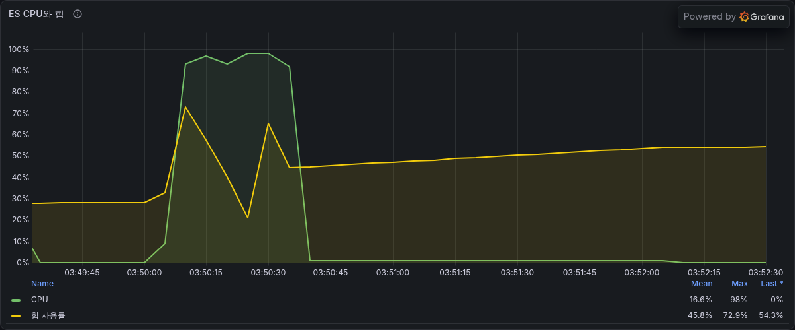 | 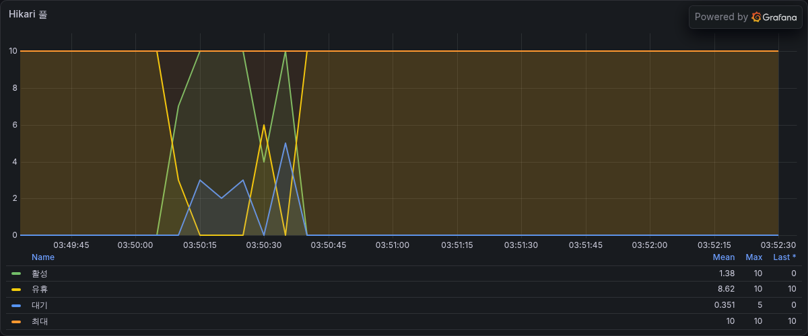 |

- 96 req/s는 L5의 128 req/s 단계 실제 처리량(96 req/s)과 같다. burst 30초 동안 ES 호스트 CPU가 93%에서 98%였지만 대기가 길게 쌓이지 않았다. DB 커넥션 대기는 최대 5였고 burst가 끝나고 1초 뒤 탐침 p95가 500ms 아래로 돌아왔다.
- T08은 같은 burst에서 ES가 포화된 약 40초 동안 커넥션 대기가 190 안팎으로 쌓였다. 검색 요청이 ES 응답을 기다리는 동안 DB 커넥션을 잡고 있는 구조는 그대로라 ES가 더 오래 포화되면 같은 대기가 다시 생긴다.

#### 검색어별 첫 페이지

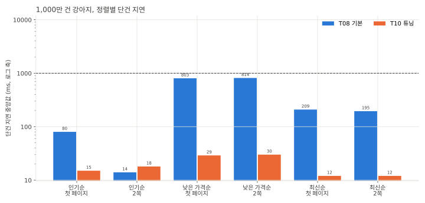

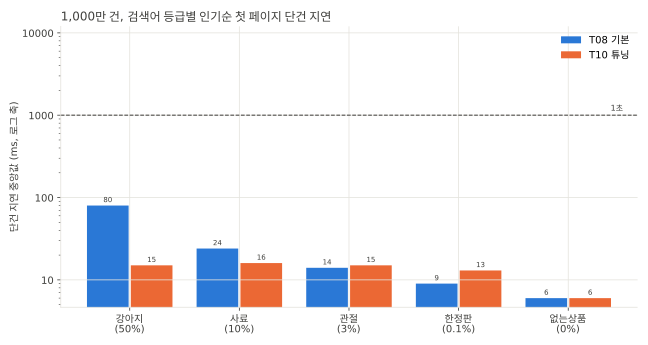

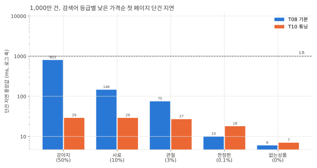

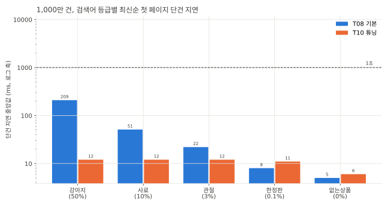

- 일치 상품이 많은 검색어일수록 크게 줄었다. 강아지(50%)는 세 정렬 모두 30ms 아래가 됐다.
- 일치 상품이 적은 한정판(0.1%)은 T08보다 2ms에서 8ms 느리다. 인기순 9ms에서 13ms, 낮은 가격순 10ms에서 18ms, 최신순 8ms에서 11ms다. 한 요청이 ES 요청 여럿을 보내는 비용이 줄인 비용보다 큰 것으로 보인다.

### force merge (참고)

L5 측정을 마친 뒤 세그먼트 18개를 하나로 합쳤다(`_forcemerge?max_num_segments=1`, 1분 4초, 1,672MB에서 1,689MB). 앞뒤로 같은 쿼리를 ES에 직접 보내 took을 비교했다. 앱 셀은 다시 돌리지 않았다.

| 요청 | merge 전 | merge 뒤 |
|---|---|---|
| 강아지 인기순 첫 페이지 (개수 포함, 같은 요청 반복) | 132 | 65 |
| 강아지 개수만 (크기 0, 같은 요청 반복) | 65 | 0 (첫 요청 468) |
| 강아지 최신순 첫 페이지 (개수 포함, 같은 요청 반복) | 84 | 24 |
| 관절 할인 중이 아닌 쪽, L5 조건 | 16 | 4 |
| 강아지 할인 중이 아닌 쪽 개수, L5 조건 (가격 필터) | 71 | 9 |
| 강아지 할인 중이 아닌 쪽 개수, `must_not` (가격 필터) | 380 | 738 |
| 관절 할인 중인 쪽 개수 (가격 필터) | 39 | 50 |

- 같은 요청을 되풀이하면 대부분 빨라졌다. 처음 한 번은 오히려 느렸고(개수만 468ms) `must_not` 개수는 두 배 느려졌다. 세그먼트가 하나가 되면 ES 쿼리 캐시가 조건 결과를 세그먼트 전체에 대해 남겨 다시 쓰는 것으로 보인다. 확인하지는 않았다.

### 가설과 비교

| 항목 | 가설 | 실측 (L5) |
|---|---|---|
| 강아지 낮은 가격순 첫 페이지 | 100ms 안팎 | 29ms |
| 강아지 낮은 가격순 2쪽 | 20ms 안팎 | 30ms |
| 강아지 최신순 2쪽 | 20ms 아래 | 12ms |
| 강아지 인기순 첫 페이지 | 20ms 안팎 | 15ms |
| 처리 가능 요청률 | 128 req/s 이상 | 64 req/s (128 req/s 단계 실제 처리량 96 req/s) |

- 단건 지연은 가설에 맞거나 더 줄었다. 다만 L1 하나로 줄 것이라던 낮은 가격순은 L1 뒤 오히려 느려졌고 L3, L4, L5를 더하고서야 가설 수준이 됐다.
- 처리 가능 요청률은 가설에 못 미쳤다. 가설은 요청 하나의 ES CPU가 지연만큼 줄 것으로 봤는데 지연이 70%에서 96% 줄 때 요청당 ES CPU는 25%에서 31% 줄었다.

## 해석

- 지연은 크게 줄었지만 CPU는 그만큼 줄지 않았다. 한 HTTP 요청이 ES에 결과 요청과 개수 요청을 함께 보내므로 지연은 가장 느린 요청을 따르고 CPU는 모든 요청을 더한 값이다. 처리 가능 요청률이 두 배에 그친 이유다.
- 레버의 효과는 조합에 따라 다르다. 색인 정렬(L2)은 혼자 넣으면 인기순 첫 페이지와 steady를 나쁘게 했고 개수 분리(L3)와 함께여야 이득이 남았다. 가격 필터 개수를 세 요청으로 나눈 L4는 필터 요청을 줄인 대신 다른 요청의 대기를 늘렸고 L5가 요청 수를 다시 줄였다.
- 같은 상품 집합이라도 조건을 거는 방식에 따라 비용이 10배 다르다. 할인 중이 아닌 상품을 `must_not`(할인 중)으로 걸면 관절에서 175ms, 할인 기간 밖 조건의 OR로 걸면 16ms였다.
- 측정 조건이 결론을 바꿨다. 요청 시각을 고정한 실험은 캐시가 시각 조건을 다시 써서 L1의 비용을 15분의 1 안팎으로 작게 보였다(63ms와 954ms). 예열을 다르게 하면 레버와 무관한 요청도 8ms 안팎 차이가 났다.
- 첫 페이지 지연은 요청 캐시 적중 여부에 따라 크게 달라진다. 캐시에 없는 강아지 개수는 65ms이고 sequential과 steady는 같은 검색어를 되풀이해 이 비용이 거의 보이지 않는다.
- 처리 한계는 여전히 ES 호스트 CPU다. 128 req/s 단계에서 ES CPU가 100%일 때 api CPU는 33%, RDS CPU는 4.4%였다.

## 결정

- L1부터 L5까지 모두 남긴다. L1과 L2는 혼자서는 지연이 늘었지만 L3, L4, L5와 함께일 때 일치 상품이 많은 검색어의 단건 지연, steady, spike, 처리 가능 요청률이 T08보다 좋아졌다. 한정판처럼 일치 상품이 적은 검색어와 인기순 2쪽은 몇 ms 느려졌다.
- 색인 정렬(`index.sort`)은 색인을 만들 때만 정할 수 있다. 이미 있는 색인은 재색인해야 적용된다. 앱의 기본 검색 엔진은 지금도 `jpa`라 이 변경으로 운영 검색 경로가 바뀌지는 않는다.
- force merge는 넣지 않는다. 되풀이되는 요청은 대부분 빨라졌지만 첫 요청과 `must_not` 개수는 느려졌다. 실시간 색인 갱신이 있는 색인에서는 세그먼트를 하나로 합친 상태가 유지되지 않는다.
- 다음 후보는 셋이다. ES 응답을 기다리는 동안 DB 커넥션을 잡고 있는 구조(T08 spike에서 대기가 커넥션 풀에 쌓였다), 요청 캐시에 없는 첫 요청의 개수 비용(강아지 65ms), 필터 요청 하나가 ES에 보내는 요청 수다.
- 1억 건에서 T07 jar와 이번 jar를 같은 데이터로 다시 잰다(SEARCH-T12).

## 측정의 한계

- 개수 요청의 요청 캐시 적중률이 실제보다 높다. 검색어가 9개이고 카테고리가 하나라 같은 개수 요청이 계속 되풀이된다. 가격 필터가 없는 개수 요청은 L3 측정까지 적중 7,281건, 미스 167건이었다. 검색어가 다양하면 처음 들어온 검색어마다 개수 비용(강아지 65ms)이 든다.
- 가격 필터 개수 요청은 요청 시각이 본문에 들어가 다시 쓰이지 않는데도 요청 캐시에 들어간다. L4 측정 뒤 미스가 3,910건, 캐시 메모리가 3.9MB였다. 캐시 한도(힙의 1%, 약 40MB) 안이라 이번 측정에는 영향이 없었다.
- 쓰기 트래픽이 없다. 실시간 색인 갱신이 있으면 색인이 바뀔 때마다 요청 캐시가 비워진다.
- 시드에서 할인 기간 밖의 상품(시작 전, 끝남)은 각각 상품의 0.1%다. 끝난 할인을 지우지 않고 쌓아 두는 데이터라면 L5 조건의 시각 범위에 맞는 상품이 늘어 비용이 달라진다.
- ES에 직접 보낸 실험은 ES 응답의 took만 본다. 네트워크와 앱 처리 시간은 들어가지 않는다. 실험 요청 본문과 스크립트는 저장소에 넣지 않았다.
- L3는 응답 동등성을 따로 확인하지 않았다.
- 레버는 L1부터 L5까지 한 순서로만 더했다. L2처럼 혼자서는 손해인 레버가 있어서 순서를 바꾸면 레버별 효과가 다르게 나온다.
- L1은 T08 색인에서, L2부터는 새로 만든 색인에서 쟀다. L2의 효과에는 색인 정렬과 함께 색인을 새로 만든 차이(세그먼트 16개와 18개)가 섞여 있다.
- 검색 스레드 대기열은 5초 간격 표본이라 짧은 대기는 놓친다.
- ramp, spike, sequential은 한 번씩 돌렸다.

## 재현

```bash
cd loadtest/terraform && terraform apply -var es_enabled=true
cd ../search && make outputs && make up DATASET=10m
make jar REV=15fc78db   # 레버 커밋마다 jar를 만든다(31d5b318, f633570a, 96ab7966, 533fc297도 같다)
make equiv STEP=SEARCH-T10 DATASET=10m ENGINE=es REV=235e95a53568 LABEL=t07   # T08 색인에서 T07 jar 응답
make equiv STEP=SEARCH-T10 DATASET=10m ENGINE=es REV=15fc78db721f LABEL=l1
make variant STEP=SEARCH-T10 DATASET=10m VARIANT=l1 REV=15fc78db721f DDL="SEARCH-T06" ENV=AECHAK_SEARCH_ENGINE=es BASE_RATE=32 CELLS="steady sequential"
make reindex DATASET=10m REV=31d5b3188453   # L2부터는 색인 정렬이 든 색인이 필요하다
make variant STEP=SEARCH-T10 DATASET=10m VARIANT=l2s REV=31d5b3188453 DDL="SEARCH-T06" ENV=AECHAK_SEARCH_ENGINE=es BASE_RATE=32 CELLS="steady sequential"
make variant STEP=SEARCH-T10 DATASET=10m VARIANT=l3s REV=f633570a0165 DDL="SEARCH-T06" ENV=AECHAK_SEARCH_ENGINE=es BASE_RATE=32 CELLS="steady sequential"
make variant STEP=SEARCH-T10 DATASET=10m VARIANT=l4 REV=96ab796662af DDL="SEARCH-T06" ENV=AECHAK_SEARCH_ENGINE=es BASE_RATE=32 CELLS="steady sequential"
make variant STEP=SEARCH-T10 DATASET=10m VARIANT=l5 REV=533fc2978da2 DDL="SEARCH-T06" ENV=AECHAK_SEARCH_ENGINE=es BASE_RATE=32 \
  RAMP_RATES="2 4 8 16 32 64 128 256 384 512" CELLS="ramp steady spike sequential"
```

`make equiv`는 L2, L4, L5에도 같은 방식으로 돌리고 `results/equiv/SEARCH-T10-10m-es-<레버>.jsonl`을 T07 파일과 `cmp`로 비교한다. ES에 직접 보낸 실험은 ES 호스트에서 `curl -H 'Content-Type: application/json' 'localhost:9200/products/_search?request_cache=false' -d @body.json`으로 보냈다.
