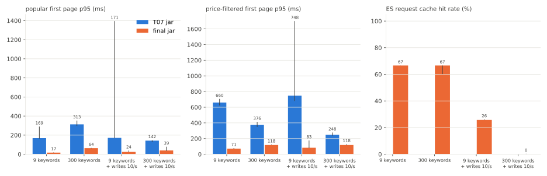

# SEARCH-T11 Elasticsearch 1,000만 건 최종 비교

2026-11-08에 AWS perf 스택에서 T07 jar와 최종 jar를 상품 1,000만 건, 네 조건(고정 검색어 9개, 검색어 300개, 쓰기 초당 10건, 검색어 300개와 쓰기 초당 10건)으로 잰 기록이다. ES 호스트는 T16과 같은 m7g.large다. 최종 jar는 T16 측정 jar(T13 jar에 T16 코드 변경만 얹은 jar)다. 두 jar의 비교는 같은 날 오후에 jar마다 새로 색인하고 같은 조건 순서로 잰 값(`t07*`, `final2*`)으로 한다. 밤에 잰 최종 jar 값과 개수 요청의 요청 캐시를 끈 jar 값은 따로 적었다. 지연은 ms, 요청률은 초당 HTTP 요청 수(req/s)다. run별 전체 표는 `SEARCH-T11.md`에 있다.

## 요약

- 같은 날 jar마다 새로 색인하고 같은 조건 순서로 잰 비교에서 최종 jar는 네 조건 모두 T07 jar보다 빨랐다. 첫 페이지 p95 중앙값은 고정 검색어 9개 169ms 대 17ms(9.8배), 검색어 300개 313ms 대 64ms(4.9배), 쓰기 초당 10건 171ms 대 24ms(7.0배), 검색어 300개와 쓰기 142ms 대 39ms(3.6배)였다. 최종 jar는 실패가 없었고 ES CPU 평균은 조건마다 T07 jar보다 낮았다(고정 9개 17%에서 19% 대 49%에서 59%, 검색어 300개와 쓰기 32%에서 44% 대 58%에서 59%).
- 이 비교는 완성된 두 구현의 조건부 비교다. 시간과 순서의 영향을 없애지 못했고 두 색인의 세그먼트 배치도 같지 않다.
- 차이는 고정 검색어 9개에서 가장 컸다. 검색어 300개에서는 최종 jar의 요청 캐시 적중률이 거의 그대로였지만 쿼리 하나의 평균 시간이 두 배가 돼 차이가 4.9배로 줄었다.
- 쓰기 초당 10건에서 최종 jar의 요청 캐시 적중률은 26% 안팎으로 떨어졌지만 첫 페이지 p95는 24ms에서 39ms로 조금 올랐다. 쓰기 셀의 꼬리 지연은 세그먼트가 쌓이다 큰 병합이 일어난 run에서 컸다(T07 jar 첫 페이지 p95 1,396ms, 최종 jar p99 405ms).
- 재시작 뒤 확인이 측정 전에 정한 기준을 벗어나 최종 jar를 새 색인에서 다시 쟀다. 다시 잰 값은 네 조건 모두 밤 값과 같은 범위였다.
- 쓰기 셀이 모두 끝난 색인에서 최종 jar 검색어 300개를 다시 재자 첫 페이지 p95가 62ms에서 67ms가 27ms에서 32ms로 낮았다(쓰기 없음). 쓰기 없이 다시 잰 셀이 가장 빨라 뒤 셀이 빨랐던 것을 쓰기 탓으로 보기는 어렵다. 앞 셀들이 남긴 상태(병합된 세그먼트, 채워진 노드 쿼리 캐시)나 시간의 영향과 맞지만 무엇 때문인지는 나누지 못했다.
- 요청 캐시를 끈 jar(밤, 고정 9개)는 첫 페이지 p95가 18ms에서 19ms로 그대로였다. 이 셀로 두 jar 차이 중 요청 캐시의 몫은 나누지 못했다.
- T07 jar는 같은 m7g.large에서 T08(80ms)보다 느렸다(164ms에서 290ms). 원인은 확인하지 않았다.

## 가설

측정 전에 적은 가설이다. 최종 jar의 쓰기 없음 셀 결과만 본 뒤에 적었다.

- 최종 jar는 T13 jar에 T16만 얹어 ES 쿼리가 같으므로 조건별 지연은 T14의 T13 jar와 같은 흐름일 것이다.
- 쓰기 없음은 최종 jar 첫 페이지 p95 18ms에서 19ms(이미 봤다), T07 jar는 T08처럼 80ms 안팎일 것이다.
- 쓰기 초당 10건은 최종 jar의 요청 캐시 적중률이 25% 안팎으로 떨어지고 첫 페이지 p95가 70ms 안팎이 되지만 T07 jar보다 낮을 것이다. T07 jar는 요청 캐시를 쓰지 않아 쓰기에 덜 흔들릴 것이다.
- 검색어 300개는 최종 jar 첫 페이지 p95가 60ms 안팎일 것이다. 적중률은 거의 그대로이고 느려지는 쪽은 쿼리 실행일 것이다.
- 검색어 300개와 쓰기 초당 10건은 적중률이 두 조건 중 낮은 쪽보다 더 떨어지고 첫 페이지 p95가 두 조건보다 높지만 T07 jar보다는 낮을 것이다.
- 요청 캐시를 끈 jar(고정 9개, 쓰기 없음)는 첫 페이지 p95가 쓰기 초당 10건 값에 가까울 것이다. 이 셀로 T07 jar와 최종 jar의 차이 중 요청 캐시의 몫을 나눈다.
- 순서 효과 확인 셀의 기준은 앞 조건 결과를 본 뒤 이 셀을 재기 전에 적었다. 모든 쓰기 셀이 끝난 색인에서 최종 jar 검색어 300개를 다시 잰다. 첫 페이지 p95 범위가 앞서 잰 검색어 300개(62ms에서 67ms)와 겹치지 않고 낮으면 앞 셀들이 바꾼 색인 상태가 남아 빨라진 것과 맞는다고 보고 겹치면 상태가 남아서가 아니라고 본다.

## 환경

- perf 측정층과 ES 호스트는 T16과 같다. api m7i.large(api 컨테이너 1코어, 2GB, Hikari 최대 10, Tomcat 기본 스레드 최대 200), 러너 c7g.large, RDS db.m7g.large(MySQL 8.4), ES 호스트 m7g.large(vCPU 2개, 8GB, ES 컨테이너 CPU 2개, 힙 4GB, 샤드 1개, 복제 0개)다. 데이터는 RDS `aechak-perf-10m`(상품 1,000만 건)이다.
- jar는 셋이다. T07 jar(235e95a53568)는 T07과 T08을 잰 jar다. 최종 jar(4d530ad7b75e)는 T16을 잰 jar이고 동시 요청 상한 기본값 40으로 띄웠다. 요청 캐시를 끈 jar(4b23455c3959)는 최종 jar에서 첫 페이지 개수 요청의 `requestCache(true)`를 `false`로만 바꿨다.
- 색인 매핑이 jar마다 다르다(최종 jar는 id 내림차순 색인 정렬). 그래서 jar마다 그 jar로 만든 색인에서 쟀다.
- 조건은 넷이다. 고정 검색어 9개는 지금까지의 구성이다. 검색어 300개(`KEYWORD_SET=diverse`)는 상품명 어휘에서 뽑은 구성이다(등급별 high 7개, mid 24개, low 252개, rare 2개, none 15개). 쓰기 초당 10건(`PERTURB=write PERTURB_RATE=10`)은 ES 문서 1,000개를 같은 `_id`와 같은 `_source`로 초당 10건 다시 넣는다. 검색 결과는 그대로이고 새 세그먼트, 1초 refresh, 요청 캐시 무효화, 색인 CPU는 실제 쓰기처럼 생긴다.
- 셀은 조건마다 steady(초당 22.4건 180초)를 세 번 돌렸다. 변형마다 api를 그 jar로 다시 띄우고 2 req/s로 60초 데웠다. 조건 순서는 두 jar 모두 고정 9개, 검색어 300개, 쓰기, 검색어 300개와 쓰기다.

### 경과

| 시각 | 한 일 |
|---|---|
| 00:15에서 01:58 | 최종 jar 다섯 셀(`final*`, 요청 캐시 끔 포함)을 T16 세션에서 T13 jar로 만든 색인(최종 jar와 매핑이 같다)에서 쟀다 |
| 05:00 | perf 스택이 매일 05:00의 자동 정지로 멈췄다 |
| 12:31에서 13:02 | 스택을 다시 띄우고 측정 전에 정한 기준으로 최종 jar 고정 9개를 다시 쟀다(`final-recheck`). 기준을 벗어났다 |
| 13:02에서 14:32 | T07 jar로 다시 색인하고(640초, 1,632MB) T07 jar 네 조건을 쟀다(`t07*`) |
| 14:32에서 16:26 | 최종 jar로 다시 색인하고(705초, 1,669MB) 최종 jar 네 조건을 같은 순서로 다시 쟀다(`final2*`) |
| 16:26에서 16:48 | 모든 쓰기 셀이 끝난 색인에서 최종 jar 검색어 300개를 세 번 더 쟀다(`final2-diverse-after`, 순서 효과 확인) |

- 재시작 뒤 확인 기준은 측정 전에 정했다. 첫 페이지 p95 중앙값이 밤 값에서 2ms 안이고 가격 필터 첫 페이지 p95 중앙값이 5% 안이면 밤 값과 오늘 값을 한 세션처럼 비교하고 벗어나면 최종 jar도 오늘 다시 잰다. 재시작 뒤 측정은 첫 페이지 p95 중앙값(17.6ms, 밤 17.8ms)은 기준 안이었지만 가격 필터 p95 중앙값이 80.9ms로 밤(67.8ms)보다 19% 높았다. 색인은 밤의 쓰기 셀을 지나 세그먼트 26개, 삭제 문서 5,456개였다.
- 그래서 T07 jar 셀 뒤에 최종 jar로 다시 색인하고 네 조건을 같은 순서로 다시 쟀다. 새 색인에서 잰 최종 jar 고정 9개(`final2`)는 가격 필터 p95 중앙값이 70.7ms(밤보다 4% 높음)로 기준 안이었다.

## 측정 결과

### 조건별 T07 jar와 최종 jar



막대는 세 번의 중앙값, 선은 최소와 최대다. 최종 jar는 오후에 새 색인에서 다시 잰 값(`final2*`)이다. T07 jar는 ES 요청 캐시를 쓰지 않아 적중률 막대가 없다. T07 jar 쓰기 셀의 긴 선은 큰 병합이 일어난 r1이다. 표의 범위는 세 번 중 최소에서 최대다.

| 조건 | 지표 | T07 jar | 최종 jar |
|---|---|---|---|
| 고정 9개 | 첫 페이지 p50 / p95 / p99 | 30에서 32 / 164에서 290 / 283에서 601 | 11에서 12 / 17에서 20 / 19에서 34 |
| 고정 9개 | 가격 필터 첫 페이지 p95 / p99 | 623에서 706 / 1,546에서 1,649 | 69에서 79 / 75에서 132 |
| 고정 9개 | 다음 페이지 p95 | 36에서 58 | 12에서 17 |
| 고정 9개 | 요청 캐시 적중률 | - | 66.6%에서 66.7% |
| 고정 9개 | ES CPU 평균 (컨테이너 한도 대비) | 49%에서 59% | 17%에서 19% |
| 고정 9개 | 실패율 | 0.00% | 0.00% |
| 검색어 300개 | 첫 페이지 p50 / p95 / p99 | 83에서 93 / 296에서 353 / 497에서 556 | 24에서 27 / 62에서 67 / 128에서 169 |
| 검색어 300개 | 가격 필터 첫 페이지 p95 / p99 | 349에서 413 / 579에서 722 | 118에서 123 / 148에서 159 |
| 검색어 300개 | 다음 페이지 p95 | 320에서 425 | 74에서 85 |
| 검색어 300개 | 요청 캐시 적중률 | - | 60.2%에서 66.6% |
| 검색어 300개 | ES CPU 평균 (컨테이너 한도 대비) | 70%에서 71% | 34%에서 36% |
| 검색어 300개 | 실패율 | 0.00% | 0.00% |
| 쓰기 초당 10건 | 첫 페이지 p50 / p95 / p99 | 30에서 37 / 168에서 1,396 / 274에서 2,361 | 13에서 15 / 24에서 39 / 28에서 405 |
| 쓰기 초당 10건 | 가격 필터 첫 페이지 p95 / p99 | 680에서 1,700 / 1,667에서 2,732 | 79에서 176 / 94에서 608 |
| 쓰기 초당 10건 | 다음 페이지 p95 | 35에서 1,394 | 15에서 20 |
| 쓰기 초당 10건 | 요청 캐시 적중률 | - | 25.7%에서 26.1% |
| 쓰기 초당 10건 | ES CPU 평균 (컨테이너 한도 대비) | 52%에서 74% | 23%에서 42% |
| 쓰기 초당 10건 | 실패율 | 0.00%에서 0.08% | 0.00% |
| 검색어 300개와 쓰기 | 첫 페이지 p50 / p95 / p99 | 54에서 57 / 127에서 147 / 270에서 289 | 17에서 23 / 36에서 79 / 187에서 249 |
| 검색어 300개와 쓰기 | 가격 필터 첫 페이지 p95 / p99 | 237에서 277 / 483에서 620 | 116에서 128 / 170에서 181 |
| 검색어 300개와 쓰기 | 다음 페이지 p95 | 142에서 147 | 23에서 79 |
| 검색어 300개와 쓰기 | 요청 캐시 적중률 | - | 0.0%에서 0.3% |
| 검색어 300개와 쓰기 | ES CPU 평균 (컨테이너 한도 대비) | 58%에서 59% | 32%에서 44% |
| 검색어 300개와 쓰기 | 실패율 | 0.00% | 0.00% |

| 조건 | 첫 페이지 p95 중앙값(T07 jar 대 최종 jar) | 가격 필터 첫 페이지 p95 중앙값 |
|---|---|---|
| 고정 9개 | 169 대 17 (9.8배) | 660 대 71 (9.3배) |
| 검색어 300개 | 313 대 64 (4.9배) | 376 대 118 (3.2배) |
| 쓰기 초당 10건 | 171 대 24 (7.0배) | 748 대 83 (9.0배) |
| 검색어 300개와 쓰기 | 142 대 39 (3.6배) | 248 대 118 (2.1배) |

- 네 조건 모두 최종 jar가 빨랐다. 실패는 최종 jar 0건, T07 jar는 쓰기 셀의 한 run에서 0.08%였다. ES CPU 평균(컨테이너 한도 대비)은 조건마다 최종 jar가 T07 jar보다 낮았다. 최종 jar의 중앙값은 T07 jar의 35%(고정 9개), 48%(검색어 300개), 47%(쓰기), 57%(검색어 300개와 쓰기)다.
- 최종 jar는 검색 하나에 ES 요청을 더 보낸다(첫 페이지 개수 요청을 따로 보내고 낮은 가격순은 둘로 나눈다). ES가 센 쿼리는 run마다 9,100건 안팎으로 T07 jar(5,100건 안팎)보다 많았지만 쿼리 하나의 평균 시간이 짧았다(고정 9개 7.6ms에서 8.2ms 대 40.5ms에서 50.2ms, 검색어 300개 15.6ms에서 16.7ms 대 71.0ms에서 76.7ms). 이 평균에는 요청 캐시 적중도 들어 있다.
- 차이는 고정 검색어 9개에서 가장 크고(9.8배) 검색어 300개와 쓰기에서 가장 작았다(3.6배). T14(r7g.xlarge)의 같은 세 조건 비교(고정 9개 8.7배, 쓰기 2.4배, 검색어 300개 1.8배)와 크기 순서는 같다. 이번에는 검색어 300개에서 T07 jar가 T14보다 느렸고(313ms, T14 111ms에서 113ms) 쓰기에서는 최종 jar가 T14의 T13 jar보다 빨라(24ms, T14 75ms에서 76ms) 비가 컸다.
- 검색어 300개에서 최종 jar는 요청 캐시 적중률이 60.2%에서 66.6%로 거의 그대로였고 샤드 쿼리 하나의 평균 시간이 두 배가 됐다. 검색어 등급으로 보면 mid 등급 p95가 58ms에서 63ms가 166ms에서 172ms로 늘었다(모든 검색 종류). T14는 이 구성의 세 글자 검색어가 일치 수에 비례해 느리다는 것을 확인했다.
- 쓰기 초당 10건에서 최종 jar의 요청 캐시 적중률은 쓰기 없음의 66.7% 안팎에서 25.7%에서 26.1%로 떨어졌지만 첫 페이지 p95는 쓰기 없음(17ms에서 20ms)보다 조금 높은 24ms에서 39ms였다. 느려진 것은 high 등급(강아지)이다(p50 11ms에서 12ms가 23ms).
- 검색어 300개와 쓰기에서는 최종 jar의 요청 캐시가 거의 맞지 않았다(0.0%에서 0.3%). 첫 페이지 p95는 r1 79ms, r2 39ms, r3 36ms로 r2와 r3가 앞서 잰 검색어 300개(62ms에서 67ms)보다 낮았다. T07 jar도 이 조건(127ms에서 147ms)이 검색어 300개(296ms에서 353ms)보다 빨랐다. 두 jar 모두 이 셀은 쓰기 셀의 큰 병합 뒤에 돌았다.

### 검색어 등급별 지연

등급은 고정 9개 구성에서 강아지(high), 사료, 연어, 간식(mid), 관절, 하네스, 바잇미(low), 한정판(rare), 없는상품(none)이고 검색어 300개 구성은 상품명 일치 비율로 같은 기준을 썼다. 모든 검색 종류(첫 페이지, 가격 필터 첫 페이지, 다음 페이지)의 p50 / p95다.

| 변형 | high p50 / p95 | mid p50 / p95 | low p50 / p95 | rare p50 / p95 | none p50 / p95 |
|---|---|---|---|---|---|
| t07 | 158에서 171 / 736에서 1,367 | 31에서 33 / 284에서 288 | 24에서 26 / 140에서 160 | 17에서 19 / 27에서 44 | 5에서 6 / 8에서 13 |
| final2 | 11에서 12 / 56에서 65 | 11에서 12 / 58에서 63 | 11에서 13 / 44에서 60 | 9에서 10 / 17에서 20 | 5에서 6 / 7에서 11 |
| t07-diverse | 104에서 106 / 744에서 878 | 114에서 151 / 610에서 771 | 80에서 93 / 274에서 317 | 20에서 22 / 42에서 50 | 8에서 11 / 56에서 162 |
| final2-diverse | 19에서 20 / 54에서 62 | 25에서 29 / 166에서 172 | 24에서 28 / 72에서 81 | 12에서 13 / 15에서 20 | 6에서 7 / 9에서 13 |
| t07-write10 | 158에서 167 / 744에서 2,427 | 31에서 40 / 291에서 1,376 | 23에서 32 / 157에서 1,402 | 12에서 17 / 25에서 1,238 | 5에서 8 / 8에서 1,213 |
| final2-write10 | 23 / 63에서 208 | 13에서 15 / 60에서 99 | 13에서 15 / 45에서 90 | 9에서 10 / 18에서 28 | 5에서 7 / 7에서 13 |
| t07-diverse-write10 | 98에서 99 / 610에서 660 | 71에서 82 / 324에서 358 | 55에서 58 / 144에서 150 | 15에서 16 / 22에서 29 | 7에서 9 / 15에서 19 |
| final2-diverse-write10 | 16에서 25 / 402에서 405 | 24에서 34 / 190에서 225 | 19에서 24 / 60에서 85 | 9에서 11 / 13에서 21 | 6에서 8 / 9에서 13 |

- T07 jar는 고정 9개에서 high 등급(강아지) p95가 736ms에서 1,367ms였다. 강아지는 상품 절반에 일치해 정렬하고 셀 문서가 가장 많다. 최종 jar는 56ms에서 65ms였다.
- 검색어 300개에서 T07 jar는 p50으로 mid 등급(114ms에서 151ms), p95로 high 등급(744ms에서 878ms)이 가장 느렸다. 최종 jar는 mid 등급이 p50(25ms에서 29ms)과 p95(166ms에서 172ms) 모두 가장 느렸다.
- 검색어 300개와 쓰기에서 최종 jar의 high 등급 p95는 402ms에서 405ms로 쓰기가 없을 때(54ms에서 62ms)보다 크게 높았다. 이 등급은 300개 중 7개라 검색의 2% 안팎이어서 첫 페이지 p95보다 p99(187ms에서 249ms)에 드러났다.

### 쓰기 셀과 병합

| 순서 | run별 첫 페이지 p95 / p99 | run별 세그먼트 수 최대 | run별 노드 쿼리 캐시 축출 |
|---|---|---|---|
| T07 jar(`t07-write10`) | 1,396 / 2,361, 171 / 274, 168 / 288 | 119, 29, 29 | 142, 0, 0 |
| 최종 jar 오후(`final2-write10`) | 24 / 30, 39 / 405, 24 / 28 | 120, 151, 29 | 0, 1,098, 0 |
| 최종 jar 밤(`final-write10`) | 22 / 43, 36 / 247, 20 / 29 | 120, 138, 29 | 0, 3,463, 0 |

- 쓰기는 1초마다 refresh로 작은 세그먼트를 만든다. 세 순서 모두 세그먼트가 119개에서 151개까지 늘다가 한 run에서 큰 병합이 일어나 29개가 됐다. 첫 페이지 p99가 튄 run(T07 jar 2,361ms, 최종 jar 405ms와 247ms)은 세그먼트 수가 크게 줄고 노드 쿼리 캐시 항목이 지워진 run과 같았다. T07 jar는 그 run에서 ES CPU가 최대 100%였고 실패가 0.08% 났다.
- 오후 최종 jar 색인은 쓰기 셀 전에 세그먼트 22개(90만 건 안팎 10개 포함)였고 쓰기 셀 뒤에는 문서 906만 건짜리 세그먼트 하나를 포함한 26개가 됐다. 이 세그먼트의 문서 수(살아 있는 문서 9,058,798건과 삭제 표시 2,133건)가 90만 건 안팎 세그먼트 10개의 합(9,061,798건)에 가까워 10개가 하나로 병합된 것과 맞는다. 뒤의 셀(검색어 300개와 쓰기, 순서 효과 확인)은 이 색인에서 쟀다.

### 순서 효과 확인

| 측정 | 상태 | 첫 페이지 p50 / p95 / p99 | 가격 필터 p95 | 다음 페이지 p95 | 요청 캐시 적중률 | ES CPU 평균 | 쿼리 하나의 평균 시간 | 노드 쿼리 캐시 |
|---|---|---|---|---|---|---|---|---|
| 검색어 300개(`final2-diverse`) | 새 색인, 쓰기 셀 전 | 24에서 27 / 62에서 67 / 128에서 169 | 118에서 123 | 74에서 85 | 60.2%에서 66.6% | 34%에서 36% | 15.6ms에서 16.7ms | 122MB, 적중 34%에서 35% |
| 검색어 300개와 쓰기(`final2-diverse-write10`) | 큰 병합 뒤, 쓰기 중 | 17에서 23 / 36에서 79 / 187에서 249 | 116에서 128 | 23에서 79 | 0.0%에서 0.3% | 32%에서 44% | 14.2ms에서 20.2ms | 348MB에서 355MB, 적중 38%에서 45% |
| 검색어 300개 다시(`final2-diverse-after`) | 큰 병합 뒤, 쓰기 없음 | 17에서 18 / 27에서 32 / 59에서 76 | 104에서 112 | 22에서 29 | 60.0%에서 66.6% | 25%에서 26% | 11.6ms에서 12.0ms | 356MB, 적중 42% |

- 같은 jar, 같은 검색어 구성, 쓰기 없음인데 쓰기 셀 뒤에 다시 잰 첫 페이지 p95(27ms에서 32ms)가 쓰기 셀 전(62ms에서 67ms)과 겹치지 않고 낮았다. 측정 전에 정한 기준대로 앞 셀들이 남긴 상태 때문에 빨라진 것과 맞는다.
- 그 사이에 바뀐 것은 둘이다. 90만 건 안팎 세그먼트 10개가 하나로 병합된 것으로 보이고 노드 쿼리 캐시가 122MB에서 356MB로 채워졌다. 시간도 흘렀다. 이 셀로는 무엇 때문인지 나누지 못했다.
- 쓰기 없이 다시 잰 이 셀이 가장 빨랐으므로 검색어 300개와 쓰기 셀이 검색어 300개 셀보다 빨랐던 것을 쓰기 탓으로 보기는 어렵다.
- T07 jar도 검색어 300개와 쓰기 셀(127ms에서 147ms)이 검색어 300개 셀(296ms에서 353ms)보다 빨랐고 쿼리 하나의 평균 시간이 71ms에서 77ms가 46ms에서 48ms로 줄어 같은 흐름이다. T07 jar로는 이 셀을 재지 않았다.

### 밤 측정과 다시 잰 최종 jar

| 측정 | 색인 상태 | 첫 페이지 p50 / p95 | 가격 필터 p95 | ES CPU 평균 | 샤드 쿼리 평균 | 노드 쿼리 캐시 |
|---|---|---|---|---|---|---|
| 밤(`final`, 00:15) | T16 세션에 만든 색인, 세그먼트 22, 삭제 문서 0 | 9.8에서 10.8 / 17.7에서 18.8 | 67.6에서 68.3 | 16% | 7.2ms에서 7.5ms | 294MB, 적중 44% |
| 재시작 뒤(`final-recheck`, 12:39) | 밤 쓰기 셀을 지난 색인, 세그먼트 26, 삭제 문서 5,456 | 14.0에서 16.0 / 17.2에서 27.9 | 79.2에서 107.4 | 20%에서 27% | 8.7ms에서 10.3ms | 38.6MB, 적중 43%에서 45% |
| 새 색인(`final2`, 14:44) | 최종 jar로 다시 색인, 세그먼트 22 | 10.9에서 12.1 / 16.7에서 19.6 | 69.2에서 79.0 | 17%에서 19% | 7.6ms에서 8.2ms | 38.4MB, 적중 42%에서 43% |

| 조건 | 밤(`final*`) 첫 페이지 p95 | 오후(`final2*`) 첫 페이지 p95 |
|---|---|---|
| 고정 9개 | 18에서 19 | 17에서 20 |
| 검색어 300개 | 62에서 66 | 62에서 67 |
| 쓰기 초당 10건 | 20에서 36 | 24에서 39 |
| 검색어 300개와 쓰기 | 35에서 83 | 36에서 79 |

- 재시작 뒤 측정만 밤과 달랐다. 첫 페이지 p50이 14ms에서 16ms(밤 10ms에서 11ms)였고 가격 필터 p95 중앙값이 19% 높았다. ES 노드는 재시작으로 캐시가 비어 있었고 색인은 밤 쓰기 셀을 지나 세그먼트와 삭제 문서가 늘어 있었다.
- 새 색인에서 잰 `final2`도 노드 쿼리 캐시가 38.4MB로 작았지만 밤 값과 같았다. 재시작 뒤 측정이 느렸던 것은 캐시 크기보다 쓰기 셀을 지난 색인 상태와 맞지만 따로 확인하지 않았다.
- 검색어 300개와 쓰기는 run별 값도 밤과 거의 같았다(밤 83, 38, 35, 오후 79, 39, 36). 두 순서 모두 r1만 높았다.

### 요청 캐시를 끈 최종 jar(밤, 고정 검색어 9개, 쓰기 없음)

| 지표 | 최종 jar(`final`) | 요청 캐시 끔(`final-nocache`) |
|---|---|---|
| 첫 페이지 p50 / p95 / p99 | 10에서 11 / 18에서 19 / 19에서 23 | 10에서 11 / 18에서 19 / 20에서 24 |
| 가격 필터 첫 페이지 p95 | 68 | 69에서 71 |
| 다음 페이지 p95 | 10에서 14 | 10에서 14 |
| 높은 일치 등급(강아지) p50 / p95, 모든 검색 종류 | 10에서 11 / 51에서 54 | 17에서 18 / 52에서 53 |
| 요청 캐시 적중률 | 66.6%에서 66.7% | 꺼짐 |
| 노드 쿼리 캐시 적중률 | 44% | 47% |
| 샤드 쿼리 하나의 평균 시간 | 7.2ms에서 7.5ms | 7.9ms에서 8.1ms |
| ES CPU 평균(한도 대비) | 16% | 18% |

- 요청 캐시를 꺼도 첫 페이지 p95는 18ms에서 19ms로 같았다. 강아지(상품 절반에 일치) p50이 10ms에서 11ms가 17ms에서 18ms로, ES CPU 평균이 16%에서 18%로 올랐다.
- 이 셀은 밤에 검색어 300개 셀 바로 뒤에 돌아 순서의 영향을 배제하지 못했다. HTTP 지연으로는 개수 요청의 실행 시간을 따로 볼 수 없어 두 jar 차이 중 요청 캐시의 몫은 나누지 않았다.

## 가설과 비교

| 항목 | 가설 | 실측 |
|---|---|---|
| 조건별 흐름 | T14의 T13 jar와 같은 흐름 | 고정 9개가 가장 빠른 것은 같았다. T14는 쓰기 셀이 가장 느렸지만(75ms에서 76ms) 이번에는 검색어 300개가 가장 느렸고(62ms에서 67ms) 쓰기의 영향은 24ms에서 39ms로 작았다 |
| T07 jar 고정 9개 | 80ms 안팎(T08) | 164ms에서 290ms |
| 쓰기 초당 10건 | 적중률 25% 안팎, 첫 페이지 p95 70ms 안팎, T07 jar보다 낮음. T07 jar는 덜 흔들림 | 적중률 25.7%에서 26.1%, 첫 페이지 p95 24ms에서 39ms. T07 jar는 168ms에서 1,396ms로 병합 run에서 크게 흔들렸다 |
| 검색어 300개 | 첫 페이지 p95 60ms 안팎, 적중률 그대로, 쿼리 실행이 느려짐 | 62ms에서 67ms, 적중률 60.2%에서 66.6%, 쿼리 하나의 평균 시간 두 배 |
| 검색어 300개와 쓰기 | 적중률이 둘 중 낮은 쪽보다 더 떨어지고 첫 페이지 p95가 두 조건보다 높지만 T07 jar보다 낮음 | 적중률은 0.0%에서 0.3%로 가장 낮았다. 첫 페이지 p95는 36ms에서 79ms로 r2와 r3가 검색어 300개(62ms에서 67ms)보다 낮아 가설과 달랐다. T07 jar(127ms에서 147ms)보다는 낮았다 |
| 요청 캐시 끔 | 첫 페이지 p95가 쓰기 초당 10건 값에 가까움. 요청 캐시의 몫을 나눔 | 18ms에서 19ms로 그대로. 몫은 나누지 못했다 |
| 순서 효과 확인 | 범위가 겹치지 않고 낮으면 색인 상태가 남은 것과 맞음 | 27ms에서 32ms로 앞선 검색어 300개(62ms에서 67ms)와 겹치지 않고 낮았다. 기준대로 앞 셀들이 남긴 상태와 맞는다. 세그먼트 병합, 채워진 노드 쿼리 캐시, 시간 중 무엇 때문인지는 나누지 못했다 |

## 해석

- 최종 jar는 네 조건 모두 T07 jar보다 빨랐다. 이 단계는 완성된 두 구현을 비교했고 레버마다 몫은 나누지 않았다. 레버별 효과는 T10이 고정 검색어 9개로 하나씩 더해 쟀다.
- 요청 캐시 적중이 줄어든 두 셀(쓰기 초당 10건에서 적중률 26% 안팎, 요청 캐시 끔)에서도 최종 jar의 첫 페이지 p95는 크게 오르지 않았다. 이 세션에서 최종 jar가 빠른 것을 요청 캐시 적중만으로 설명하기는 어렵다. 두 셀 모두 다른 조건도 함께 바뀌어 몫을 수치로 나누지는 않았다.
- 검색어 300개에서 최종 jar는 요청 캐시 적중률이 거의 그대로인데 느려졌고 T07 jar도 느려졌다. 두 jar 모두 쿼리 하나의 평균 시간이 늘었고 두 jar의 차이는 4.9배로 줄었다.
- 쓰기 셀의 꼬리 지연은 큰 병합이 일어난 run에서 컸다. 두 jar 모두 그 run에서 p99가 튀었고 T07 jar가 더 크게 흔들렸다.
- 검색어 300개와 쓰기 셀이 검색어 300개 셀보다 빨랐던 것은 쓰기 없이 다시 잰 셀이 더 빨랐으므로 쓰기 탓으로 보기는 어렵다. 앞 셀들이 남긴 상태(병합된 세그먼트, 채워진 노드 쿼리 캐시)나 시간의 영향과 맞지만 무엇 때문인지는 나누지 못했다. 두 jar 비교에서 순서의 영향이 가장 적은 값은 쓰기 셀 전에 잰 두 조건(고정 9개, 검색어 300개)이고 쓰기 셀과 그 뒤 값에는 순서의 영향이 섞인다.
- T07 jar가 T08(80ms)보다 느린 이유는 확인하지 않았다. 같은 m7g.large, 같은 jar와 데이터, 같은 부하였고 노드 쿼리 캐시 메모리(13.7MB 대 40MB)와 세그먼트 수(28개 대 16개)가 달랐다. 두 jar 비교의 결론은 바뀌지 않지만 T07 jar의 절대값은 세션에 따라 2배 안팎 달라질 수 있다.

## 결정

- 최종 jar(T16 jar)를 시리즈의 결과로 둔다. 같은 날 jar마다 새 색인에서 잰 네 조건 모두 T07 jar보다 첫 페이지 p95 중앙값이 3.6배에서 9.8배 낮았고 실패가 없었다.
- 측정은 여기서 끝낸다. 남은 의문(T07 jar가 T08보다 느린 이유, 순서 효과의 원인)은 jar 결정을 바꾸지 않아 한계에 적었다.

## 측정의 한계

- 조건마다 steady 세 번만 돌렸다. ramp와 순간 부하는 이 세션에서 돌리지 않았다.
- 같은 날 jar마다 새로 색인하고 같은 순서로 쟀지만 시간과 순서의 영향을 없애지 못했다. 두 색인의 세그먼트 배치도 다르다(새 색인에서 T07 jar 28개, 최종 jar 22개). 한 색인에서 이어 돈 세 run은 독립된 색인 세 개가 아니다.
- 쓰기 셀 뒤의 셀은 앞 셀들이 남긴 상태의 영향을 받았다(순서 효과 확인 27ms에서 32ms 대 62ms에서 67ms). 쓰기 셀과 그 뒤 값에는 앞 셀의 영향이 섞인다.
- 요청 캐시를 끈 셀은 밤에 최종 jar로만 쟀다.
- T07 jar가 T08보다 느린 이유를 확인하지 않았다.
- 쓰기 부하는 같은 내용의 문서를 다시 넣는다. 실제 상품 변경(가격, 재고, 이름)과 삭제는 검색 결과까지 바꾸지만 이 셀은 결과를 바꾸지 않는다.
- 검색어 300개 구성은 낮은 일치 검색어가 많아 캐시 적중률만 바꾸는 시험이 아니다. 요청 구성 자체가 고정 9개와 다르다.
- 1백만 건 여정(기준 jar, MySQL 최종, ES 최종)은 다시 재지 않았다. 기존 run의 차이가 수백 배라 세션 차이로 결론이 바뀌지 않는다고 봤다(SUMMARY).

## 재현

```bash
cd loadtest/terraform && terraform apply -var es_enabled=true && cd ../..
R07=235e95a53568   # T07 jar 커밋
# 최종 jar 커밋. T16 보고서의 재현 절차와 같다. 측정에 쓴 4d530ad7b75e와 트리(ff2cf083)는 같고 해시는 다르다
git switch --detach 533fc2978da2 && git cherry-pick 4c8406e6
git diff 4f4ed143 94048c16 -- infra application | git apply --index
git commit -q --no-verify -m "SEARCH-T16 측정"
RF=$(git rev-parse --short=12 HEAD)
# 요청 캐시 끔 커밋. 개수 요청의 requestCache만 false로 바꾼다. 측정에 쓴 4b23455c3959와 트리(91cd9cd2)는 같다
sed -i '' 's/\.requestCache(true)/.requestCache(false)/' infra/persistence/elasticsearch/src/main/kotlin/com/aechak/infra/elasticsearch/product/search/ElasticsearchProductKeywordSearchAdapter.kt
git commit -q --no-verify -am "SEARCH-T11 요청 캐시 끔 측정"
RNC=$(git rev-parse --short=12 HEAD)
git switch -
cd loadtest/search && make outputs && make up DATASET=10m
make jar REV=$R07 && make jar REV=$RF && make jar REV=$RNC
v() { make variant STEP=SEARCH-T11 DATASET=10m DDL="SEARCH-T06" CELLS=steady BASE_RATE=32 ENV=AECHAK_SEARCH_ENGINE=es "$@"; }
# 밤 측정(최종 jar, 요청 캐시 끔)
make reindex DATASET=10m REV=$RF
v VARIANT=final REV=$RF
v VARIANT=final-diverse REV=$RF KEYWORD_SET=diverse
v VARIANT=final-nocache REV=$RNC
v VARIANT=final-write10 REV=$RF PERTURB=write PERTURB_RATE=10
v VARIANT=final-diverse-write10 REV=$RF KEYWORD_SET=diverse PERTURB=write PERTURB_RATE=10
# 재시작 뒤 확인
v VARIANT=final-recheck REV=$RF
# 오후 비교. jar마다 새로 색인하고 같은 조건 순서로 잰다
make reindex DATASET=10m REV=$R07
v VARIANT=t07 REV=$R07
v VARIANT=t07-diverse REV=$R07 KEYWORD_SET=diverse
v VARIANT=t07-write10 REV=$R07 PERTURB=write PERTURB_RATE=10
v VARIANT=t07-diverse-write10 REV=$R07 KEYWORD_SET=diverse PERTURB=write PERTURB_RATE=10
make reindex DATASET=10m REV=$RF
v VARIANT=final2 REV=$RF
v VARIANT=final2-diverse REV=$RF KEYWORD_SET=diverse
v VARIANT=final2-write10 REV=$RF PERTURB=write PERTURB_RATE=10
v VARIANT=final2-diverse-write10 REV=$RF KEYWORD_SET=diverse PERTURB=write PERTURB_RATE=10
v VARIANT=final2-diverse-after REV=$RF KEYWORD_SET=diverse   # 순서 효과 확인
```

- 밤 측정에서는 최종 jar 색인을 T16 세션에서 T13 jar로 만든 것을 그대로 썼다(매핑이 같다). 첫 `make reindex DATASET=10m REV=$RF`는 그 단계를 대신한다.
- 밤 측정과 재시작 사이에는 perf 스택이 05:00 자동 정지로 멈췄다가 `make up DATASET=10m`으로 다시 떴다.
- 위 절차로 만든 세 커밋의 트리가 측정 커밋과 같은 것을 확인했다. 커밋 훅이 포맷을 바꾸면 트리가 달라지므로 `--no-verify`로 커밋한다.
