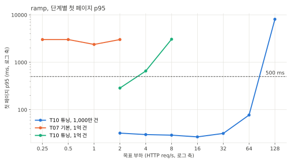
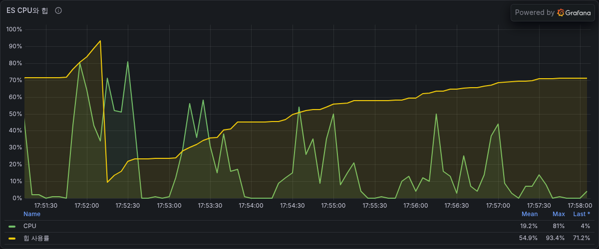
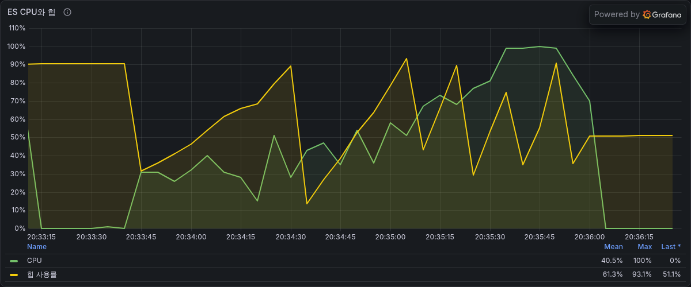
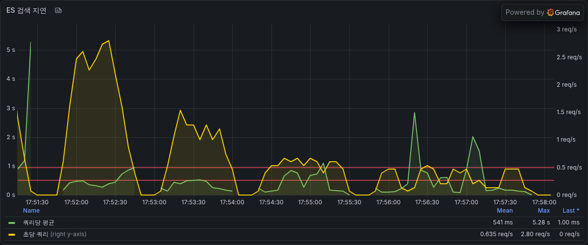
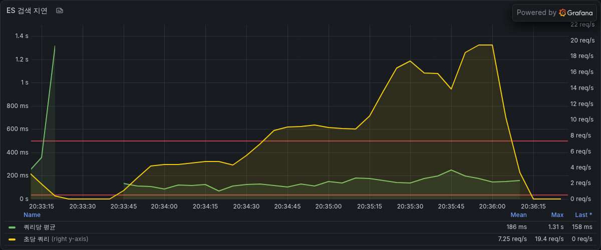
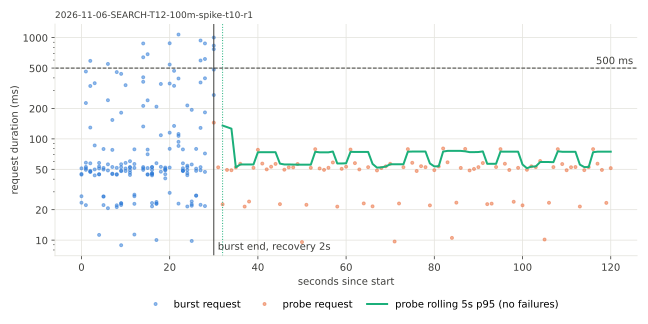
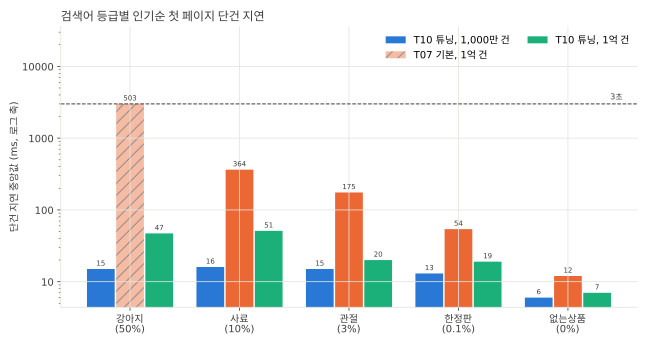
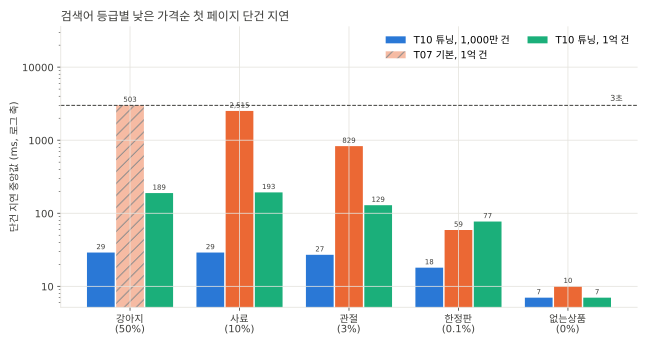
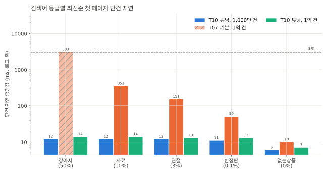

# SEARCH-T12 Elasticsearch 1억 건 측정

2026-11-06에 AWS perf 스택에서 상품 1억 건을 만들고 T07 jar(기본 Elasticsearch 검색)와 T10 jar(L5까지 튜닝한 검색)를 같은 데이터로 잰 기록이다. 앱 코드는 바꾸지 않았다. 지연은 ms, 요청률은 초당 HTTP 요청 수(req/s)다. run별 전체 표는 `SEARCH-T12.md`에 있다.

## 요약

- T07 jar는 강아지(상품명 일치 50%, 검색 결과 4,700만 건) 첫 페이지가 인기순, 낮은 가격순, 최신순 모두 3초 타임아웃(503)이었다. ramp의 모든 단계(0.25 req/s에서 2 req/s)에서 요청의 4.4%에서 6.9%가 실패해 최대 안정 요청률과 처리 가능 요청률이 모두 0이다.
- T10 jar는 최대 안정 요청률 2 req/s, 처리 가능 요청률 4 req/s였다. 같은 2 req/s 단계에서 첫 페이지 p95가 3,013ms에서 286ms, 실패율이 5.61%에서 0%가 됐다. 부하 없이 보낸 강아지 첫 페이지는 인기순 47ms, 낮은 가격순 189ms, 최신순 14ms다.
- T10 jar를 1,000만 건과 비교하면 최대 안정 요청률이 64 req/s에서 2 req/s가 됐다. 요청 하나가 쓴 ES CPU는 0.020초 안팎에서 0.15초에서 0.21초로 8배에서 10배가 됐다. 4 req/s 단계에서 ES CPU 평균은 컨테이너 한도의 37%였지만 첫 페이지 p95가 654ms로 SLO를 넘었다.
- 1억 건에서 비싼 요청은 가격 범위를 건 낮은 가격순 첫 페이지다. ES에 함께 보내는 하위 요청 넷이 부하 없는 ES에서 하나에 30ms에서 299ms, 넷을 더하면 563ms에서 772ms였다. 인기순 첫 페이지의 결과 요청은 13ms에서 42ms다. steady(1.4 req/s)에서 이 필터 요청의 p50은 419ms에서 567ms였다.
- 1억 건 색인은 17,059MB(T07 jar)와 18,181MB(T10 jar, 색인 정렬)였고 ES 호스트(r7g.xlarge, 메모리 32GB)의 페이지 캐시에 모두 올라 측정 중 ES 호스트 디스크 읽기가 없었다. 1,000만 건(m7g.large, 메모리 8GB)도 디스크 읽기가 없었다. ES 컨테이너 CPU 한도는 두 크기 모두 2코어다.
- 데이터 준비에서 T06 리뷰 수 UPDATE 한 문장이 72분 동안 470만 행만 고쳐 중단했다. id 50만 건 구간마다 나눠 다시 채우니 1,097초에 끝났다(초당 약 1,000행에서 약 5만 5천 행).

## 목적

측정 전에 수치 가설은 적지 않았다. 확인하려던 것은 셋이다.

- 데이터가 1,000만 건의 10배일 때도 T10 레버가 T07 jar보다 나은지
- 1,000만 건에서 1억 건으로 갈 때 어느 요청의 비용이 얼마나 느는지
- ES CPU 2코어에서 1억 건을 SLO 안에서 몇 req/s까지 받는지

## 변경 내용

- 앱 코드는 바꾸지 않았다. 측정 jar는 T07 jar(235e95a53568)와 T10 jar(533fc2978da2, L5)다.
- perf terraform에 RDS `aechak-perf-100m`(저장 공간 150GB)을 더하고 ES 호스트 디스크를 80GB로 늘렸다. 1억 건은 ES 호스트를 r7g.xlarge로 띄우고(`-var es_instance_type=r7g.xlarge`) ES 컨테이너 CPU를 2개로 제한해 1,000만 건(m7g.large, vCPU 2)과 ES CPU 조건을 맞췄다. 힙은 두 크기 모두 4GB다.
- 측정 도구가 100m 데이터셋을 받는다. 시드와 init 대기는 6시간, manifest는 3시간, 재색인 준비 대기는 4시간으로 늘렸다.
- 1억 건 manifest는 행 수, 체크섬, 활성 할인 수만 센다. 검색어별 개수를 세는 문장이 5시간 30분이 지나도 끝나지 않았다. 변형을 시작할 때의 manifest 비교는 원래 행 수와 체크섬만 본다.

## 환경

- perf 측정층은 T08, T10과 같다. api m7i.large(api 컨테이너 1코어, 2GB, Hikari 최대 10), 러너 c7g.large, RDS db.m7g.large(MySQL 8.4.11, 버퍼 풀 5.25GiB)다.
- ES 호스트는 r7g.xlarge(vCPU 4, 메모리 32GB, 디스크 80GB)다. Elasticsearch 9.2.6 단일 노드를 컨테이너 CPU 2개, 힙 4GB로 띄웠고 색인은 샤드 1개, 복제 0개다. 1,000만 건(T08, T10)의 ES 호스트는 m7g.large(vCPU 2, 메모리 8GB)였다.
- 데이터는 RDS `aechak-perf-100m`이다. 상품 1억 건, 상품 통계 6,000만 건, 판매자 1,000명, 카테고리 67개, 측정 시점 활성 할인 3,010만 건이다. 시드 직후 information_schema 추정으로 products 테이블은 데이터 17.9GB, 인덱스 8.2GB였다(T06 인덱스 전). 스키마 해시와 인덱스 해시는 1,000만 건 측정과 같다.
- 검색 결과 총개수(가격 필터 없음, 모든 카테고리)는 강아지 4,700만, 사료 1,000만, 관절 266만 6,667건이다. 1억 건 manifest에 검색어별 개수가 없어 ES 개수 요청으로 셌다. 강아지는 1,000만 건의 470만 건에서 10배다.
- 셀 순서는 예열(2 req/s 60초), ramp, steady 3번, spike, sequential이다. T07 jar는 ramp에서 SLO와 처리 기준을 통과한 단계가 없어 기준 요청률이 0이고 kit 규칙대로 steady와 spike를 건너뛰었다. T10 jar는 자기 ramp의 최대 안정 요청률 2 req/s를 기준으로 steady 1.4 req/s, spike 6 req/s를 돌렸다. steady와 spike는 T10 jar만 있다.
- 시각(KST)은 시드 05:14부터 06:21, DDL 복구 끝 15:27, T07 jar 재색인 끝 17:15, T07 jar 측정 17:50부터 17:59, T10 jar 측정 20:32부터 20:50이다. ES에 직접 보낸 실험은 21:06에 측정 트래픽 없이 보냈다.
- 시간당 비용(서울 리전 온디맨드, AWS 가격 페이지가 쓰는 공개 가격 데이터, 2026-11-05 게시분)은 ES 호스트 r7g.xlarge 0.2584달러, 1,000만 건의 m7g.large 0.1003달러다. api 호스트 m7i.large 0.1239달러와 러너 c7g.large 0.0816달러는 두 크기가 같다. RDS 클래스도 두 크기가 같고(db.m7g.large) 가격은 확인하지 않았다.

### 색인과 메모리

| 항목 | 1,000만 건 | 1억 건 |
|---|---|---|
| ES 호스트 | m7g.large (vCPU 2, 8GB) | r7g.xlarge (vCPU 4, 32GB), ES 컨테이너 CPU 2개 |
| 색인 크기 (T07 jar) | 1,631MB | 17,059MB |
| 색인 크기 (T10 jar, 색인 정렬) | 1,656MB | 18,181MB |
| 색인 크기 / 호스트 메모리 | 20% | 52%, 55% |
| 재색인 (T07 jar, T10 jar) | 590초, 621초 | 6,408초, 6,827초 |
| 측정 중 ES 호스트 디스크 읽기 | run마다 1MB 미만 | run마다 1MB 미만 |
| ES 힙 사용률 최대 (steady) | 69%에서 75% | 91%에서 95% |
| ES 호스트 시간당 비용 | 0.1003달러 | 0.2584달러 |

- T10 jar 측정이 끝난 뒤 ES 호스트의 페이지 캐시는 31.5GB 중 18.4GB였다.
- 힙 사용률 최대는 1억 건이 높았지만 steady run 하나(3분)의 GC 시간 합은 0.07초였고 old GC는 없었다.

### 1억 건 데이터 준비

- 시드는 67분 걸렸다.
- T06 DDL의 리뷰 수 UPDATE(products와 product_stats 6,000만 행 조인) 한 문장이 72분 동안 470만 행을 고쳤다. RDS가 gp3 기본 성능 3,000 IOPS를 다 쓰고 있었고(읽기 1,100, 쓰기 1,900 IOPS, 대기열 29, CPU 7%) 남은 시간이 13시간 안팎으로 계산돼 `mysql.rds_kill_query`로 중단했다. 롤백은 48분 걸렸다.
- 다시 채울 때는 id 50만 건 구간마다 `UPDATE products p STRAIGHT_JOIN product_stats s ON s.product_id = p.id SET p.review_count = s.review_count WHERE p.id >= ? AND p.id < ?`를 보냈다. products를 먼저 읽게 해 id 순서로 고친다. 1,097초에 끝났고 두 테이블의 리뷰 수 합계(7,467,500,000)가 같은 것을 확인했다.
- T06 파일의 인덱스 세 개는 ALTER 한 문장으로 만들었다(1,651초). perf_applied_ddl에 SEARCH-T06을 기록해 이후 측정의 DDL 확인을 통과했다.

## 측정 결과

### ramp



ES CPU는 ES 호스트 CPU를 Prometheus에서 단계 구간의 평균으로 다시 읽어 ES 컨테이너 한도(2코어) 대비로 바꾼 값이다. 1억 건 ES 호스트는 vCPU가 4개라 호스트 사용률에 2를 곱했고 호스트의 다른 프로세스도 들어간다. T07 jar ramp는 첫 단계(2 req/s)에서 SLO를 못 지켜 kit 규칙대로 1, 0.5, 0.25 req/s로 내려갔다.

| 목표 req/s | T07 첫 페이지 p95 | T07 실패율 | T10 첫 페이지 p95 | T10 실패율 | T10 실제 req/s | T07 ES CPU | T10 ES CPU |
|---|---|---|---|---|---|---|---|
| 0.25 | 3,012 | 6.89% | 재지 않음 | | | 8% | |
| 0.5 | 3,012 | 6.89% | 재지 않음 | | | 14% | |
| 1 | 2,377 | 4.44% | 재지 않음 | | | 21% | |
| 2 | 3,013 | 5.61% | 286 | 0% | 2.02 | 41% (최대 56%) | 16% (최대 21%) |
| 4 | 재지 않음 | | 654 | 0% | 3.97 | | 37% (최대 52%) |
| 8 | 재지 않음 | | 3,061 (dropped 7) | 1.13% | 7.74 | | 80% (최대 97%) |

| 지표 | T07 jar 1억 건 | T10 jar 1억 건 | T10 L5 1,000만 건 |
|---|---|---|---|
| 최대 안정 요청률 | 0 | 2 req/s | 64 req/s |
| 처리 가능 요청률 | 0 | 4 req/s | 64 req/s |
| 요청 하나의 ES CPU | 0.41초 (2 req/s) | 0.15초에서 0.21초 (2에서 8 req/s) | 0.020초 (2에서 8 req/s), 0.018초 (64 req/s) |
| HTTP 요청 하나의 ES 쿼리 시간 합 | 535ms (2 req/s) | 243ms, 313ms, 388ms (2, 4, 8 req/s) | 21ms에서 23ms (2에서 8 req/s) |
| 검색 스레드 대기열 최대 | 0 | 4 (2와 4 req/s), 8 (8 req/s) | 0 (32 req/s까지), 7 (64 req/s) |

| | T07 jar | T10 jar |
|---|---|---|
| ES CPU와 힙 |  |  |
| ES 검색 지연 |  |  |

- T07 jar의 실패는 모두 인기순 첫 페이지의 3초 타임아웃이고 3초에 닿은 검색어는 강아지뿐이다. 강아지 인기순 첫 페이지는 반복의 8% 안팎에서 나간다(검색어 가중치 10%, 인기순 첫 페이지를 보내는 반복 80%). 부하를 0.25 req/s로 낮춰도 실패율이 줄지 않았다.
- T10 jar는 2 req/s에서 SLO를 지켰다. 4 req/s에서 첫 페이지 p95가 654ms로 SLO를 넘었지만 실패와 dropped가 없어 처리 가능 요청률은 4 req/s다. 8 req/s에서 ES CPU가 한도에 닿았고(최대 97%) 실패가 1.13%였다.
- 요청 하나가 쓴 ES CPU는 T10 jar가 T07 jar(2 req/s 단계 0.41초)의 절반 아래다. 1,000만 건 L5와 비교하면 같은 요청률 단계에서 8배(2 req/s)에서 10배(8 req/s)이고 HTTP 요청 하나의 ES 쿼리 시간 합은 12배에서 17배다.
- 4 req/s 단계의 ES CPU 평균은 한도의 37%였다. 그런데도 2 req/s 단계부터 검색 스레드 4개가 모두 일하는 순간이 있었고 대기열이 최대 4였다. 1,000만 건은 32 req/s 단계까지 대기열이 0이었다.

### steady (T10 jar, 1.4 req/s)

| 요청 | 비율 | 1억 건 T10 jar p50 / p95 / p99 | 1,000만 건 T10 L5 p50 / p95 / p99 (22.4 req/s) |
|---|---|---|---|
| 첫 페이지 (인기순) | 60% | 52에서 58 / 136에서 144 / 137에서 153 | 17 / 25 / 31에서 33 |
| 필터 첫 페이지 (가격 범위, 낮은 가격순) | 20% | 419에서 567 / 819에서 881 / 820에서 894 | 44에서 45 / 93에서 98 / 124에서 132 |
| 다음 페이지 (인기순) | 20% | 45에서 50 / 118에서 131 / 119에서 133 | 16에서 17 / 18 / 20에서 21 |

- 세 번 모두 실패가 없다. 첫 페이지 p95 반복 사이 폭은 5.9%다.
- 요청 하나가 쓴 ES CPU는 0.18초에서 0.20초다(1,000만 건 L5 steady 0.020초). RDS CPU는 2.0%에서 2.7%다.
- 부하가 다르다. 1억 건은 자기 최대 안정 요청률의 0.7배, 1,000만 건은 T08 기준 요청률(32 req/s)의 0.7배로 돌렸다.

### spike (T10 jar, 6 req/s 30초)

| burst 실패율 | 탐침 실패율 | 회복 시간 | 첫 페이지 p50/p95/p99/최대 | Hikari 대기 최대 | ES CPU 최대 |
|---|---|---|---|---|---|
| 0% | 0% | 2초 | 53/482/639/768 | 0 | 45% |



- burst 30초 동안 179건(초당 6건)을 보냈다. 처리 가능 요청률(4 req/s)보다 높지만 30초 동안은 실패 없이 받았고 burst가 끝나고 2초 뒤 탐침 p95가 500ms 아래로 돌아왔다.
- DB 커넥션 대기는 없었다(Hikari 활성 최대 3). 요청 수가 적어 커넥션 10개가 모자라지 않았다. 검색 요청이 ES 응답을 기다리는 동안 DB 커넥션을 잡는 구조는 그대로다.

### 검색어별 첫 페이지







부하 없이 한 건씩 보낸 첫 페이지 지연의 중앙값이다. 2쪽은 T10 jar 1억 건 값이다.

| 검색어 (상품명 일치) | 정렬 | T07 jar 1억 건 | T10 jar 1억 건 | T10 jar 1억 건 2쪽 | T10 L5 1,000만 건 |
|---|---|---|---|---|---|
| 강아지 (50%) | 인기순 | 3,011 (503) | 47 | 48 | 15 |
| 강아지 (50%) | 낮은 가격순 | 3,013 (503) | 189 | 200 | 29 |
| 강아지 (50%) | 최신순 | 3,011 (503) | 14 | 14 | 12 |
| 사료 (10%) | 인기순 | 364 | 51 | 46 | 16 |
| 사료 (10%) | 낮은 가격순 | 2,515 | 193 | 195 | 29 |
| 사료 (10%) | 최신순 | 351 | 14 | 14 | 12 |
| 관절 (3%) | 인기순 | 175 | 20 | 22 | 15 |
| 관절 (3%) | 낮은 가격순 | 829 | 129 | 103 | 27 |
| 관절 (3%) | 최신순 | 151 | 13 | 13 | 12 |
| 한정판 (0.1%) | 인기순 | 54 | 19 | 20 | 13 |
| 한정판 (0.1%) | 낮은 가격순 | 59 | 77 | 58 | 18 |
| 한정판 (0.1%) | 최신순 | 50 | 13 | 14 | 11 |
| 없는상품 (0%) | 인기순 | 12 | 7 | | 6 |
| 없는상품 (0%) | 낮은 가격순 | 10 | 7 | | 7 |
| 없는상품 (0%) | 최신순 | 10 | 7 | | 6 |

- T07 jar는 일치 상품이 많을수록 크게 느려졌다. 강아지는 세 정렬 모두 3초 타임아웃이고 사료 낮은 가격순은 첫 페이지 2,515ms, 2쪽 2,141ms다. sequential 72건 중 9건(12.5%)이 503이었다.
- T10 jar의 최신순은 데이터 크기와 거의 무관하다(강아지 1,000만 건 12ms, 1억 건 14ms). 색인을 id 내림차순으로 저장해 21개를 읽고 멈춘다.
- T10 jar의 인기순은 1,000만 건의 3배 안팎(강아지 15ms에서 47ms), 낮은 가격순은 4배에서 7배(강아지 29ms에서 189ms, 관절 27ms에서 129ms)가 됐다.
- 한정판 낮은 가격순 첫 페이지만 T10 jar(77ms)가 T07 jar(59ms)보다 느리다. 1,000만 건에서도 T10 L5(18ms)가 T08(10ms)보다 느렸다.

### 필터 요청의 비용 나누기

steady에서 가장 느린 필터 첫 페이지(가격 10,000원에서 80,000원, 낮은 가격순)를 나눠 보려고 T10 jar가 보내는 요청과 같은 본문을 ES 호스트에서 `curl`로 보냈다. 요청 캐시를 끄고(`request_cache=false`) 요청 시각을 요청마다 바꿔 9번 보낸 took 중앙값이다. 노드 쿼리 캐시는 비우지 않았다. 카테고리와 무료 배송 조건은 걸지 않았다.

| 요청 | 강아지 | 사료 | 관절 |
|---|---|---|---|
| 인기순 결과 (개수 없음) | 39 | 42 | 13 |
| 인기순 개수 (크기 0) | 29 | 3 | 4 |
| 필터, 할인 중인 쪽 결과 (할인가 정렬) | 214 | 299 | 264 |
| 필터, 할인 중이 아닌 쪽 결과 (정가 정렬) | 179 | 208 | 89 |
| 필터, 할인 중인 쪽 개수 | 97 | 184 | 230 |
| 필터, 할인 중이 아닌 쪽 개수 | 73 | 81 | 30 |
| 필터 넷의 합 | 563 | 772 | 613 |

- 필터 첫 페이지는 위 표의 필터 네 요청을 한꺼번에 보낸다. 지연은 가장 느린 요청(214ms에서 299ms)을 따르고 ES가 쓰는 시간은 넷의 합(563ms에서 772ms)이다. 네 요청 모두 요청 시각이 본문에 들어가 요청 캐시로 다시 쓰이지 않는다.
- 비싼 것은 가격으로 정렬하는 결과 요청이다. 같은 조건의 개수 요청보다 비싸고 인기순 결과 요청의 4배에서 20배다.
- 인기순 첫 페이지는 결과 요청 하나와 개수 요청 하나다. 측정에서 개수 요청은 같은 검색어가 되풀이돼 대부분 요청 캐시에서 나온다.
- steady의 필터 첫 페이지 p50(419ms에서 567ms)은 부하 없는 ES에서 가장 느린 하위 요청의 2배 안팎이다.

## 해석

- 1억 건에서 T07 jar는 강아지처럼 일치 상품이 많은 검색어 때문에 부하와 상관없이 실패한다. 첫 페이지 개수와 정렬이 일치 상품 4,700만 건을 모두 다룬다. T10 레버(개수 분리, 색인 정렬, 가격 정렬 분할, 할인 조건 변경)가 없으면 1억 건에서는 강아지 검색이 3초 안에 끝나지 않는다.
- 요청 비용은 데이터 크기를 따라 늘었다. 데이터와 강아지 일치 상품이 10배가 될 때 요청 하나의 ES CPU가 8배에서 10배가 됐다. 정렬마다 늘어난 폭이 달라 색인 순서대로 21개를 읽고 멈추는 최신순은 거의 그대로였고 인기순은 3배 안팎, 요청 시각에 따라 바뀌는 할인 조건을 거는 낮은 가격순은 4배에서 7배였다.
- 처리 가능 요청률은 요청 비용보다 더 많이 줄었다(64 req/s에서 4 req/s, SLO 기준으로는 64 req/s에서 2 req/s). 요청 하나의 ES CPU(0.19초 안팎)로 계산한 CPU 2코어의 상한은 10 req/s 안팎인데 SLO는 4 req/s에서 넘었다. 필터 요청 하나가 하위 요청 넷으로 검색 스레드 4개와 CPU 2개를 함께 쓰는 동안 들어온 인기순 첫 페이지가 기다린 것으로 보인다. 필터 요청은 요청 구성의 20%지만 하나가 쓰는 ES 시간이 인기순 첫 페이지의 10배가 넘어 ES 시간에서 차지하는 몫이 큰 것으로 보인다.
- 이번 비교는 순수한 데이터 크기 확장이 아니다. ES 컨테이너 CPU는 2코어로 같지만 호스트 메모리가 8GB에서 32GB로 늘었다. 두 크기 모두 색인이 페이지 캐시에 다 올라 디스크 읽기가 없었으므로 차이는 CPU 비용이다. 메모리가 색인보다 작으면 디스크 읽기가 더해진다.
- 병목은 ES 호스트다. 1억 건 측정 내내 RDS CPU는 2%에서 3%였고 api CPU는 10% 아래였다.

## 결정

- T10 jar의 레버를 그대로 둔다. 이 단계는 측정만 했다.
- 이 요청 구성과 ES CPU 2코어에서 1억 건의 최대 안정 요청률은 2 req/s다. 1억 건을 같은 SLO로 받으려면 가격 범위 필터와 낮은 가격순 결과 요청의 비용을 줄이거나 ES CPU를 늘려야 한다.
- 비용을 줄일 후보는 가격으로 정렬하는 결과 요청이다. 요청 시각마다 달라지는 할인 조건 때문에 일치 상품을 모두 확인하는 것으로 보인다. 할인 경계마다 실제 가격을 미리 계산해 색인하는 방법은 경계 직후 가격이 늦게 바뀌는 구간이 생겨 제품 결정이 필요하다. 이번 단계에서는 하지 않는다.
- 다음은 계획대로 SEARCH-T13(ES 호출 전 DB 커넥션 반납과 ES 장애 셀), SEARCH-T14(쓰기 부하 셀과 다양한 검색어 셀), SEARCH-T11(최종 비교)이다.

## 측정의 한계

- T07 jar는 기준 요청률이 0이라 steady와 spike를 재지 않았다. 두 jar를 같은 부하에서 비교한 것은 ramp 2 req/s 단계와 sequential뿐이다.
- T10 jar ramp는 2, 4, 8 req/s만 쟀다. 최대 안정 요청률은 2 req/s와 4 req/s 사이 어딘가다.
- 1,000만 건과 1억 건은 ES 호스트 메모리(8GB, 32GB)와 vCPU 수(2, 4)가 다르다. ES 컨테이너의 CPU 한도는 둘 다 2코어지만 1억 건에서는 익스포터 같은 다른 프로세스가 남은 vCPU 2개를 쓸 수 있었다.
- 1억 건에서 응답 동등성(고정 요청 384개 비교)은 확인하지 않았다. T10 jar의 결과는 1,000만 건에서 T07 jar와 같았다.
- 1억 건 DDL은 T06 파일의 UPDATE와 인덱스 문장을 그대로 돌리지 않고 구간 백필과 ALTER 한 문장으로 적용했다. 최종 스키마 해시와 인덱스 해시는 1,000만 건과 같다.
- 1억 건 manifest에는 검색어별 개수와 노출 상품 수가 없다.
- 요청 캐시 적중률이 실제보다 높다. 검색어가 9개라 가격 필터가 없는 개수 요청은 대부분 캐시에서 나왔다.
- ES에 직접 보낸 실험은 took만 본다. 네트워크와 앱 처리 시간은 들어가지 않는다. 실험 요청 본문과 스크립트는 저장소에 넣지 않았다.
- 필터 요청이 ES 시간에서 차지하는 몫이 크다는 판단은 부하 없는 took와 요청 구성으로 셈한 것이다. 요청 종류별 ES CPU를 따로 재지는 않았고 실험의 필터 요청은 kit과 달리 카테고리와 무료 배송 조건이 없다.
- 검색 스레드 대기열은 5초 간격 표본이라 짧은 대기는 놓친다.
- ramp, spike, sequential은 한 번씩 돌렸다. 쓰기 트래픽은 없다.
- 시간당 비용은 온디맨드 정가다. RDS 비용은 확인하지 않았다.

## 재현

```bash
cd loadtest/terraform && terraform apply -var es_enabled=true -var es_instance_type=r7g.xlarge
cd ../search && make outputs && make up DATASET=100m
make init DATASET=100m REV=6dce8608b83c-dirty-5c874761   # 시드(67분)와 manifest
# 재색인이 products.review_count를 읽으므로 T06 DDL을 먼저 적용한다(1억 건은 아래 SQL 참고)
make reindex DATASET=100m REV=235e95a53568
make variant STEP=SEARCH-T12 DATASET=100m VARIANT=t07 REV=235e95a53568 DDL="SEARCH-T06" ENV=AECHAK_SEARCH_ENGINE=es \
  RAMP_RATES="2 4 8 16 32 64 128 256 384 512" CELLS="ramp steady spike sequential"
make reindex DATASET=100m REV=533fc2978da2
make variant STEP=SEARCH-T12 DATASET=100m VARIANT=t10 REV=533fc2978da2 DDL="SEARCH-T06" ENV=AECHAK_SEARCH_ENGINE=es \
  RAMP_RATES="2 4 8 16 32 64 128 256 384 512" CELLS="ramp steady spike sequential"
```

1억 건 T06 DDL은 러너에서 `ddl/SEARCH-T06.sql`의 ADD COLUMN 문장을 돌린 뒤 아래처럼 적용했다. 끝나면 `perf_applied_ddl`에 `SEARCH-T06`과 파일 체크섬을 넣는다.

```sql
-- id 50만 건 구간마다 반복
UPDATE products p STRAIGHT_JOIN product_stats s ON s.product_id = p.id
SET p.review_count = s.review_count WHERE p.id >= ? AND p.id < ?;
ALTER TABLE products ADD INDEX ix_products_popular (review_count DESC, id DESC),
  ADD INDEX ix_products_discount_price (discount_price, id DESC),
  ADD INDEX ix_products_regular_price (regular_price, id DESC), ALGORITHM=INPLACE, LOCK=NONE;
```

ES에 직접 보낸 실험은 ES 호스트에서 `curl -H 'Content-Type: application/json' 'localhost:9200/products/_search?request_cache=false' -d @body.json`으로 보냈다.
