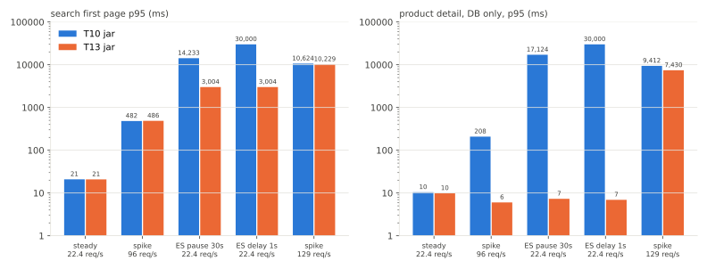
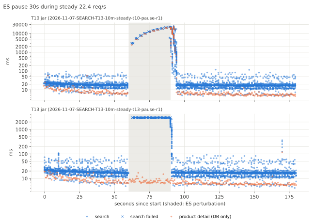
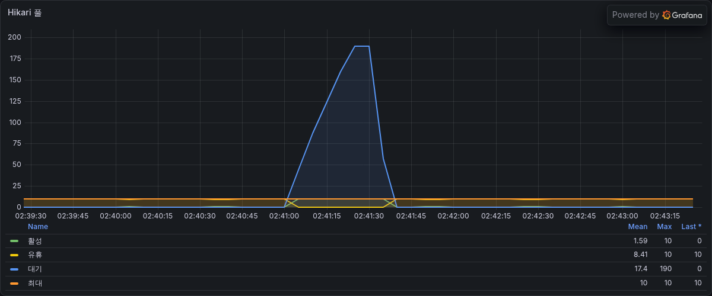
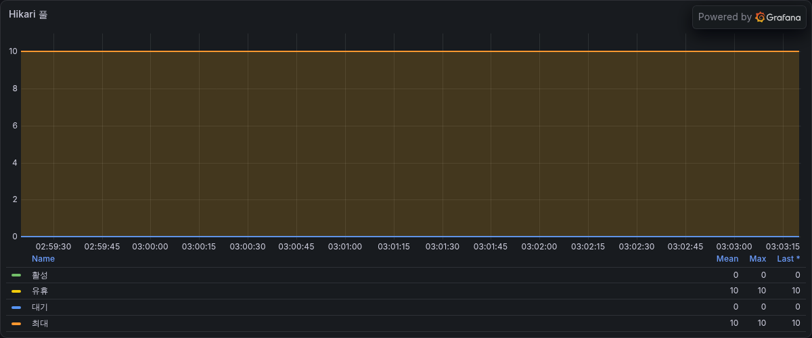
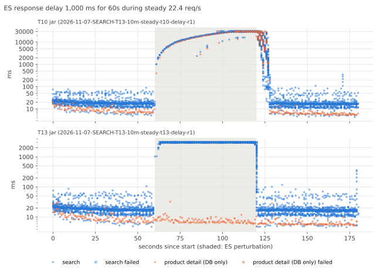
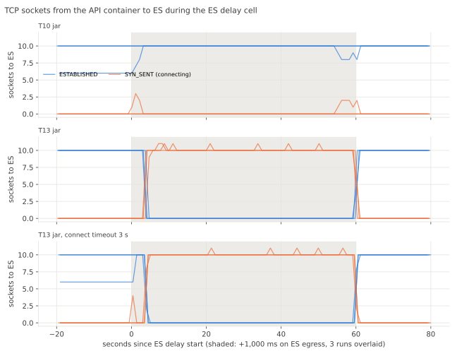
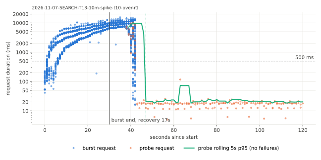
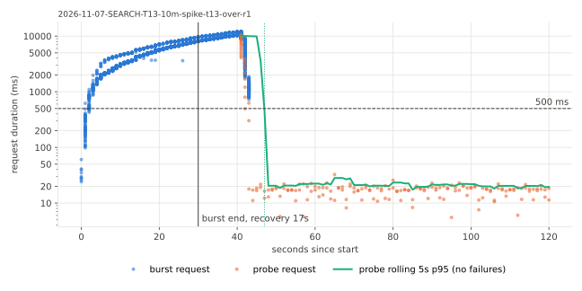

# SEARCH-T13 Elasticsearch 응답을 기다리는 동안 DB 커넥션 반납

2026-11-07에 AWS perf 스택에서 T10 jar와 T13 jar를 상품 1,000만 건으로 잰 기록이다. T13 jar는 T10 jar 커밋에 이 단계의 코드 변경만 더해 만들었으므로 두 jar의 차이는 검색 트랜잭션의 범위뿐이다. 평소 부하, 순간 부하, ES 정지, ES 응답 지연, ES 처리량을 넘는 순간 부하에서 검색과 DB만 쓰는 요청을 함께 쟀다. 지연은 ms, 요청률은 초당 HTTP 요청 수(req/s)다. run별 전체 표는 `SEARCH-T13.md`에 있다.

## 요약

- 검색이 ES 응답을 기다리는 동안 읽기 트랜잭션을 열어 두지 않게 했다. ES 어댑터를 쓰면 카테고리 조회와 찜 조회만 짧은 읽기 트랜잭션에서 하고 ES 호출은 트랜잭션 밖에서 한다. JPA 어댑터는 지금처럼 검색 전체를 읽기 트랜잭션 하나로 묶는다.
- ES를 30초 멈췄을 때 T10 jar는 DB 커넥션 대기가 190까지 쌓였고 처리 중 요청이 Tomcat 스레드 상한인 200에 닿았다. DB만 읽는 상품 상세 요청의 p95가 평소 7ms에서 13ms였는데 17초가 됐다. T13 jar는 DB 커넥션 대기가 0이었고 상품 상세 p95가 6ms에서 14ms였다. 검색은 3초 타임아웃(503)으로 실패했다.
- ES 응답을 1초 늦췄을 때 T10 jar는 run마다 DB 커넥션 획득 타임아웃이 52건에서 67건 났다. 지연 구간에 끝난 상품 상세 60건 안팎 중 17건에서 24건이 k6의 30초 타임아웃으로 실패했다. T13 jar는 상품 상세가 모두 성공했고 p95가 6ms에서 10ms였다. 대신 지연 구간에 끝난 검색의 95%에서 98%가 503으로 실패했다.
- 이 실패는 ES 클라이언트의 연결 10개에서 생겼다. 지연이 시작되고 4초에서 5초 사이에 T13 jar의 ES 연결 10개가 모두 닫혔다. 그 뒤로 연결 시도가 초당 38건 있었지만 지연이 끝날 때까지 한 건도 맺어지지 않았고 ES가 받은 쿼리도 0건이었다. 연결을 기다리던 검색이 3초를 넘겨 요청을 취소하면서 맺는 중이던 연결을 평균 0.26초 만에 끊었기 때문이다. 연결 제한 시간을 1초에서 3초로 늘려도 같았다.
- T10 jar에서는 DB 커넥션이 10개라 ES를 부르는 검색도 동시에 10개까지만 돌았다. 나머지 검색은 3초 타임아웃이 시작되기 전에 DB 커넥션을 기다렸고 ES 연결 10개는 지연 내내 유지됐다. ES가 받은 쿼리는 초당 9.7건이었다.
- 초당 96건 순간 부하에서 첫 페이지 p95는 482ms와 486ms로 같았다. DB 커넥션 대기 최대가 24에서 0, 상품 상세 p95가 208ms에서 6ms가 됐다. 2쪽 p95는 490ms에서 899ms로 늘었다.
- ES 처리량을 넘는 초당 129건 순간 부하에서는 두 jar 모두 처리 중 요청이 200에 닿았고 상품 상세 p95가 9.4초와 7.4초였다. DB 커넥션을 놓아도 검색 요청이 Tomcat 스레드를 모두 쓰면 다른 요청이 기다린다.
- 평소 부하(초당 22.4건)의 첫 페이지 p95는 21ms에서 23ms와 21ms에서 22ms로 차이가 없다.

## 가설

측정 전에 적은 가설이다.

- 근거는 두 가지다. `ProductKeywordSearchFacade.searchProducts`의 `@Transactional(readOnly = true)`가 카테고리 조회, ES 호출, 찜 조회를 한 트랜잭션으로 묶는다. 1,000만 건 T08 순간 부하(초당 96건)에서 Hikari 대기가 191까지 늘었고 첫 페이지 p95가 ES 3초 타임아웃보다 긴 15초였다.
- ES 경로의 Hikari 대기가 0 근처로 줄고 순간 부하의 지연은 ES 처리 시간만 따를 것이다.
- ES에 지연을 넣으면 변경 전에는 커넥션 풀이 비어 DB만 쓰는 요청도 느려지고 변경 뒤에는 검색만 느려질 것이다.

## 변경 내용

| 커밋 | 바꾼 것 |
|---|---|
| 4c8406e6 | `ProductKeywordSearchFacade`에서 `@Transactional(readOnly = true)`를 뺐다. 검색 포트가 DB를 읽으면(`ProductKeywordSearchPort.readsDatabase`, JPA 어댑터) 검색 전체를 읽기 트랜잭션 하나로 돌린다. DB를 읽지 않으면(ES 어댑터) 카테고리 조회를 짧은 읽기 트랜잭션에서 하고 ES 호출은 트랜잭션 밖에서 한다. 로그인 사용자면 찜 조회와 검색 이벤트 발행을 그 뒤의 짧은 읽기 트랜잭션에서 한다. 통합 테스트 `ProductKeywordSearchTransactionIntegrationTest`를 더했다 |
| 28c175cc | `docs/80-product-catalog.md`에 키워드 검색의 트랜잭션 범위를 적었다 |
| c63650c7 | 측정 도구에 ES 교란(`PERTURB=pause`, `delay`, `write`), DB만 쓰는 대조 요청(`CONTROL_RATE`), 다양한 검색어 구성(`KEYWORD_SET=diverse`, SEARCH-T14에서 쓴다)을 더했다. run마다 ES 요청 캐시와 refresh 통계를 남기고 교란을 건 steady는 요청마다 기록한다 |

- 검색 이벤트 리스너는 `@TransactionalEventListener(AFTER_COMMIT)`이다. 트랜잭션 밖에서 발행하면 최근 검색어가 빠지므로 발행은 커밋되는 트랜잭션 안에 둔다. 통합 테스트는 ES 경로에서도 로그인 첫 페이지만 최근 검색어로 남고 찜 여부가 채워지는 것을 확인한다.
- 통합 테스트는 포트 호출 시점의 트랜잭션 상태와 스레드에 바인딩된 리소스를 기록한다. ES 경로는 첫 페이지와 커서 페이지 모두 트랜잭션도 바인딩된 커넥션도 없고 JPA 경로는 읽기 트랜잭션 안이다.
- 대조 요청은 비로그인 상품 상세 `GET /api/v1/products/{publicId}`다. MySQL만 읽고 ES와 Redis는 부르지 않는다. 늘 같은 상품을 읽는다.

## 환경

- perf 측정층은 T08, T10과 같다. api m7i.large(api 컨테이너 1코어, 2GB, Hikari 최대 10, Tomcat 기본 스레드 최대 200), 러너 c7g.large, RDS db.m7g.large(MySQL 8.4)다. 데이터는 T08의 RDS `aechak-perf-10m`(상품 1,000만 건)이다.
- ES 호스트는 T12의 r7g.xlarge를 그대로 썼다. ES 컨테이너 CPU 2개, 힙 4GB, 샤드 1개, 복제 0개다. T10 jar로 1,000만 건을 다시 색인했다(685초, api 재시작 포함, 1,999MB). T10 측정의 ES 호스트(m7g.large)와 달라 T10 보고서 수치와 직접 비교하지 않는다.
- 측정 jar는 T10 jar(533fc2978da2)와 T13 jar(75517d5f9ba7)다. T13 jar 커밋은 533fc297에 T13 코드 커밋(4c8406e6)만 cherry-pick한 로컬 커밋이고 트리 해시는 3226b8d5다. 이 PR 브랜치의 코드는 develop을 병합해 측정 jar와 검색 밖의 코드가 다르다.
- 앱은 ES 클라이언트의 연결 설정을 따로 주지 않는다. 클라이언트 라이브러리 기본값은 노드 하나에 연결 10개, 전체 30개, 연결 제한 시간 1,000ms다. Spring Boot의 `spring.elasticsearch.connection-timeout` 기본값도 1초이고 Spring Boot 4.0.5의 Elasticsearch 자동 설정 클래스에는 연결 수를 바꾸는 호출이 없다. 앱의 검색 타임아웃 3초는 응답 future를 기다리다 넘으면 취소하고 503(40008)을 돌려준다.
- 셀은 T08, T10의 기준 요청률 32 req/s를 따른다.
  - steady는 초당 22.4건 180초를 세 번 돌렸다.
  - 순간 부하는 초당 96건 30초 뒤 탐침이다.
  - ES 정지는 steady 60초부터 30초 동안 ES 컨테이너를 `docker pause`한다.
  - ES 지연은 steady 60초부터 60초 동안 ES 호스트에서 `tc netem`으로 ES가 보내는 패킷(출발 포트 9200)을 1,000ms 늦춘다.
  - 과부하 순간 부하는 기준 43 req/s로 초당 129건 30초다.
  - steady와 순간 부하에는 대조 요청을 초당 2건 함께 보냈다.
- 셀마다 T10 jar 다음 T13 jar 순서로 돌렸다(01:49부터 04:12). 변형마다 api를 그 jar로 다시 띄우고 2 req/s로 60초 데웠다. k6 요청 타임아웃은 30초다.
- 응답 동등성은 고정 요청 384개로 확인했다. T13 jar 응답은 T10 jar 응답, 2026-11-06 T10 L5 응답과 같았다. 재색인 직후 처음 돌린 T10 jar는 첫 요청(강아지 인기순 첫 페이지)이 3초 타임아웃으로 503이라 그 검색어의 2쪽과 3쪽이 빠져 382줄이었다. 다시 돌리니 384줄로 같았다.

## 측정 결과



steady와 교란 셀은 세 번의 중앙값, 순간 부하는 한 번의 값이다.

### 평소 부하와 순간 부하(초당 96건)

| 셀 | 지표 | T10 jar | T13 jar |
|---|---|---|---|
| steady 22.4 req/s | 첫 페이지 p95 | 21에서 23 | 21에서 22 |
| steady 22.4 req/s | 상품 상세 p95 | 7에서 13 | 7에서 12 |
| 순간 부하 96 req/s | 첫 페이지 p95 / p99 / 최대 | 482 / 578 / 976 | 486 / 596 / 660 |
| 순간 부하 96 req/s | burst 전체 p95, 2쪽 p95 | 490, 490 | 638, 899 |
| 순간 부하 96 req/s | 상품 상세 p95 / p99 / 최대 | 208 / 402 / 584 | 6 / 10 / 19 |
| 순간 부하 96 req/s | Hikari 대기 최대, 처리 중 요청 최대 | 24, 34 | 0, 50 |
| 순간 부하 96 req/s | 실패율, 회복 시간 | 0%, 1초 | 0%, 1초 |

- steady는 차이가 없다. 요청 하나가 쓴 ES CPU와 RDS CPU도 같은 수준이었다.
- 순간 부하에서 ES CPU가 한도(2코어)에 닿았다. T10 jar는 검색이 DB 커넥션 10개를 잡고 ES를 기다려 커넥션 대기가 24까지 쌓였고 상품 상세가 그 뒤에서 기다렸다. T13 jar는 상품 상세가 평소와 같았다.
- T13 jar는 동시에 ES를 기다리는 검색이 34에서 50으로 늘었다. 첫 페이지 p95는 같았지만 2쪽 p95가 490ms에서 899ms로 늘었다.

### ES 정지 30초



| 지표 | T10 jar | T13 jar |
|---|---|---|
| run 전체 첫 페이지 p95 | 13,800에서 14,640 | 3,004에서 3,006 |
| run 전체 실패율 | 2.22%에서 2.34% | 10.27%에서 10.40% |
| dropped | 173에서 174 | 4에서 5 |
| Hikari 대기 최대 | 190에서 191 | 0 |
| 처리 중 요청 최대 | 200 | 48에서 49 |
| 상품 상세 run 전체 p95 / 최대 | 16,955에서 17,161 / 22,086에서 23,349 | 6에서 14 / 14에서 117 |

정지 구간에 응답이 끝난 요청만 센 값이다(세 번의 범위).

| 지표 | T10 jar | T13 jar |
|---|---|---|
| 검색 응답 수 | 99에서 152 | 440에서 467 |
| 검색 성공 | 7에서 57 | 12에서 34 |
| 검색 실패 | 90에서 95 (503, 500) | 428에서 433 (503) |
| 검색 p50 / p95 | 12,531에서 16,464 / 21,874에서 22,031 | 3,004에서 3,005 / 3,005에서 3,009 |
| 상품 상세 응답 수, 실패 | 17에서 28, 0 | 60, 0 |
| 상품 상세 p95 | 19,890에서 21,067 | 6에서 11 |
| 정지가 끝난 뒤 500ms 넘는 응답이 끝난 시각 | 검색 4초, 상품 상세 4초 | 검색 1초 이내, 상품 상세 없음 |

| | T10 jar | T13 jar |
|---|---|---|
| Hikari 풀 |  |  |

- T10 jar는 검색 10건이 DB 커넥션을 잡은 채 ES 응답을 3초씩 기다렸다. 나머지 검색과 상품 상세는 커넥션 대기열에 섰고 대기가 190까지 쌓이며 Tomcat 스레드 200개가 모두 찼다. 정지 구간에 들어온 상품 상세 60건 중 17건에서 28건만 구간 안에 끝났고 나머지는 ES가 돌아온 뒤에 끝났다. 가장 오래 걸린 상품 상세는 22초에서 23초였다.
- T10 jar의 실패율이 낮은 이유는 정지 구간에 들어온 검색 대부분이 커넥션을 기다리다가 ES가 돌아온 뒤 성공했기 때문이다. 정지가 끝나고 30초 안에 끝난 첫 페이지 517건에서 553건은 1건을 빼고 모두 성공했지만 p95가 15.8초에서 20.3초였다.
- T13 jar는 정지 구간의 검색이 3초 타임아웃으로 바로 실패했고 커넥션 대기도 스레드 부족도 없었다. ES가 돌아오고 1초 안에 검색 지연이 평소로 돌아왔다.

### ES 응답 지연 1초



| 지표 | T10 jar | T13 jar |
|---|---|---|
| run 전체 첫 페이지 p95 | 30,000 (k6 타임아웃) | 3,004에서 3,006 |
| run 전체 실패율 | 5.06%에서 5.27% | 22.60%에서 22.71% |
| dropped | 310에서 314 | 4에서 5 |
| Hikari 대기 최대, 획득 타임아웃 | 191, 52에서 67 | 0, 0 |
| 처리 중 요청 최대 | 200 | 48 |
| 상품 상세 run 전체 실패율 / p95 | 6.09%에서 7.76% / 30,000 | 0% / 6에서 13 |

지연 구간에 응답이 끝난 요청만 센 값이다(세 번의 범위).

| 지표 | T10 jar | T13 jar |
|---|---|---|
| 검색 응답 수 | 342에서 349 | 915에서 950 |
| 검색 성공 | 192에서 194 | 16에서 47 |
| 검색 실패 | 148에서 157 (k6 타임아웃, 503) | 899에서 903 (503, 500) |
| 검색 p50 / p95 | 26,563에서 27,270 / 30,001 | 3,004에서 3,005 / 3,005에서 3,008 |
| 상품 상세 응답 수, 실패 | 60에서 63, 17에서 24 | 120, 0 |
| 상품 상세 p95 / 최대 | 30,000 / 30,001 | 6에서 10 / 10에서 32 |
| ES 쿼리 수 (구간 시작 5초 뒤부터) | 초당 9.7에서 9.8 | 초당 0 |
| 지연이 끝난 뒤 500ms 넘는 응답이 끝난 시각 | 검색 7초에서 8초, 상품 상세 7초 | 검색 1초 이내, 상품 상세 없음 |

- T10 jar는 검색 하나가 ES에 1초 넘게 머물며 DB 커넥션을 잡아 초당 5건 안팎만 끝냈다. 들어오는 검색은 초당 20건 안팎이라 커넥션 대기열이 계속 길어졌고 Hikari 획득 타임아웃(30초)과 k6 타임아웃(30초)이 났다. 상품 상세도 같은 대기열에 서서 지연 구간에 끝난 60건 안팎 중 17건에서 24건이 실패했다.
- T13 jar는 상품 상세가 지연과 무관했다. 그러나 지연 구간에 끝난 검색의 95%에서 98%가 503으로 실패했고 ES는 구간 시작 5초 뒤부터 쿼리를 하나도 받지 않았다. 원인은 아래 절에 적었다.
- run 전체 실패율만 보면 T13 jar가 높다. T10 jar가 지연 구간에 성공시킨 검색 192건에서 194건은 지연 구간 검색 p50이 26초를 넘을 만큼 오래 걸렸다. 지연이 끝나고 30초 안에 끝난 첫 페이지도 p95가 27초에서 29초였다.

### 지연 셀에서 T13 jar 검색이 거의 모두 실패한 이유

측정이 끝난 뒤 같은 지연을 다시 걸고 api 호스트에서 ES로 새 연결을 맺어 봤다. 연결 수립에 1.000초가 걸렸다. 연결 제한 시간을 1초로 준 `curl`은 실패했고 2초와 3초로 준 `curl`은 2.0초에 응답을 받았다. `tc netem`이 ES가 보내는 모든 패킷을 늦추므로 연결 수립 응답(SYN-ACK)도 1초 늦는다. 그래서 처음에는 연결 제한 시간 1초 안에 새 연결을 맺지 못한 것을 원인으로 봤다.

이를 확인하려고 같은 지연 셀(steady 초당 22.4건, 대조 요청 초당 2건)을 세 변형으로 세 번씩 다시 돌렸다(2026-11-07 10:47부터 11:47). 변형은 T13 jar, T10 jar, 연결 제한 시간을 3초로 늘린 T13 jar(`SPRING_ELASTICSEARCH_CONNECTIONTIMEOUT=3s`)다. 그동안 api 호스트에서 api 컨테이너 네트워크 네임스페이스의 ES(9200)행 TCP 소켓 상태와 연결 시도 누계(`/proc/<pid>/net/tcp`, `/proc/<pid>/net/snmp`)를 1초마다 읽었고 ES 호스트에서 ES가 연 HTTP 연결 수(`_nodes/stats/http`)를 1초마다 읽었다.



지연 구간의 값이다(세 번의 범위).

| 지표 | T10 jar | T13 jar | T13 jar, 연결 제한 3초 |
|---|---|---|---|
| ES 연결(ESTABLISHED), 지연 6초 뒤부터 | 10 | 0 | 0 |
| 연결 10개가 모두 닫힌 시각 | 닫히지 않음 | 4.0초에서 4.7초 | 4.5초에서 5.0초 |
| 연결 중인 소켓(SYN_SENT), 지연 6초 뒤부터 평균 | 0에서 0.2 | 10 | 10 |
| 새 연결 시도 | 초당 0에서 0.2건 | 초당 38건 | 초당 38건 |
| 연결 시도 하나의 평균 시간 | | 0.26초 | 0.26초 |
| ES가 받은 쿼리 (구간 시작 5초 뒤부터) | 초당 9.6에서 10.0 | 초당 0 | 초당 0 |
| ES가 연 HTTP 연결 수 | 13 | 13에서 3으로 | 13에서 3으로 |
| 커서 해석 500을 뺀 첫 검색 실패 | 36초에서 38초 (k6 타임아웃) | 3초 (503) | 2초에서 3초 (503) |
| 구간에 끝난 검색 중 성공 | 188에서 191 / 346에서 350 | 42에서 59 / 944에서 959 | 55에서 90 / 958에서 993 |
| 지연이 끝나고 연결 10개가 돌아온 시각 | | 0.4초에서 1.1초 | 0.6초에서 1.2초 |

- 연결 시도 하나의 평균 시간은 연결 중인 소켓 수(10)를 초당 연결 시도 수(38)로 나눈 값이다. ES가 연 HTTP 연결 수의 13 중 3은 api 밖의 연결이다. 지연 구간에 ES의 누적 HTTP 연결 수는 지연 전과 같은 속도(초당 1.8개 안팎)로만 늘어 api의 새 연결은 ES까지 맺어지지 않았다.
- 지연이 시작되면 ES 요청 하나가 연결 하나를 1초 넘게 쓴다. 연결 10개로는 초당 10건 안팎이 상한인데 T13 jar는 동시에 처리 중인 검색이 48개 안팎이라 ES 요청이 연결을 기다리며 쌓였다.
- 검색의 3초 타임아웃은 연결을 기다린 시간도 센다. 지연 3초째부터 검색이 3초를 넘겨 ES 요청을 취소했고 응답을 기다리던 요청이 취소되면 그 연결은 닫힌다. 4초에서 5초 사이에 연결 10개가 모두 닫혔다.
- 그 뒤로 연결이 닫힐 때마다 기다리던 요청을 위해 새 연결을 맺기 시작했다. 이 셀에서는 연결 수립에 1초가 넘게 걸리는데 연결 시도는 평균 0.26초 만에 끝났다. 연결 제한 시간보다 짧으므로 연결 시도를 끝낸 것은 제한 시간이 아니라 검색의 취소다. 연결을 받는 요청은 이미 3초 중 대부분을 기다리며 쓴 요청이라 연결이 맺어지기 전에 검색이 3초를 넘긴 것으로 본다.
- 연결 제한 시간을 3초로 늘려도 소켓 상태, 연결 시도 수, ES가 받은 쿼리 수가 같았다. 처음에 본 원인(연결 제한 시간 1초)은 원인이 아니었다.
- T10 jar는 DB 커넥션 10개를 잡은 검색만 ES를 불렀다. 나머지 검색은 3초 타임아웃이 시작되기 전에 DB 커넥션을 기다렸다(Hikari 대기 191). ES 요청이 3초를 넘기는 일이 드물어 연결이 닫히지 않았고 ES가 초당 10건 안팎의 쿼리를 받았다. 대신 지연 구간에 끝난 검색의 45% 안팎이 DB 커넥션을 기다리다 k6 타임아웃(30초)으로 실패했다.
- ES 프로세스가 느린 경우(GC, CPU 포화)에는 커널이 연결 수립을 바로 처리하므로 ES가 쿼리를 한 건도 받지 못하는 일은 없다. 그러나 연결을 기다린 시간이 3초 타임아웃에 포함되는 구조는 같아서 ES가 받은 요청도 응답 전에 취소되며 연결이 닫힐 수 있다. 이 경우는 재지 않았다.

### ES 처리량을 넘는 순간 부하(초당 129건 30초)

| 지표 | T10 jar | T13 jar |
|---|---|---|
| 첫 페이지 p50 / p95 / p99 / 최대 | 5,305 / 10,624 / 12,255 / 15,488 | 5,989 / 10,229 / 10,582 / 10,638 |
| 실패율, 회복 시간 | 0%, 17초 | 0%, 17초 |
| 상품 상세 p95 / p99 / 최대 | 9,412 / 11,267 / 12,470 | 7,430 / 8,485 / 8,788 |
| Hikari 대기 최대 | 190 | 0 |
| 처리 중 요청 최대 | 200 | 200 |
| api CPU 최대 (1코어 한도) | 0.99 | 0.92 |

| T10 jar | T13 jar |
|---|---|
|  |  |

- 초당 129건은 이 ES 호스트의 처리량을 넘는다. 두 jar 모두 ES CPU가 한도에 닿았고 burst 동안 응답 시간이 0초에서 10초 넘게 계속 늘었다. 줄이 계속 길어진 것이다.
- T13 jar는 DB 커넥션 대기가 없었지만 처리 중 요청이 Tomcat 스레드 상한 200에 닿았다. 상품 상세도 스레드를 기다려 p95가 7.4초였다. ES 처리량을 넘는 부하에서는 DB 커넥션을 놓는 것만으로 다른 요청을 지키지 못한다.
- api CPU도 두 jar 모두 한도 가까이 올랐다. 스레드와 CPU 중 어느 쪽이 먼저 막혔는지는 나누지 않았다.

### 발견한 문제

- 2쪽 요청의 커서 상품을 ES에서 찾는 `findIdByPublicId`가 3초를 넘기면 503(40008)이 아니라 500(90000)이 나간다. `ProductKeywordSearchService.searchPage`는 결과 조회의 `QueryTimeoutException`만 `PRODUCT_SEARCH_TIMEOUT`으로 바꾸고 커서 해석(`resolveCursor`)은 그 밖에서 부른다. T07부터 있던 동작이다.
- 이번 측정에서 T10 jar 정지 셀 r1에 1건, T13 jar 지연 셀 세 번에 2건씩 있었다. api 로그에서 확인한 스택은 모두 `resolveCursor`를 거쳤다. 지연 셀 원인 확인 run에서도 T13 jar 지연 셀마다 2건, T10 jar 지연 셀 r1에 2건이 오류 코드 90000으로 나왔다. 이 단계에서는 고치지 않았다.

## 가설과 비교

| 항목 | 가설 | 실측 |
|---|---|---|
| ES 경로의 Hikari 대기 | 0 근처 | 순간 부하 24에서 0, 정지 190에서 0, 지연 191에서 0, 과부하 190에서 0 |
| 순간 부하 지연 | ES 처리 시간만 따름 | 초당 96건 첫 페이지 p95 482와 486으로 같음. 2쪽 p95는 490에서 899. 초당 129건은 Tomcat 스레드에서 줄이 생김 |
| ES 지연 때 DB만 쓰는 요청 | 변경 전 느려지고 변경 뒤 그대로 | 맞음. 지연 구간 p95 30초(60건 안팎 중 17건에서 24건 실패)에서 6ms에서 10ms |
| ES 지연 때 검색 | 변경 뒤 검색만 느려짐 | 검색은 느려지지 않고 95%에서 98%가 3초에 실패 |

## 해석

- T10 jar에서는 DB 커넥션 풀이 ES로 들어가는 동시 검색 수를 정하고 있었다. ES가 느려지면 커넥션 10개가 ES를 기다리는 데 묶이고 DB만 쓰는 요청까지 그 뒤에 섰다. 대기가 쌓이면 Tomcat 스레드가 모두 차 api 전체가 멈췄다.
- T13 변경으로 ES가 멈추거나 느려질 때 문제가 검색 안에 머물렀다. 정지와 지연 모두 상품 상세가 평소와 같았고 ES가 돌아오고 1초 안에 검색도 평소로 돌아왔다(T10 jar는 4초와 7초에서 8초).
- T10 jar에서는 DB 커넥션 풀이 ES를 부르는 동시 검색을 10개로 정했고 나머지 검색은 3초 타임아웃 밖에서 기다렸다. T13 변경으로 이 제한이 없어지자 검색이 ES 클라이언트 연결 10개 앞에 쌓였고 그 대기 시간이 3초 타임아웃에 포함됐다. ES가 1초 늦어지자 대기가 3초를 넘었고 요청 취소로 연결이 닫혀 검색이 거의 모두 실패했다. 초당 96건 순간 부하의 2쪽 p95 증가도 같은 대기에서 나온 것으로 본다.
- ES 처리량을 넘는 부하에서는 줄이 DB 커넥션 대기열에서 Tomcat 스레드로 옮겨 갈 뿐이다. 다른 요청을 지키려면 검색의 동시 실행 수를 따로 정해 넘는 요청을 바로 503으로 돌려보내야 할 것 같다.
- 실패율만 보면 T10 jar가 낫다. 그러나 그 차이는 T10 jar가 검색을 수십 초 붙잡아 두었다가 성공시킨 데서 나왔고 그동안 다른 요청도 함께 기다렸다.

## 결정

- T13 변경을 남긴다. ES가 멈추거나 느려질 때 실패가 검색 안에 머물고 DB만 쓰는 요청은 영향을 받지 않았다. 평소 부하의 지연은 같다.
- 다음 후보는 둘이다. 이 단계에서는 바꾸지 않았다.
  - 검색 동시 실행 수 제한. ES를 부르기 전에 동시 검색 수를 제한하고 넘는 요청에는 바로 503을 응답한다. 연결을 기다리는 시간이 3초 타임아웃에 포함되지 않게 해서 지연 셀의 연결 취소를 막고 초당 129건에서 Tomcat 스레드가 다 차는 문제도 함께 다룬다. 검색 하나가 ES 요청을 2개에서 4개 보내므로 제한값을 ES 연결 수(10)와 같게 두면 연결 대기가 남는다. 제한값은 몇 단계로 재서 정한다.
  - 커서 해석 타임아웃을 503으로 바꾸기.
- 연결 제한 시간은 원인이 아니어서 후보에서 뺐다. ES 클라이언트 연결 수(노드당 10)를 늘리면 처리량 상한은 오르지만 상한을 넘는 부하에서 연결을 기다리는 시간이 3초 타임아웃에 포함되는 구조는 그대로다.
- SEARCH-T14(쓰기 부하와 다양한 검색어)는 T13 jar로 잰다.

## 측정의 한계

- ES 호스트가 T10 측정(m7g.large)과 다르다. 이번 T10 jar 순간 부하 첫 페이지 p95(482ms)는 2026-11-06 T10 L5 측정(229ms)과 다르므로 이 문서의 비교는 같은 세션의 T10 jar와 T13 jar 사이만 한다.
- 지연 셀은 ES가 보내는 모든 패킷을 늦춘다. 연결 수립도 늦어지므로 ES 프로세스가 느린 경우와 다르다. 정지 셀은 ES 프로세스를 멈추지만 커널은 연결을 계속 받는다.
- k6 요청은 모두 비로그인이라 찜 조회와 검색 이벤트 발행 트랜잭션은 측정에 들어가지 않았다. 통합 테스트가 이 경로를 확인한다.
- 대조 요청은 늘 같은 상품 한 건을 읽는다. DB 부하가 아니라 공유 자원(커넥션, 스레드)을 기다리는지 보는 요청이다.
- 순간 부하와 과부하 순간 부하는 한 번씩 돌렸다. steady와 교란 셀은 세 번씩이다.
- 처리 중 요청 수는 Spring의 처리 중 요청 지표(1초 간격 표본)로 셌고 Tomcat 대기열 길이는 재지 않았다.
- 지연 셀의 원인 확인은 측정 뒤 같은 셀을 다시 돌린 실험이다. 소켓 상태는 1초마다 읽은 순간값이고 연결 시도 수는 커널 누계다. 연결 시도 하나의 시간은 이 둘로 셈한 평균이다. ES 클라이언트 안에서 요청이 연결을 얼마나 기다렸는지는 재지 않았다.

## 재현

```bash
cd loadtest/terraform && terraform apply -var es_enabled=true -var es_instance_type=r7g.xlarge
cd ../search && make outputs && make up DATASET=10m
make reindex DATASET=10m REV=533fc2978da2
# T13 jar 커밋. 커밋 해시는 측정 때와 달라지지만 트리 해시(3226b8d5)는 같다
git switch --detach 533fc2978da2 && git cherry-pick 4c8406e6 && R13=$(git rev-parse --short=12 HEAD)
make jar REV=$R13
make equiv STEP=SEARCH-T13 DATASET=10m ENGINE=es REV=533fc2978da2 LABEL=t10
make equiv STEP=SEARCH-T13 DATASET=10m ENGINE=es REV=$R13 LABEL=t13
v() { make variant STEP=SEARCH-T13 DATASET=10m DDL="SEARCH-T06" ENV=AECHAK_SEARCH_ENGINE=es CONTROL_RATE=2 "$@"; }
for j in t10:533fc2978da2 t13:$R13; do
  n=${j%%:*} r=${j#*:}
  v VARIANT=$n REV=$r BASE_RATE=32 CELLS="steady spike"
  v VARIANT=$n-pause REV=$r BASE_RATE=32 CELLS=steady PERTURB=pause
  v VARIANT=$n-delay REV=$r BASE_RATE=32 CELLS=steady PERTURB=delay PERTURB_DELAY_MS=1000
  v VARIANT=$n-over REV=$r BASE_RATE=43 CELLS=spike
done
```

측정은 셀마다 T10 jar와 T13 jar를 번갈아 돌렸다(위 반복과 순서가 다르다). 정지와 지연 구간은 기본값(정지 60초부터 30초, 지연 60초부터 60초)이다.

지연 셀 원인 확인은 아래 순서로 돌렸다. 변형마다 steady 세 번이다.

```bash
d() { make variant STEP=SEARCH-T13 DATASET=10m DDL="SEARCH-T06" CONTROL_RATE=2 BASE_RATE=32 CELLS=steady PERTURB=delay PERTURB_DELAY_MS=1000 "$@"; }
d VARIANT=t13-delay-check REV=$R13 ENV=AECHAK_SEARCH_ENGINE=es
d VARIANT=t10-delay-check REV=533fc2978da2 ENV=AECHAK_SEARCH_ENGINE=es
d VARIANT=t13-delay-ct3s REV=$R13 ENV="AECHAK_SEARCH_ENGINE=es SPRING_ELASTICSEARCH_CONNECTIONTIMEOUT=3s"
# 그동안 api 호스트에서 ES(9200)행 소켓 수(01 ESTABLISHED, 02 SYN_SENT)와 연결 시도 누계를 1초마다 찍는다
# api를 jar마다 다시 띄우므로 PID를 매번 읽는다
while sleep 1; do
  pid=$(docker inspect -f '{{.State.Pid}}' perf-api)
  echo "$(date +%s%3N) $(awk 'FNR > 1 { split($3, r, ":"); if (r[2] == "23F0") n[$4]++ } END { printf "%d %d", n["01"], n["02"] }' /proc/$pid/net/tcp /proc/$pid/net/tcp6) $(awk '/^Tcp:/ { if (++k == 2) print $6 }' /proc/$pid/net/snmp)"
done
# ES 호스트에서 ES가 연 HTTP 연결 수를 1초마다 찍는다
while sleep 1; do curl -s 'localhost:9200/_nodes/stats/http?filter_path=nodes.*.http.current_open,nodes.*.http.total_opened'; echo; done
```
