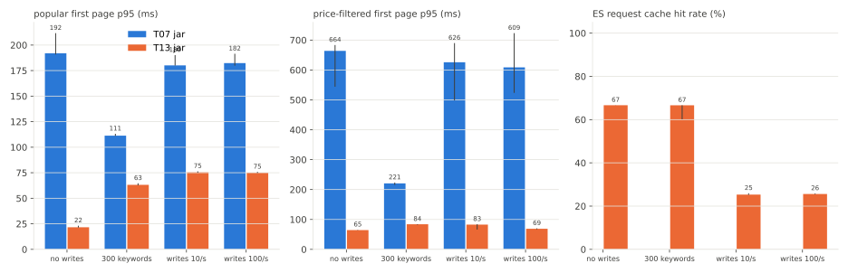

# SEARCH-T14 쓰기 부하와 다양한 검색어에서 Elasticsearch 검색 측정

2026-11-07에 AWS perf 스택에서 상품 1,000만 건으로 T07 jar와 T13 jar를 잰 기록이다. 쓰기 없음, 다양한 검색어, 쓰기 초당 10건, 쓰기 초당 100건의 네 조건을 같은 부하(초당 22.4건)로 돌렸다. 앱 코드는 바꾸지 않았다. 지연은 ms, 요청률은 초당 HTTP 요청 수(req/s)다. run별 전체 표는 `SEARCH-T14.md`에 있다.

## 요약

- 쓰기를 초당 10건 넣자 T13 jar의 ES 요청 캐시 적중률이 66.6%에서 66.7%였던 것이 25.2%에서 25.9%가 됐다. 인기순 첫 페이지 p95는 21ms에서 23ms였던 것이 75ms에서 76ms가 됐다. p50은 17ms 안팎으로 그대로였고 느려진 것은 강아지(상품명 일치 50%)가 든 높은 일치 등급이었다(p50 16ms에서 17ms였던 것이 37ms에서 43ms).
- 쓰기를 초당 100건으로 늘려도 지연과 캐시 적중률은 초당 10건과 같았다. refresh가 1초마다 한 번이라 쓰기 양과 상관없이 요청 캐시가 1초마다 무효화된다. 늘어난 것은 ES CPU뿐이다(컨테이너 한도 대비 32%에서 36%였던 것이 46%에서 49%).
- 검색어를 300개로 늘리자 T13 jar의 첫 페이지 p95가 63ms에서 65ms가 됐다. 요청 캐시 적중률은 60.2%에서 66.6%로 거의 그대로였다. 느려진 것은 쿼리 실행이다. 노드 쿼리 캐시 적중률이 44%에서 35% 안팎으로 떨어졌고 샤드 쿼리 하나의 평균 시간이 8.5ms 안팎에서 15ms에서 16ms가 됐다. 상품명 조건만 건 개수 요청을 따로 보내 보니 두 글자 검색어는 일치 수와 상관없이 1ms에서 3ms였고 세 글자 검색어는 일치 100만 건당 52ms에서 62ms였다. 300개 구성에는 일치 100만 건 안팎의 세 글자 검색어가 많다.
- 네 조건 모두 T13 jar가 T07 jar보다 빨랐다. 첫 페이지 p95는 쓰기 없음 191ms에서 212ms 대 21ms에서 23ms, 검색어 300개 111ms에서 113ms 대 63ms에서 65ms, 쓰기 초당 10건 180ms에서 190ms 대 75ms에서 76ms였다. 쓰기 초당 100건은 180ms에서 191ms 대 75ms에서 76ms였다.
- SEARCH-T10이 고정 검색어 9개로 잰 개선 폭은 캐시가 잘 맞는 조건의 값이다. 같은 세션에서 두 jar의 첫 페이지 p95 차이는 세 번의 중앙값 기준으로 고정 9개에서 8.7배였고 검색어 300개에서 1.8배, 쓰기 초당 10건과 100건에서 2.4배였다.

## 가설

측정 전에 적은 가설이다.

- 근거는 두 가지다. 지금까지의 측정은 쓰기가 없고 검색어가 9개라 ES 요청 캐시 항목이 무효화된 적이 없다. SEARCH-T10은 첫 페이지 개수를 크기 0 요청으로 나눠 샤드 요청 캐시에서 읽게 했고 ES는 refresh 때 샤드에 바뀐 문서가 있으면 그 샤드의 요청 캐시 항목을 다시 쓰지 않는다. 이 색인의 refresh 주기는 1초다.
- 쓰기가 들어오면 개수 요청의 캐시 적중률이 떨어져 인기순 첫 페이지 p95가 캐시 없는 개수 세기 쪽으로 늘 것이다. SEARCH-T10에서 캐시를 쓰지 않은 강아지 개수 세기는 65ms였다.
- T07 jar는 개수를 결과 요청 안에서 세서 요청 캐시를 쓰지 않으므로 쓰기가 들어와도 T13 jar가 더 빠를 것이다.
- 다양한 검색어 조건은 계획의 목표에 캐시에 없는 검색어가 많은 조건에서 개선이 얼마나 남는지 본다고만 적었고 수치 가설은 적지 않았다.

## 변경 내용

- 앱 코드는 바꾸지 않았다. 측정 jar는 T07 jar(235e95a53568)와 T13 jar(75517d5f9ba7)다. T13 jar는 SEARCH-T10 L5 jar에 SEARCH-T13 변경(ES 응답을 기다리는 동안 DB 커넥션 반납)만 더한 jar다.
- 쓰기 부하와 다양한 검색어 구성은 SEARCH-T13 PR의 측정 도구 커밋(c63650c7)으로 더했다.
  - 쓰기 부하(`PERTURB=write PERTURB_RATE=N`)는 ES 호스트에서 products 색인 문서 1,000개를 읽어 두고 같은 `_id`와 `_source`를 초당 N건 `_bulk`로 다시 색인한다. 검색 결과는 바뀌지 않고 새 세그먼트, refresh, 요청 캐시 무효화는 실제 쓰기와 같이 생긴다. 같은 값으로 보내는 부분 업데이트는 ES가 아무것도 쓰지 않아(noop) 무효화가 없으므로 쓰지 않았다.
  - 다양한 검색어 구성(`KEYWORD_SET=diverse`)은 시드 상품명 어휘에서 뽑은 검색어 300개를 같은 가중치로 고른다. 등급별로 높음 7개, 중간 24개, 낮음 252개, 드묾 2개, 없음 15개다. 고정 구성 9개는 강아지(일치 50%)를 10% 비율로 고르므로 다양한 구성은 일치 상품이 적은 검색어 쪽으로도 옮겨 간다.

## 환경

- perf 측정층과 ES 호스트는 SEARCH-T13과 같다. api m7i.large(api 컨테이너 1코어, 2GB, Hikari 최대 10), 러너 c7g.large, RDS db.m7g.large(MySQL 8.4), ES 호스트 r7g.xlarge(ES 컨테이너 CPU 2개, 힙 4GB, 샤드 1개, 복제 0개)다. ES가 인식한 프로세서 수는 2개다. 데이터는 RDS `aechak-perf-10m`(상품 1,000만 건)이다.
- 셀은 steady(초당 22.4건 180초) 세 번이다. 요청 구성은 인기순 첫 페이지 60%, 가격 범위 필터 낮은 가격순 첫 페이지 20%, 인기순 다음 페이지 20%로 SEARCH-T08, SEARCH-T10과 같다. 대조 요청은 넣지 않았다. 쓰기는 steady 180초 내내 건다.
- 순서. T13 jar 네 조건을 SEARCH-T13에서 T10 jar로 만든 색인(id 내림차순 색인 정렬)에서 재고 T07 jar로 다시 색인한 뒤(10분) T07 jar 네 조건을 쟀다(11:47부터 15:52). 12:48부터 14:03까지는 노트북의 AWS 로그인이 만료돼 다음 조건이 늦게 시작했고 그동안 측정 트래픽은 없었다. 두 jar의 색인 매핑이 달라 재색인이 필요하다. 쓰기 조건은 세그먼트를 바꾸므로 jar마다 마지막에 뒀다.
- 다시 색인하는 문서 1,000개는 `_doc` 순서로 읽는다. 그래서 T13 jar 색인에서는 최신 상품, T07 jar 색인에서는 오래된 상품을 다시 쓴다.
- run마다 ES 요청 캐시 적중과 실패, refresh 횟수를 `_stats`로 run 앞뒤에 읽어 차이를 남겼다. 노드 쿼리 캐시와 샤드 쿼리 시간은 Prometheus의 ES 익스포터 지표를 run 구간으로 다시 읽은 값이다.
- 같은 T07 jar를 SEARCH-T08(ES 호스트 m7g.large)에서 같은 부하로 쟀을 때 첫 페이지 p95가 80ms, 요청 하나의 ES CPU가 0.029초였다. 이번에는 191ms에서 212ms, 0.046초에서 0.055초였다. T13 jar는 SEARCH-T10 L5와 같은 0.020초였다. 측정 중에 세그먼트 병합은 없었고 이유는 확인하지 않았다. 그래서 이 문서는 SEARCH-T08, SEARCH-T10 수치와 직접 비교하지 않고 같은 세션의 두 jar만 비교한다.

## 측정 결과



막대는 세 번의 중앙값, 선은 최소와 최대다. T07 jar는 요청 캐시를 쓰지 않아 적중률 막대가 없다.

### 조건별 비교

세 번의 범위다.

| 조건 | 지표 | T07 jar | T13 jar |
|---|---|---|---|
| 쓰기 없음 | 첫 페이지 p50 / p95 / p99 | 29에서 33 / 191에서 212 / 296에서 721 | 16에서 17 / 21에서 23 / 23에서 29 |
| 쓰기 없음 | 필터 첫 페이지 p95 / p99 | 544에서 683 / 1,543에서 1,643 | 64에서 66 / 91에서 95 |
| 쓰기 없음 | 다음 페이지 p95 | 31에서 57 | 16에서 22 |
| 쓰기 없음 | 요청 캐시 적중률 | - | 66.6%에서 66.7% |
| 쓰기 없음 | ES CPU 평균 (컨테이너 한도 대비) | 51%에서 61% | 22%에서 23% |
| 검색어 300개 | 첫 페이지 p50 / p95 / p99 | 52에서 54 / 111에서 113 / 252에서 255 | 29에서 31 / 63에서 65 / 151에서 156 |
| 검색어 300개 | 필터 첫 페이지 p95 / p99 | 215에서 223 / 424에서 561 | 82에서 84 / 114에서 137 |
| 검색어 300개 | 다음 페이지 p95 | 110에서 113 | 64에서 70 |
| 검색어 300개 | 요청 캐시 적중률 | - | 60.2%에서 66.6% |
| 검색어 300개 | ES CPU 평균 (컨테이너 한도 대비) | 57% | 37%에서 40% |
| 쓰기 초당 10건 | 첫 페이지 p50 / p95 / p99 | 29에서 31 / 180에서 190 / 221에서 303 | 17에서 18 / 75에서 76 / 80에서 90 |
| 쓰기 초당 10건 | 필터 첫 페이지 p95 / p99 | 498에서 690 / 1,537에서 1,682 | 66에서 84 / 101에서 120 |
| 쓰기 초당 10건 | 다음 페이지 p95 | 21에서 31 | 17에서 24 |
| 쓰기 초당 10건 | 요청 캐시 적중률 | - | 25.2%에서 25.9% |
| 쓰기 초당 10건 | ES CPU 평균 (컨테이너 한도 대비) | 52%에서 53% | 32%에서 36% |
| 쓰기 초당 100건 | 첫 페이지 p50 / p95 / p99 | 29에서 31 / 180에서 191 / 239에서 276 | 16에서 17 / 75에서 76 / 80 |
| 쓰기 초당 100건 | 필터 첫 페이지 p95 / p99 | 524에서 723 / 1,597에서 1,693 | 67에서 70 / 103에서 113 |
| 쓰기 초당 100건 | 다음 페이지 p95 | 25에서 36 | 17에서 20 |
| 쓰기 초당 100건 | 요청 캐시 적중률 | - | 25.5%에서 25.9% |
| 쓰기 초당 100건 | ES CPU 평균 (컨테이너 한도 대비) | 66% | 46%에서 49% |

네 조건 모두 두 jar의 실패율은 0%였다.

- 쓰기 교란은 run마다 초당 10.00건에서 10.01건(1,792건), 초당 100.00건(17,927건에서 17,932건)을 오류 없이 보냈다. refresh는 두 jar 모두 run마다 180회에서 181회였다.
- ES CPU는 ES 호스트 CPU를 컨테이너 한도(2코어) 대비로 바꾼 값이다. 쓰기 조건에서는 색인 비용이 들어간다.

### 쓰기 부하

검색어 등급별 p50 / p95다(세 번의 범위).

| 변형 | high p50 / p95 | mid p50 / p95 | low p50 / p95 | rare p50 / p95 | none p50 / p95 |
|---|---|---|---|---|---|
| t13 | 16에서 17 / 58에서 83 | 16에서 17 / 44에서 46 | 15에서 17 / 39에서 44 | 10에서 12 / 15에서 19 | 5에서 6 / 6에서 10 |
| t13-diverse | 23에서 24 / 58에서 69 | 26에서 29 / 157에서 164 | 28에서 31 / 64에서 66 | 13에서 14 / 16에서 20 | 6에서 8 / 9에서 13 |
| t13-write10 | 39에서 43 / 90에서 91 | 17에서 18 / 45에서 49 | 16에서 18 / 41에서 58 | 11에서 12 / 15에서 18 | 5에서 6 / 6에서 11 |
| t13-write100 | 37에서 43 / 88에서 90 | 16에서 17 / 44에서 48 | 16에서 17 / 42에서 54 | 10에서 11 / 15에서 17 | 4에서 5 / 6에서 9 |
| t07 | 190에서 192 / 712에서 1,391 | 32에서 34 / 284에서 287 | 25에서 28 / 128에서 160 | 13에서 15 / 29에서 45 | 4에서 6 / 8에서 17 |
| t07-diverse | 94에서 97 / 590에서 633 | 61에서 72 / 279에서 326 | 52에서 56 / 127에서 130 | 16에서 18 / 21에서 31 | 6에서 9 / 11에서 17 |
| t07-write10 | 165에서 167 / 697에서 1,373 | 31에서 33 / 287에서 289 | 23에서 25 / 128에서 160 | 12에서 14 / 26에서 27 | 5에서 6 / 8에서 13 |
| t07-write100 | 166에서 167 / 700에서 1,436 | 32에서 33 / 288에서 290 | 23에서 25 / 142에서 161 | 12에서 15 / 27에서 31 | 5에서 7 / 8에서 21 |

- T13 jar는 쓰기가 들어오자 높은 일치 등급만 느려졌다. 고정 구성의 높은 등급은 강아지 하나이고 노출 조건을 건 검색 결과가 470만 건이라 개수 세기가 가장 비싸다. 다른 등급은 개수 요청이 캐시에서 빠져도 세는 비용이 작아 지연이 그대로였다.
- 개수 요청을 보내지 않는 다음 페이지는 T13 jar에서 p95가 16ms에서 22ms였던 것이 17ms에서 24ms로 그대로였다.
- 쓰기 초당 100건은 초당 10건과 지연이 같았다. refresh는 1초마다 한 번이라 1초 안에 쓰기가 한 건이든 100건이든 다음 refresh에서 캐시가 한 번 무효화된다.
- T07 jar는 쓰기가 들어와도 첫 페이지 p95가 180ms에서 190ms로 쓰기 없음과 같았다. 개수를 결과 요청 안에서 세서 요청 캐시를 쓰지 않는다.
- 쓰기가 들어오면 세그먼트가 늘었다. T13 jar 색인은 12개였던 것이 29개가 됐고 T07 jar 색인은 19개였던 것이 29개에서 31개가 됐다.

### 다양한 검색어

| 지표 | T13 jar 고정 9개 | T13 jar 300개 | T07 jar 고정 9개 | T07 jar 300개 |
|---|---|---|---|---|
| 요청 캐시 적중률 | 66.6%에서 66.7% | 60.2%에서 66.6% | 쓰지 않음 | 쓰지 않음 |
| 노드 쿼리 캐시 적중률 | 44% | 34%에서 35% | 35%에서 36% | 28.5% |
| 샤드 쿼리 하나의 평균 시간 | 8.5ms에서 8.6ms | 15.1ms에서 16.2ms | 41.8ms에서 49.6ms | 43.5ms에서 44.1ms |
| 노드 쿼리 캐시 메모리 | 41MB | 117MB | 13.5MB | 13.5MB |

- T13 jar는 검색어를 300개로 늘리자 요청 캐시 적중률이 거의 그대로였다. 쓰기가 없으면 캐시 항목이 무효화되지 않아 같은 검색어가 다시 오면 적중한다. 첫 run(60.2%) 뒤로는 고정 9개와 같은 66.6%였다.
- 대신 노드 쿼리 캐시 적중률이 떨어지고 샤드 쿼리 하나의 평균 시간이 두 배 가까이 됐다. 가장 느려진 것은 중간 일치 등급(p95 44ms에서 46ms였던 것이 157ms에서 164ms)이다. 고정 9개의 중간 등급은 두 글자 검색어(사료, 연어, 간식)이고 300개 구성에는 세 글자 검색어(닭고기, 소고기, 반려동 등)가 섞여 있다. 아래 실험에서 세 글자 검색어의 개수 세기는 일치 100만 건에 53ms에서 62ms였고 두 글자 검색어는 2ms 안팎이었다. 300개 구성에서는 세 글자 검색어의 구문 일치가 노드 쿼리 캐시 없이 실행된 경우가 늘어 중간 등급이 느려진 것으로 본다. 노드 쿼리 캐시 퇴출은 0건이었다.
- T07 jar는 300개에서 오히려 빨라졌다(첫 페이지 p95 191ms에서 212ms였던 것이 111ms에서 113ms). 높은 일치 등급의 비율이 10%에서 2% 남짓으로 줄었고 T07 jar는 일치 상품이 많을수록 비싸다.

### 검색어별 개수 요청 비용

측정이 모두 끝난 뒤(15:52) T07 jar 색인에서 ES 호스트에 직접 개수 요청을 보냈다. 상품명 `match_phrase` 조건 하나만 걸었고 노출 조건, 카테고리, 가격 조건은 없다. 요청 캐시를 끄고 검색어마다 노드 쿼리 캐시를 비운 뒤 한 번 보내고 이어서 다섯 번 더 보냈다. 앱의 개수 요청은 노출 조건이 더 붙어 있어 절대값은 다르다. 검색어 33개를 재고 글자 수와 일치 수가 같은 것은 한 줄로 묶었다. 표에 없는 두 글자 검색어도 모두 1ms에서 3ms였다.

| 검색어 | 글자 수 | 일치 수 | 첫 took | 다음 다섯 번 중앙값 |
|---|---|---|---|---|
| 강아지 | 3 | 5,000,000 | 263 | 264 |
| 강아, 아지 | 2 | 5,000,000 | 2 | 2 |
| 고양이 | 3 | 4,000,000 | 209 | 210 |
| 고양, 양이 | 2 | 4,000,000 | 2 | 2 |
| 닭고기, 소고기, 양고기 | 3 | 1,000,000 | 62 | 62 |
| 려동물, 반려동, 칠면조 | 3 | 1,000,000 | 53에서 54 | 53 |
| 사료, 연어, 닭고, 소고, 반려 | 2 | 1,000,000 | 2 | 2 |
| 식사료 | 3 | 666,667 | 39 | 39 |
| 하네스 | 3 | 333,333 | 18 | 18 |
| 관절 | 2 | 333,334 | 1 | 1 |
| 바잇미 | 3 | 250,000 | 13 | 13 |
| 한정판 | 3 | 10,000 | 1 | 1 |

- 두 글자 검색어는 일치 수와 상관없이 1ms에서 3ms였다. 바이그램 색인에서 두 글자는 단어 하나라 문서마다 위치를 확인할 필요가 없다. 일치 수와 상관없이 시간이 같아서 개수도 색인의 단어 통계에서 바로 읽는 것으로 보인다.
- 세 글자 검색어는 바이그램 두 개가 이어져 있는지 문서마다 위치를 확인하므로 일치 수에 비례해 비쌌다. 일치 100만 건당 52ms에서 62ms였다.
- 이어서 다섯 번 보낸 took의 중앙값도 첫 번째와 같았다. 여섯 번 안에서는 노드 쿼리 캐시가 쓰이지 않은 것으로 보인다.
- 고정 9개에서 일치 상품이 많은 세 글자 검색어는 강아지 하나다. 중간 등급(사료, 연어, 간식)은 모두 두 글자라 일치 상품이 100만 건이어도 싸다. 300개 구성의 중간 등급 24개 중 7개가 세 글자 검색어이고 그중 6개는 일치 100만 건이다.

## 가설과 비교

| 항목 | 가설 | 실측 |
|---|---|---|
| 쓰기 때 개수 요청 캐시 | 적중률이 떨어짐 | 66.6%에서 66.7%였던 것이 25.2%에서 25.9%(초당 10건과 100건이 같음) |
| 쓰기 때 T13 jar 첫 페이지 p95 | 캐시 없는 개수 세기 쪽으로 늚 | 21ms에서 23ms였던 것이 75ms에서 76ms. 높은 일치 등급만 느려짐 |
| 쓰기 때 두 jar | T13 jar가 더 빠름 | 맞음. 첫 페이지 p95 180ms에서 190ms 대 75ms에서 76ms, 초당 100건 180ms에서 191ms 대 75ms에서 76ms |
| 다양한 검색어 | 수치 가설 없음 (캐시에 없는 검색어가 늘 것으로 봄) | 요청 캐시 적중률은 거의 그대로. 쿼리 실행이 느려져 첫 페이지 p95 63ms에서 65ms |

## 해석

- SEARCH-T10의 개수 분리는 요청 캐시가 맞을 때 가장 큰 이득을 낸다. 쓰기가 1초에 한 번이라도 들어오면 캐시 항목이 1초마다 무효화되므로 일치 상품이 많은 검색어의 개수는 거의 매번 다시 센다. 그래도 T13 jar는 쓰기 조건에서 T07 jar보다 빨랐다(첫 페이지 p95 75ms에서 76ms 대 180ms에서 190ms). 두 jar는 개수 분리 말고도 여러 레버가 달라 이 차이를 개수 분리 하나의 효과로 보지 않는다.
- 실제 서비스에서는 상품 수정, 재고, 리뷰 수 반영으로 쓰기가 계속 들어올 것이다. 이 색인이 실시간 동기화로 갱신된다면 고정 9개 쓰기 없음 조건의 수치(첫 페이지 p95 21ms에서 23ms)보다 쓰기 조건의 수치(75ms에서 76ms)가 실제에 가까울 것이다.
- 검색어가 다양해지면 요청 캐시보다 쿼리 실행 비용이 지연을 정한다. 세 글자 이상 검색어의 구문 일치는 일치 100만 건당 50ms 넘게 든다. 고정 9개에서 이 비용이 큰 검색어는 강아지 하나였고 자주 와서 노드 쿼리 캐시에 들어 있었던 것으로 본다. 그래서 고정 9개로는 구문 일치 비용이 거의 드러나지 않았다.
- 두 jar의 첫 페이지 p95 차이는 조건에 따라 1.8배에서 8.7배로 달라졌다(세 번의 중앙값 기준). SEARCH-T10의 대표 수치는 고정 9개 쓰기 없음 조건의 값이라고 함께 적어야 한다.

## 결정

- T13 jar를 최종 후보로 둔다. 네 조건 모두 T07 jar보다 빨랐다.
- SEARCH-T11(최종 비교)은 고정 9개와 300개를 모두 돌리는 계획에 쓰기 초당 10건 조건을 더한다. 대표 수치를 조건과 함께 적는다.
- 다음 후보는 둘이다. 이 단계에서는 바꾸지 않았다.
  - refresh 주기. 1초를 늘리면 쓰기가 있어도 요청 캐시가 덜 무효화되지만 상품 수정이 검색에 늦게 보인다. 제품 결정이 필요하다.
  - 세 글자 이상 검색어의 구문 일치 비용. 3-gram 필드를 더해 세 글자 검색어를 단어 하나로 찾게 하는 방법이 있다. 색인 크기가 늘고 MySQL 경로와의 결과 동등성을 다시 확인해야 한다.

## 측정의 한계

- 실제 서비스의 쓰기 속도는 모른다. 초당 10건과 100건 두 단계로 쟀다.
- 쓰기는 같은 내용을 다시 색인한다. 실제 상품 수정처럼 가격이나 노출 상태가 바뀌어 결과가 달라지는 경우와 실시간 동기화(아웃박스) 경로는 재지 않았다.
- 첫 페이지의 결과 요청과 개수 요청은 따로 나간다(SEARCH-T10 L3). 두 요청 사이에 refresh가 있고 그 사이 결과가 바뀌는 쓰기가 들어오면 totalCount와 결과 목록이 서로 다른 시점을 볼 수 있다. 이번 쓰기는 내용이 같아 이 경우가 생기지 않았고 따로 재지 않았다.
- T07 jar와 T13 jar는 개수 분리, 색인 정렬, 가격 정렬, 할인 조건, 트랜잭션 범위가 함께 다르다. 두 jar의 차이를 요청 캐시 하나의 효과로 볼 수 없다. 같은 jar에서 요청 캐시만 끈 조건은 재지 않았다.
- 다양한 검색어와 쓰기를 함께 건 조건은 재지 않았다. 로컬 사전 확인(ES 9.2.6, 30만 건)에서는 둘을 함께 걸면 개수 캐시 적중률이 8%였다.
- 다양한 검색어 구성은 검색어 수와 함께 일치 비율 분포와 검색어 길이도 바꾼다. 세 효과를 나누지 않았다.
- steady만 돌렸다. ramp와 spike는 이 조건들에서 재지 않았다.
- ES 호스트가 SEARCH-T08, SEARCH-T10(m7g.large)과 다르다. 같은 T07 jar가 이번 호스트에서 더 느렸고 이유는 확인하지 않았다.

## 재현

```bash
cd loadtest/terraform && terraform apply -var es_enabled=true -var es_instance_type=r7g.xlarge
cd ../search && make outputs && make up DATASET=10m
make reindex DATASET=10m REV=533fc2978da2
# T13 jar 커밋. 커밋 해시는 측정 때와 달라지지만 트리 해시(3226b8d5)는 같다
git switch --detach 533fc2978da2 && git cherry-pick 4c8406e6 && R13=$(git rev-parse --short=12 HEAD)
v() { make variant STEP=SEARCH-T14 DATASET=10m DDL="SEARCH-T06" ENV=AECHAK_SEARCH_ENGINE=es CELLS=steady BASE_RATE=32 "$@"; }
v VARIANT=t13 REV=$R13
v VARIANT=t13-diverse REV=$R13 KEYWORD_SET=diverse
v VARIANT=t13-write10 REV=$R13 PERTURB=write PERTURB_RATE=10
v VARIANT=t13-write100 REV=$R13 PERTURB=write PERTURB_RATE=100
make reindex DATASET=10m REV=235e95a53568
v VARIANT=t07 REV=235e95a53568
v VARIANT=t07-diverse REV=235e95a53568 KEYWORD_SET=diverse
v VARIANT=t07-write10 REV=235e95a53568 PERTURB=write PERTURB_RATE=10
v VARIANT=t07-write100 REV=235e95a53568 PERTURB=write PERTURB_RATE=100
```

검색어별 개수 요청 비용은 측정 트래픽이 없을 때 ES 호스트에서 아래처럼 쟀다.

```bash
for kw in 강아지 강아 고양이 고양 닭고기 닭고 사료 식사료 하네스 바잇미 한정판; do
  curl -s -XPOST 'localhost:9200/products/_cache/clear?query=true' >/dev/null
  for i in 1 2 3 4 5 6; do
    curl -s -H 'Content-Type: application/json' 'localhost:9200/products/_search?request_cache=false' \
      -d "{\"size\":0,\"track_total_hits\":true,\"query\":{\"bool\":{\"filter\":[{\"match_phrase\":{\"name\":\"$kw\"}}]}}}" \
      | jq -c --arg kw "$kw" '[$kw, .hits.total.value, .took]'
  done
done
```
