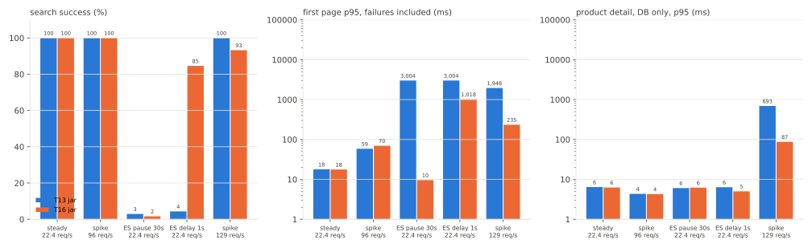
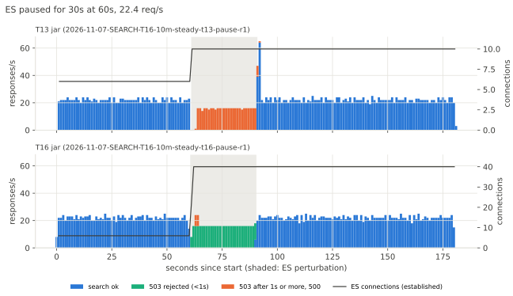
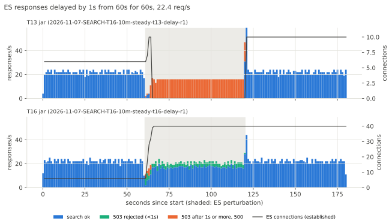

# SEARCH-T16 Elasticsearch 검색 동시 요청 상한과 장애 응답 정리

2026-11-07 17:07부터 11-08 00:15까지 AWS perf 스택에서 T13 jar와 T16 jar를 상품 1,000만 건으로 잰 기록이다. T16 jar는 T13 jar 커밋에 이 단계의 코드 변경만 더해 만들었으므로 두 jar의 차이는 이 단계의 변경뿐이다. 셀은 T13과 같다(평소 부하, 순간 부하, ES 정지, ES 응답 지연, ES 처리량을 넘는 순간 부하). 지연은 ms, 요청률은 초당 HTTP 요청 수(req/s)다. run별 전체 표는 `SEARCH-T16.md`에 있다.

## 요약

- ES 검색 어댑터가 ES 요청을 동시에 40개까지만 보내게 했다. ES 클라이언트 연결 수도 40개로 맞춰 보낸 요청은 연결을 기다리지 않는다. 자리가 없으면 요청을 보내지 않고 바로 503을 돌려준다. 시간을 넘긴 요청은 취소하지 않는다. 다음 페이지 커서 해석의 시간 초과와 ES 연결 실패도 500이 아니라 503으로 응답한다.
- ES 응답을 1초 늦췄을 때 T13 jar는 지연 구간에 끝난 검색의 4%에서 5%만 성공했다. 지연이 시작되고 4초에서 5초 사이에 ES 연결 10개가 모두 닫혔고 ES가 받은 쿼리는 초당 0건이었다. T16 jar는 82%에서 85%가 성공했다. ES 연결이 닫히지 않았고(지연 구간 평균 38.7개에서 40개) ES가 초당 37건의 쿼리를 받았다. 나머지 검색은 r1의 15건을 빼고 모두 1초 안에 503을 받았다. T13에서 찾은 원인(연결을 기다리던 검색이 시간을 넘겨 취소하면서 맺는 중이던 연결을 끊음)을 없애자 연결이 유지됐다.
- ES를 30초 멈췄을 때 두 jar 모두 정지 구간의 검색이 거의 다 실패했다. T13 jar는 실패한 검색이 모두 3초를 기다렸다(실패 응답 p95 3,004ms에서 3,008ms). T16 jar는 정지 직후 보낸 검색 16건에서 18건만 3초를 기다렸고 나머지 464건에서 468건은 바로 503을 받았다(실패 응답 p95 4ms에서 8ms). 처리 중 요청 최대는 T13 jar 48, T16 jar 16에서 18이었다.
- ES 처리량을 넘는 초당 129건 순간 부하에서 T13 jar는 모든 검색을 받았고 처리 중 요청 최대가 Tomcat 스레드 상한인 200이었다. 첫 페이지 p95가 1,948ms, DB만 읽는 상품 상세 p95가 664ms였다. T16 jar는 검색의 6.7%를 바로 503으로 돌려보냈다. 첫 페이지 p95가 235ms, 상품 상세 p95가 64ms, 처리 중 요청 최대가 21이었다.
- 평소 부하(초당 22.4건)와 초당 96건 순간 부하는 두 jar 모두 실패가 없었다. 첫 페이지 p95는 평소 부하에서 18ms에서 19ms와 17ms에서 19ms로 같고 순간 부하에서 59ms와 70ms다(한 번씩).
- 측정 중에 문제 셋을 찾아 고쳤다. 처음 jar의 상한 10은 초당 96건 순간 부하에서 검색의 3.8%를 거절해 기본값을 40으로 올렸다. 시간을 넘긴 요청을 취소하던 처음 jar는 상한 40에서 ES 클라이언트의 I/O 스레드가 멈춰 api를 다시 띄울 때까지 모든 검색이 500이었다. T13 jar 지연 셀에서는 커서 해석 시간 초과와 연결 제한 시간 초과가 500이 됐다.
- ES 호스트를 T08, T10과 같은 m7g.large로 되돌렸다. T12에서 T14까지 쓴 r7g.xlarge(vCPU 4개, ES 컨테이너 CPU 2개 제한)는 같은 jar와 부하에서 ES 쿼리 하나에 호스트 CPU를 20%에서 35% 더 썼고 순간 부하에서 CPU 한도까지 썼다. T13 보고서의 순간 부하 수치(T13 jar 첫 페이지 p95 486ms)와 이번 값을 직접 비교하지 않는다.

## 가설

측정 전에 적은 가설이다.

- 근거는 T13의 원인 확인이다. 검색 응답 대기 상한 3초가 ES 클라이언트 연결을 기다린 시간까지 셌다. ES 응답이 1초 늦어지자 연결을 기다린 검색이 3초를 넘겨 요청을 취소했고 이 취소가 맺는 중이던 연결을 끊어 지연이 끝날 때까지 연결이 다시 맺어지지 않았다.
- steady는 변형 모두 거절이 없고 첫 페이지 p95도 차이가 없을 것이다.
- ES 응답 지연 셀은 T16 jar에서 ES 연결이 유지되고 ES가 쿼리를 계속 받을 것이다. 연결 하나가 초당 요청 1개 안팎을 처리하므로 검색 성공 비율은 상한 10이 20% 안팎, 상한 40이 70% 안팎이고 나머지는 바로 503일 것이다(T13 jar는 2%에서 5%).
- 과부하 순간 부하는 T16 jar에서 처리 중 요청이 200보다 적고 상품 상세 p95가 평소 수준일 것이다(T13 보고서의 T13 jar는 7.4초).
- 순간 부하 96은 상한 10에서 바로 거절이 생기고 상한 40에서 줄어들 것이다.
- ES 정지 셀은 상한을 넘는 검색이 3초를 기다리지 않고 바로 503을 받을 것이다.
- 기본값을 정하는 기준도 측정 전에 정했다. steady 거절 0건이 먼저다. 그다음 순간 부하 96의 실패율이 T13 jar(0%)에 가까운 값을 고르고 지연 셀 성공 비율과 과부하 셀 상품 상세 p95가 T13 jar보다 나은지 확인한다.

## 변경 내용

| 커밋 | 바꾼 것 |
|---|---|
| b9750535 | `ElasticsearchProductKeywordSearchAdapter`가 ES 요청을 동시 요청 상한(`aechak.search.max-concurrent-requests`)까지만 보낸다. 검색 한 번이 보내는 요청 수만큼 자리를 한 번에 잡고 모자라면 보내지 않고 바로 실패한다. `ElasticsearchConnectionPoolConfig`가 ES 클라이언트 연결 수(노드당, 전체)를 같은 값으로 둔다 |
| c88b9696 | 다음 페이지 커서를 해석하는 ES 요청(`findIdByPublicId`)이 응답 대기 상한을 넘기면 500이 되던 것을 검색 요청과 같이 `PRODUCT_SEARCH_TIMEOUT`(503)으로 바꿨다 |
| 0f113d64 | 측정 도구의 `ssm_run`이 SSM 명령 상태를 5분 넘게 못 읽으면 5분마다 경고를 남긴다. T14 측정 중 노트북의 AWS SSO 세션이 만료됐을 때 원격 명령은 끝났는데 측정이 멈춘 것처럼 보였다 |
| ff8f717f | 응답 대기 상한을 넘긴 ES 요청을 취소하지 않는다. 사용자에게는 503을 돌려주고 요청은 응답이 오거나 소켓 제한 시간(30초)이 될 때까지 자리를 차지한다 |
| b326cafe | 동시 요청 상한 기본값을 10에서 40으로 바꿨다 |
| 6c8b8b36, 94048c16 | ES 연결 실패와 연결 끊김(I/O 실패), 동시 요청 상한 초과를 `TransientDataAccessResourceException`으로 던지고 서비스가 일시적 실패(`TransientDataAccessException`)를 모두 503으로 바꾼다. `docs/80-product-catalog.md`에 동시 요청 상한, 연결 수, 시간 초과와 연결 실패 처리를 적었다 |

- 자리는 ES 요청 단위다. 결과 요청은 1개(낮은 가격순은 2개), 첫 페이지 개수 요청은 1개(가격 필터가 있으면 2개), 다음 페이지의 커서 해석은 1개다. 한 번에 잡는 자리는 1개에서 4개다. 상한은 4 이상이어야 하고 시작할 때 검사한다.
- 부하 검색으로 보면 첫 페이지(인기순)는 자리 2개, 가격 필터 첫 페이지(낮은 가격순)는 4개를 한 번에 잡는다. 다음 페이지는 커서 해석 1개를 잡았다 놓고 결과 요청 1개를 다시 잡는다.
- 연결 수가 자리 수와 같으므로 보낸 요청은 연결을 기다리지 않는다. 응답 대기 상한 3초는 ES 응답 시간만 센다.
- 색인 재작성(쓰기 어댑터)도 같은 클라이언트 연결을 쓴다. 재작성 중에는 검색 요청이 연결을 기다릴 수 있다.
- 단위 테스트는 응답하지 않는 서버와 실제 클라이언트로 확인한다. 자리가 차 있으면 보내지 않고 바로 실패하는지, 시간을 넘긴 요청이 끝날 때까지 자리를 차지하는지, 연결하지 못하면 일시적 실패로 바꾸는지, 서비스가 커서 해석과 첫 페이지의 일시적 실패를 503으로 바꾸는지 본다. 시간을 넘긴 요청을 다시 취소하게 바꾸면 테스트가 실패한다.

## 환경

- perf 측정층은 T13과 같다. api m7i.large(api 컨테이너 1코어, 2GB, Hikari 최대 10, Tomcat 기본 스레드 최대 200), 러너 c7g.large, RDS db.m7g.large(MySQL 8.4)다. 데이터는 RDS `aechak-perf-10m`(상품 1,000만 건)이다.
- ES 호스트를 T12, T13, T14의 r7g.xlarge에서 T08, T10과 같은 m7g.large로 되돌렸다. ES 컨테이너 CPU 2개, 힙 4GB, 샤드 1개, 복제 0개다. T13 jar로 1,000만 건을 다시 색인했다(746초, api 재시작 포함, 1,647MB).
- 부하를 잰 jar는 T13 jar(75517d5f9ba7), 처음 T16 jar(5c3267cbe261), 최종 T16 jar(4d530ad7b75e)다. 처음 jar는 b9750535와 c88b9696만 얹어 시간을 넘긴 요청을 취소했고 상한 기본값이 10이었다. 중간에 만든 jar(43b27ef04be0, 취소하지 않고 기본값 40)는 응답 동등성만 확인하고 연결 실패 처리를 더한 최종 jar로 바꿨다. 최종 jar의 검색 코드 파일(어댑터, 연결 설정, 서비스)은 이 브랜치와 같다.
- 셀은 T13과 같다. steady는 초당 22.4건 180초를 세 번, 순간 부하는 초당 96건 30초 뒤 탐침, ES 정지는 steady 60초부터 30초 동안 `docker pause`, ES 지연은 steady 60초부터 60초 동안 ES가 보내는 패킷(출발 포트 9200)을 `tc netem`으로 1,000ms 늦춘다. 과부하 순간 부하는 기준 43 req/s로 초당 129건 30초다. 모든 셀에 DB만 읽는 대조 요청(비로그인 상품 상세)을 초당 2건 함께 보냈다.
- 변형마다 api를 그 jar로 다시 띄우고 2 req/s로 60초 데웠다. k6 요청 타임아웃은 30초다.
- 세션 내내 api 호스트에서 api 컨테이너의 ES(9200)행 TCP 소켓 상태와 연결 시도 누계를, ES 호스트에서 ES가 연 HTTP 연결 수를 1초마다 기록했다(T13 원인 확인과 같은 방법).
- ES CPU는 ES 호스트의 CPU 사용률을 30초 rate로 읽은 값이다. ES 호스트의 vCPU 2개가 ES 컨테이너 한도와 같아 평균은 한도 대비 비율로, 최대는 코어 수로 적었다.
- 응답 동등성은 고정 요청 384개로 확인했다. 측정에 쓴 jar 넷(T13 jar, 처음 jar, 중간 jar, 최종 jar)의 응답이 서로 같고 T13 세션의 T13 jar 응답과도 같다.

## 측정 결과



그래프의 steady와 교란 셀은 세 번의 중앙값, 순간 부하는 한 번의 값이다. 교란 셀은 교란 구간에 응답이 끝난 요청만 셌다. 표의 범위는 세 번 중 최소에서 최대다.

### 평소 부하와 순간 부하(초당 96건)

| 셀 | 지표 | T13 jar | T16 jar |
|---|---|---|---|
| steady 22.4 req/s | 첫 페이지 p50 / p95 / p99 | 10에서 11 / 18에서 19 / 20에서 25 | 10에서 11 / 17에서 19 / 19에서 21 |
| steady 22.4 req/s | 가격 필터 첫 페이지 p95 | 68에서 73 | 68에서 70 |
| steady 22.4 req/s | 상품 상세 p95 | 5에서 12 | 5에서 11 |
| steady 22.4 req/s | 실패, ES CPU 평균(한도 대비) | 0건, 17%에서 19% | 0건, 17% |
| 순간 부하 96 req/s | 검색 응답, 실패 | 2,842, 0 | 2,842, 0 |
| 순간 부하 96 req/s | 첫 페이지 p95 / p99 / 최대 | 59 / 81 / 128 | 70 / 109 / 138 |
| 순간 부하 96 req/s | 2쪽 p95, 상품 상세 p95 | 57, 6 | 62, 6 |
| 순간 부하 96 req/s | 처리 중 요청 최대, api의 ES 연결 최대 | 5, 10 | 13, 29 |
| 순간 부하 96 req/s | ES CPU 최대 | 1.44코어 | 1.44코어 |

- steady는 차이가 없다. 처리 중 요청이 최대 2개라 동시 ES 요청이 상한 40에 미치지 않았다.
- 순간 부하에서 T16 jar의 첫 페이지 p95가 11ms 높았다. 연결이 10개에서 29개로 늘어 ES에 동시에 들어간 요청이 많아진 것으로 보인다(ES 검색 대기열 최대 0과 13). 한 번씩 잰 값이라 차이를 판단하지 않았다.

### ES 정지 30초



| 지표 | T13 jar | T16 jar |
|---|---|---|
| 검색 응답 수 | 428에서 446 | 490에서 492 |
| 검색 성공 | 0에서 16 | 6에서 10 |
| 바로 거절한 503(1초 미만) | 0 | 464에서 468 |
| 3초 뒤 503 | 428에서 431 | 16에서 18 |
| 500 | 0 | 0 |
| 실패 응답 p50 / p95 | 3,003에서 3,004 / 3,004에서 3,008 | 3에서 4 / 4에서 8 |
| 처리 중 요청 최대 | 48 | 16에서 18 |
| 상품 상세 응답 수, 실패, p95 | 60, 0, 6에서 12 | 60, 0, 5에서 8 |
| 정지가 끝나고 2초 동안의 검색 응답 수, 성공 응답 최대 | 94에서 112, 2,458에서 2,968 | 41에서 45, 52에서 64 |

- ES가 멈추면 어떤 검색도 성공할 수 없다. 차이는 실패를 알리는 시간이다. T13 jar는 실패한 검색마다 3초를 기다렸고 그동안 Tomcat 스레드 하나를 차지했다. T16 jar는 정지 직후 보낸 요청이 자리 40개를 채우자 그 뒤의 검색을 보내지 않고 바로 503을 돌려줬다.
- 시간을 넘긴 요청을 취소하지 않으므로 자리는 ES가 다시 응답하거나 소켓 제한 시간(30초)이 될 때까지 차 있다. ES가 다시 응답하자 기다리던 요청 40개가 한꺼번에 들어가 ES 검색 대기열 최대가 35에서 36이었다.
- T13 jar는 정지가 끝나기 전 3초 안에 보낸 검색이 ES가 다시 응답한 뒤 한꺼번에 끝났다. 정지가 끝나고 2초 동안 검색 응답이 평소(2초에 44건 안팎)의 두 배가 넘었고 성공 응답 최대가 2.5초에서 3초였다. T16 jar는 그 검색들을 바로 돌려보내 정지가 끝난 뒤 성공 응답 최대가 64ms 이하였다.

### ES 응답 지연 1초



| 지표 | T13 jar | T16 jar |
|---|---|---|
| 검색 응답 수 | 944에서 946 | 1,218에서 1,258 |
| 검색 성공(비율) | 39에서 43 (4%에서 5%) | 1,002에서 1,064 (82%에서 85%) |
| 종류별 성공 비율(첫 페이지 / 가격 필터 첫 페이지 / 다음 페이지) | 4%에서 5% / 3%에서 4% / 0% | 87%에서 92% / 32%에서 46% / 100% |
| 성공 응답 p50 / p95 | 1,834에서 1,981 / 2,584에서 2,703 | 1,010에서 1,012 / 2,011에서 2,012 |
| 바로 거절한 503(1초 미만) | 0 | 191에서 201 |
| 1초에서 2.9초 사이 503 | 0 | 0에서 15 (r1만) |
| 3초 뒤 503 | 901에서 903 | 0 |
| 500 | 2에서 4 | 0 |
| 상품 상세 응답 수, 실패, p95 | 120, 0, 5에서 10 | 120, 0, 5에서 9 |
| api의 ES 연결(ESTABLISHED), 지연 구간 평균 | 0.5에서 0.7 | 38.7에서 40 |
| 지연 구간 새 연결 시도 | 2,116에서 2,146 | 0에서 43 |
| ES가 받은 쿼리(초당), 지연 앞 30초 | 50.6에서 50.8 | 50.6에서 50.7 |
| ES가 받은 쿼리(초당), 지연 시작 5초 뒤부터 | 0 | 37.1에서 37.2 |

- T13 jar는 T13 원인 확인과 같았다. 지연이 시작되고 4초에서 5초 사이에 ES 연결 10개가 모두 닫혔다. 연결 시도가 초당 35건 안팎 있었지만 지연이 끝날 때까지 연결이 맺어지지 않았고 ES가 받은 쿼리는 0건이었다. ES 호스트를 r7g.xlarge에서 m7g.large로 바꿔도 같다.
- T16 jar는 연결이 닫히지 않았다. 요청 하나가 1초 안팎 걸리므로 자리 40개로 ES가 초당 37건을 처리했고 처리할 수 없는 몫은 바로 503을 받았다. 성공 응답 p95 2초는 커서 해석과 결과 요청을 차례로 보내는 다음 페이지다. 첫 페이지 성공 응답 p95는 1,018ms에서 1,020ms다.
- 자리를 한 번에 잡는 방식은 요청 수가 많은 검색에 불리하다. 자리 4개를 잡는 가격 필터 첫 페이지는 32%에서 46%가 성공했다. 자리 2개를 잡는 첫 페이지는 87%에서 92%, 자리 1개씩 두 번 잡는 다음 페이지는 모두 성공했다.
- r1에만 1초에서 2.9초 사이의 503이 15건 있었다. 지연이 시작될 때 api가 맺어 둔 ES 연결이 6개였고 이를 40개로 늘리는 동안 새 연결이 연결 제한 시간(1초)을 넘긴 것으로 보인다. 늘어난 연결은 r2와 r3에서 그대로 쓰여 새 연결 시도가 없었다. 503은 로그에 남지 않아 예외 종류는 확인하지 않았다.

### 과부하 순간 부하(초당 129건)

| 지표 | T13 jar | T16 jar |
|---|---|---|
| 검색 응답 수, 성공 | 3,817, 3,817 | 3,708, 3,458 |
| 바로 거절한 503 | 0 | 250 (6.7%) |
| 첫 페이지 p50 / p95 / p99 / 최대 | 1,759 / 1,948 / 1,988 / 2,071 | 87 / 235 / 332 / 397 |
| 2쪽 p95 | 3,316 | 331 |
| 상품 상세 p95 / p99 / 최대 | 664 / 699 / 766 | 64 / 88 / 93 |
| 처리 중 요청 최대, 살아 있는 스레드 최대 | 200, 265 | 21, 121 |
| api의 ES 연결 최대 | 10 | 40 |
| ES CPU 최대 | 1.86코어 | 1.81코어 |
| api CPU 스로틀링 시간 | 7.2초 | 6.9초 |

- T13 jar는 모든 검색을 받았다. 검색이 ES 연결 10개를 기다리며 Tomcat 스레드 200개를 모두 썼고 상품 상세도 스레드가 빌 때까지 기다렸다.
- T16 jar는 동시에 보내는 ES 요청을 40개로 제한해 들어온 검색의 6.7%를 바로 거절했고 나머지를 빠르게 처리했다. ES는 두 jar 모두 CPU를 한도(2코어) 가까이 썼다.
- 상품 상세 p95가 평소(6ms)보다 높은 64ms인 것은 api 컨테이너가 CPU 한도(1코어)까지 썼기 때문으로 본다. 두 jar 모두 7초 안팎 스로틀링됐다.

### 측정 중에 찾은 문제

처음 측정한 T16 jar(5c3267cbe261)는 동시 요청 상한 기본값이 10이었고 시간을 넘긴 요청을 T13 jar처럼 취소했다. 상한 10과 환경 변수로 40을 준 변형을 steady, 순간 부하, 정지 셀에서 쟀고 두 가지 문제가 나왔다. T13 jar의 지연 셀에서는 500이 나는 곳을 하나 더 찾았다.

#### 상한 10은 순간 부하에서 검색을 거절했다

| 변형 | 검색 응답 | 성공 | 바로 거절(503) | 첫 페이지 p95 | ES CPU 최대 | api의 ES 연결 최대 |
|---|---|---|---|---|---|---|
| T13 jar | 2,842 | 2,842 | 0 | 59 | 1.44코어 | 10 |
| 상한 10 | 2,798 | 2,691 | 107 (3.8%) | 49 | 1.38코어 | 10 |
| 상한 40 | 2,841 | 2,841 | 0 | 62 | 1.43코어 | 25 |

- 초당 96건 순간 부하 한 번의 값이다. ES CPU는 2코어 중 1.5코어를 넘지 않았다. 거절은 ES 처리량이 아니라 자리 수 때문이었다.
- 검색 한 번이 ES 요청을 1개에서 4개 보내므로 응답이 20ms 안팎이어도 동시 요청이 10을 자주 넘는다. 상한 40에서 api가 연 ES 연결은 최대 25개였다.
- 기본값을 40으로 바꿨다(b326cafe).

#### 시간을 넘긴 요청을 취소하자 ES 클라이언트가 멈췄다

- 상한 40으로 ES 정지 셀을 돌리자 첫 run에서 정지가 시작되고 12초 뒤에 첫 500이 났다. 그 뒤로 api를 다시 띄울 때까지 모든 검색이 500(`I/O reactor has been shut down`)이었다. r2와 r3은 처음부터 검색이 모두 500이라 k6가 94초에 멈췄다. DB만 읽는 상품 상세는 세 run 모두 실패가 없었다.
- api 로그의 첫 오류는 ES 클라이언트 I/O 스레드의 `NoSuchElementException`이다. I/O 스레드가 끊긴 연결을 정리하며 요청 본문(`MultiBufferEntity`)의 자원을 해제하다 이 예외를 던지고 멈췄다. 이 해제 코드는 공유 필드에 반복자를 새로 넣고 그 필드를 다시 읽어 꺼낸다. 다른 스레드가 같은 요청 본문을 동시에 해제할 때만 이 예외가 난다. 그 다른 스레드는 시간을 넘긴 요청을 앱이 취소하는 경로로 보인다. 두 스레드가 겹친 것을 직접 확인하지는 않았다.
- 같은 예외로 클라이언트가 멈추는 증상이 elasticsearch-java 이슈 #1003에 클라이언트 동시성 버그로 보고돼 7.17.29에서 고쳐졌다. 이 앱이 쓰는 9.2.6의 rest5 클라이언트에서도 같은 코드에서 났다. I/O reactor가 멈춘 rest5 클라이언트는 다시 만들기 전까지 모든 요청이 실패한다(이슈 #1046).
- 상한 10과 T13 jar는 같은 정지 셀을 세 번씩 돌려도 생기지 않았다. 상한 40은 한꺼번에 시간을 넘기는 요청이 최대 40개다.
- 시간을 넘긴 요청을 취소하지 않게 바꿨다(ff8f717f). 사용자에게는 3초에 503을 돌려주고 요청은 ES가 답하거나 소켓 제한 시간(30초)이 될 때까지 둔다. 그동안 자리가 차 있으면 다음 검색은 보내지 않고 바로 503이다.
- 취소하던 jar는 상한 10 정지 셀 r2에서 api가 연 ES 연결(ESTABLISHED)이 연결 상한 10을 넘어 37개까지 늘었고 r3까지 그대로였다. 원인은 확인하지 않았다.

#### 연결을 맺지 못하면 500이었다

- T13 jar 지연 셀은 run마다 2쪽 요청 2건이 3초 뒤 500이었다. 커서 해석 시간 초과다(c88b9696이 고쳤다). T13 세션의 T13 jar 지연 셀도 run마다 2건이었다.
- r1은 첫 페이지 요청 2건도 1.0초와 1.8초에 500이었다. api 로그의 예외는 `ConnectTimeoutException`(연결 제한 시간 1초)이다. ES가 보내는 SYN-ACK도 1초 늦어 연결이 제한 시간 안에 맺어지지 않았고 이 예외가 그대로 전역 처리기까지 가서 500이 됐다.
- 연결 실패와 연결 끊김 같은 I/O 실패를 일시적 실패로 바꿔 503으로 응답하게 했다(94048c16).

## 가설과 비교

| 항목 | 가설 | 실측 |
|---|---|---|
| steady | 거절 0건, 첫 페이지 p95 차이 없음 | 거절 0건, 첫 페이지 p95 18에서 19와 17에서 19 |
| 순간 부하 96 | 상한 10에서 거절, 40에서 줄어듦 | 상한 10 3.8%, 상한 40과 최종 jar 0건 |
| ES 정지 | 상한을 넘는 검색이 바로 503 | 실패 482건에서 484건 중 16건에서 18건만 3초, 나머지는 바로 503 |
| ES 지연 | 연결 유지, ES 쿼리 계속, 검색 성공 상한 10은 20% 안팎, 상한 40은 70% 안팎 | 상한 40만 쟀다. 연결 유지, ES 초당 37건, 검색 성공 82%에서 85% |
| 과부하 129 | 처리 중 요청 200 미만, 상품 상세 p95 평소 수준 | 처리 중 요청 최대 21, 상품 상세 p95 64(평소 6, T13 jar 664) |

- 지연 셀의 처리량은 가설과 맞았다. 가설은 연결 40개가 초당 요청 40건 안팎을 처리한다고 봤고 ES는 초당 37건을 처리했다. 지연 전에 ES가 받던 쿼리(초당 50.6건에서 50.8건)의 73%다.
- 검색 성공 비율은 82%에서 85%로 가설보다 높았다. 실패가 자리 4개를 한 번에 잡는 가격 필터 첫 페이지에 몰렸기 때문이다. 가격 필터 첫 페이지는 지연 구간 검색 응답의 15%에서 16%였지만 실패의 53%에서 68%였다. 자리를 적게 쓰는 검색이 더 많이 성공해 검색 수로 센 비율이 ES 요청으로 센 비율보다 높다.
- 과부하 셀의 상품 상세는 T13 jar보다 10배 빨랐지만 평소 수준은 아니었다. api 컨테이너가 CPU 한도까지 썼다.
- 가설의 T13 jar 수치(상품 상세 p95 7.4초)는 r7g.xlarge에서 잰 T13 보고서 값이다. 이번 세션의 T13 jar는 664ms였다.

## 해석

- 응답 대기 상한이 연결을 기다린 시간까지 세면 ES가 느릴 때 연결을 기다리는 요청이 늘어난다. 이때 시간을 넘긴 요청을 취소하면 맺는 중이던 연결까지 끊겨 기다리는 요청이 더 늘어난다. T16은 앱이 동시에 보내는 요청 수를 연결 수 이하로 두어 연결을 기다리는 요청을 없앴다. 자리가 없는 검색은 기다리지 않고 바로 실패하고 보낸 요청은 끝까지 기다린다. ES가 느릴 때 처리할 수 있는 만큼은 처리하고 나머지는 바로 실패한다.
- 장애 셀마다 결과가 달랐다. 정지 셀은 두 jar 모두 정지 구간 검색이 거의 다 실패했고 실패 응답이 3초에서 수 ms가 됐다. 지연 셀은 성공한 검색이 40건 안팎에서 1,000건 남짓이 됐다. 과부하 셀은 검색의 6.7%를 거절한 대신 첫 페이지 p95가 1,948ms에서 235ms, 상품 상세 p95가 664ms에서 64ms가 됐다.
- 상한은 ES 요청 수로 센다. 검색 하나가 요청을 1개에서 4개 보내므로 검색 수로 세면 연결이 모자라 다시 연결을 기다린다. 대신 요청이 많은 검색은 자리를 얻기 어렵다.
- 응답 대기 상한을 넘긴 요청을 취소하지 않으면 ES가 느릴 때 요청이 자리를 오래 차지한다. 자리가 40개뿐이므로 ES에 한꺼번에 들어가는 요청도 40개까지다.

## 결정

- T16 변경을 남긴다. 동시 요청 상한 기본값은 40이다. 측정 전에 정한 기준대로 steady 거절 0건, 순간 부하 96 실패 0건(T13 jar와 같음)이고 지연 셀 검색 성공 비율(4%에서 5%와 82%에서 85%)과 과부하 셀 상품 상세 p95(664ms와 64ms)가 T13 jar보다 나았다.
- 더 고칠 후보는 셋이다. 이 단계에서는 바꾸지 않았다.
  - 요청이 많은 검색의 거절. 가격 필터 첫 페이지는 자리 4개를 한 번에 잡아야 해서 지연 셀 성공이 32%에서 46%였다. 개수 요청에 자리를 따로 잡거나 개수 없이 결과만 먼저 돌려주는 방법이 있다.
  - 연결을 미리 맺어 두기. 연결이 적은 상태에서 ES가 느려지면 연결을 늘리는 동안 연결 제한 시간을 넘길 수 있다(지연 셀 r1의 15건으로 추정).
  - 상한 40은 ES CPU 2개와 이 요청 구성에서 정한 값이다. ES를 키우거나 요청 구성이 바뀌면 다시 잰다.
- 다음은 SEARCH-T11(최종 비교)이다. 최종 jar는 이 단계의 T16 jar다.

## 측정의 한계

- 순간 부하와 과부하 순간 부하는 한 번씩 돌렸다.
- 상한은 10과 40만 쟀다. 상한 10은 처음 jar(취소하는 버전)로 steady, 순간 부하, 정지 셀만 쟀다. 지연과 과부하 셀은 최종 jar(상한 40)로만 쟀다.
- 취소 경합에서 I/O 스레드와 겹친 다른 스레드는 코드 구조와 증상으로 판단했다. 두 스레드를 직접 관찰하지 않았다.
- 지연 셀 r1의 1초에서 2.9초 사이 503은 연결 수가 늘어난 시각과 맞는 것으로만 판단했다. 503은 api 로그에 남지 않는다.
- 다음 페이지 요청은 첫 페이지가 성공해야 생긴다. 실패가 많은 구간에서 두 jar의 요청 구성이 다르다.
- 교란 구간은 응답이 끝난 시각으로 나눴다. 정지 직전에 보낸 검색의 3초 뒤 503은 정지 구간에 든다.
- 소켓 상태와 ES 연결 수는 1초 간격 표본이다. 처리 중 요청과 ES 검색 대기열은 Prometheus가 수집한 값이라 수집 사이의 최댓값은 놓칠 수 있다.
- ES 호스트가 T13, T14와 다르다. r7g.xlarge가 쿼리 하나에 CPU를 더 쓴 이유는 확인하지 않았다.

## 재현

```bash
cd loadtest/terraform && terraform apply -var es_enabled=true && cd ../..
R13=75517d5f9ba7   # T13 jar 커밋
# T16 jar 커밋. R13 위에 이 브랜치의 코드 변경만 얹는다. 측정에 쓴 4d530ad7b75e와 트리는 같고 해시는 다르다
git switch --detach $R13
git diff 4f4ed143 94048c16 -- infra application | git apply --index
git commit -qm "SEARCH-T16 측정"
R16=$(git rev-parse --short=12 HEAD)
git switch -
cd loadtest/search && make outputs && make up DATASET=10m
make jar REV=$R13 && make jar REV=$R16
make reindex DATASET=10m REV=$R13
make equiv STEP=SEARCH-T16 DATASET=10m ENGINE=es REV=$R13 LABEL=t13
make equiv STEP=SEARCH-T16 DATASET=10m ENGINE=es REV=$R16 LABEL=t16
v() { make variant STEP=SEARCH-T16 DATASET=10m DDL="SEARCH-T06" ENV=AECHAK_SEARCH_ENGINE=es CONTROL_RATE=2 "$@"; }
for j in t13:$R13 t16:$R16; do
  n=${j%%:*} r=${j#*:}
  v VARIANT=$n REV=$r BASE_RATE=32 CELLS="steady spike"
  v VARIANT=$n-pause REV=$r BASE_RATE=32 CELLS=steady PERTURB=pause
  v VARIANT=$n-delay REV=$r BASE_RATE=32 CELLS=steady PERTURB=delay PERTURB_DELAY_MS=1000
  v VARIANT=$n-over REV=$r BASE_RATE=43 CELLS=spike
done
```

- 측정은 위 순서와 다르게 돌렸다. T13 jar의 steady, 순간 부하, 정지, 지연과 처음 jar의 상한 10과 40을 먼저 돌렸고(17:07부터 22:40, 17:30부터 19:51은 노트북이 잠들어 멈춤) 고친 뒤 T13 jar 과부하와 최종 jar 전체를 돌렸다(22:42부터 00:15).
- 처음 jar의 상한 40은 `ENV="AECHAK_SEARCH_ENGINE=es AECHAK_SEARCH_MAX_CONCURRENT_REQUESTS=40"`으로 줬다.
- 소켓 상태와 ES 연결 수는 T13 원인 확인과 같은 방법으로 1초마다 기록했다. api 호스트에서 api 컨테이너 네트워크 네임스페이스의 ES(9200)행 TCP 소켓 상태와 연결 시도 누계(`/proc/<pid>/net/tcp`, `/proc/<pid>/net/snmp`)를, ES 호스트에서 `_nodes/stats/http`의 연결 수를 읽었다.
